# Semi-Social — Manual técnico

Semi-Social es una red social desplegada en AWS (`us-east-1`) para el Grupo 15 de
Seminario de Sistemas 1. Este documento es el manual técnico del Proyecto 1:
integrantes, arquitectura, identidades IAM, datos, despliegue, estado real de
cada módulo y capturas de los servicios.

**Cómo leerlo**

- Cada afirmación cita entre paréntesis el archivo del repositorio que la
  sostiene. La etiqueta **(CLI, 2026-10-24/25)** marca hechos comprobados con la
  AWS CLI por el equipo en esas fechas y que aún no tienen archivo de evidencia
  en el repositorio.
- La etiqueta **(rama de Isai)** marca texto que existe en
  `origin/codex/wip-proyecto-2026-10-26` (commit `d8341a8`, 2026-10-26) y que
  **todavía no está en `develop`**: la ruta citada es la del archivo, pero la
  sección o el cambio citado solo aparece cuando esa rama se integre. Si no se
  integra antes de la entrega, esas afirmaciones deben retirarse o rebajarse a
  *Pendiente*.
- Estados: **Hecho** (hay evidencia reproducible), **Parcial** (implementado o
  probado solo en parte) y **Pendiente** (no hay evidencia). Lo que no se pudo
  sostener se escribe como *Pendiente* o *Limitación conocida*.
- Las líneas `[CAPTURA PENDIENTE: …]` son marcadores: la imagen se copia después
  con el nombre exacto indicado. La lista de trabajo está en
  [Capturas por insertar](#13-capturas-por-insertar).
- No se incluyen correos, tokens, códigos de confirmación, contraseñas ni
  claves. Las cuentas de prueba se llaman **usuario A** y **usuario B**.

## Índice

1. [Datos del grupo y de los integrantes](#1-datos-del-grupo-y-de-los-integrantes)
2. [Resumen de la solución](#2-resumen-de-la-solución)
3. [Arquitectura](#3-arquitectura)
4. [Seguridad](#4-seguridad)
5. [IAM: usuarios, roles y políticas](#5-iam-usuarios-roles-y-políticas)
6. [Datos](#6-datos)
7. [Despliegue](#7-despliegue)
8. [Funcionalidades por módulo del enunciado](#8-funcionalidades-por-módulo-del-enunciado)
9. [Pruebas y evidencias](#9-pruebas-y-evidencias)
10. [Limitaciones conocidas y decisiones](#10-limitaciones-conocidas-y-decisiones)
11. [Capturas](#11-capturas)
12. [Documentación de apoyo](#12-documentación-de-apoyo)
13. [Capturas por insertar](#13-capturas-por-insertar)

---

## 1. Datos del grupo y de los integrantes

| Dato | Valor |
|---|---|
| Curso | Seminario de Sistemas 1, Ingeniería en Ciencias y Sistemas, USAC |
| Proyecto | Proyecto 1 — Semi-Social |
| Grupo | 15 (`SEMINARIO1_A_2S2026_G15`) |
| Periodo | Segundo semestre de 2026 |
| Calificación | 27 de octubre de 2026 |
| Región AWS | `us-east-1` |

| Nombre completo | Carné | Responsabilidad en el proyecto |
|---|---|---|
| Jhonatan Iván Guoz Tubac | 202300503 | Frontend (`frontend/`), CloudFront y ALB (PRO-24, PRO-25) |
| Daniel Abraham Ortiz Chinchilla | 202300641 | Backend Node.js (`backend-node/`), Lambda de carga (`lambdas/`) |
| Ebed Isai Patzan Tzic | 202308204 | Base de datos, infraestructura base, IAM, Cognito y validación integral (`database/`, `infra/`, PRO-26) |
| Javier Andrés Velásquez Bonilla | 20237775 | Backend Python (`backend-python/`), EC2 Python, Translate y Lex |

Fuentes: nombres y carnés en el `README.md` de la raíz del repositorio (líneas
19–22, sección de la Práctica 1); responsabilidades en la tabla "Estructura
acordada" de la versión anterior de este archivo y en
`docs/evidence/integration/report.md:6` (coordinación de PRO-26).

> **Pendiente de confirmar antes de entregar:** el carné de Javier Andrés
> Velásquez Bonilla (`20237775`) tiene 8 dígitos y los otros tres tienen 9. Debe
> verificarse con cada integrante que nombre y carné estén completos.

> **Pendiente:** agregar a los auxiliares `elder1095`, `CarlosJezeh777` y
> `marckomatic` como colaboradores del repositorio privado (consideración del
> enunciado). Ningún archivo del repositorio registra que ya se haya hecho.

---

## 2. Resumen de la solución

Semi-Social permite registrarse con foto obligatoria, confirmar el correo,
iniciar sesión, publicar imágenes que Rekognition etiqueta, filtrar por
etiquetas, comentar, gestionar solicitudes de amistad, chatear en tiempo real con
amigos, traducir texto y consultar un bot de la Facultad (enunciado,
`../proyecto_1_seminario_de_sistemas_1.md` §3.1).

Decisiones de diseño (`docs/api/contract.md`, `docs/data-model/model.md`,
`infra/cognito/README.md`):

- **Dos backends con el mismo contrato HTTP.** Node.js (NestJS) y Python
  (FastAPI) implementan `docs/api/openapi.yaml` y `GET /health`; ambos corren
  detrás de un Application Load Balancer (`docs/api/node.md`,
  `docs/api/python.md`).
- **Cognito es la fuente de identidad.** RDS no guarda contraseñas ni hashes; el
  identificador del usuario es `cognito_sub` (`docs/data-model/model.md`).
- **RDS PostgreSQL** guarda los datos relacionales y **S3** los archivos; RDS
  solo conserva las claves de los objetos.
- **La carga de imágenes pasa por API Gateway y Lambda**, no por los backends
  (`docs/api/upload.md`).
- **La foto se exige al registrarse:** la cuenta confirmada queda incompleta
  hasta que la foto se sube y se ejecuta `POST /me/complete-profile`
  (`infra/cognito/README.md`).
- **Frontend**: SPA React + TypeScript + Vite, publicada como sitio estático en
  S3 y servida por CloudFront con HTTPS (`docs/evidence/s3-web/report.md`,
  `docs/evidence/https-ingress/report.md`).

Estado en una frase: la infraestructura, el balanceo con failover, el
almacenamiento, la carga por API Gateway y Lambda, Cognito, Rekognition (etiquetas)
y el bot de Lex están desplegados y probados; **Translate está bloqueado por la
cuenta**, **el login facial está fuera de alcance** y **el chat y las
publicaciones se atienden solo con Node** (secciones 8 y 10).

---

## 3. Arquitectura

### 3.1 Diagrama

Diagrama de alto nivel versionado: [`docs/arquitectura.svg`](docs/arquitectura.svg).

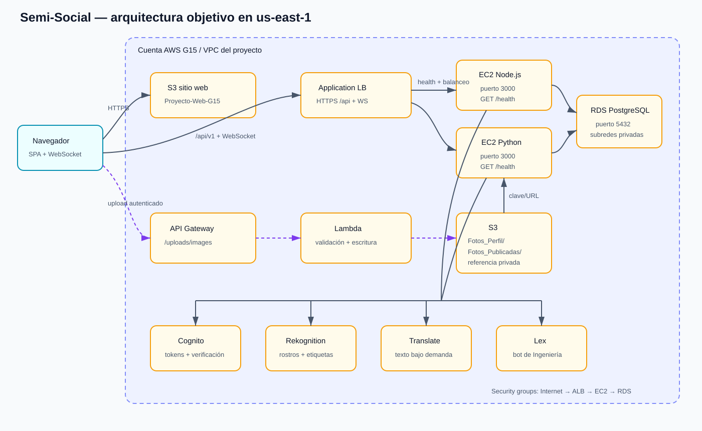

> El SVG es un diagrama de alto nivel de la arquitectura objetivo: no dibuja las
> dos distribuciones de CloudFront, la regla de ruta del ALB ni el peering entre
> VPC. El siguiente diagrama muestra lo desplegado, según los documentos citados
> en la tabla de 3.2.

```mermaid
flowchart LR
  U[Navegador]
  subgraph Edge[Entrada HTTPS]
    CFW[CloudFront web<br/>d22yc8w9s5onhg]
    CFA[CloudFront API<br/>dxfjcvf5o1pes]
  end
  S3W[(S3 proyecto-web-g15<br/>sitio estático)]
  ALB[ALB semisocial-g15-alb<br/>HTTP :80]
  subgraph VPC[VPC por defecto vpc-07d71aba0ec5b2213]
    TG[semisocial-g15-api-tg<br/>HTTP :3000]
    TGN[semisocial-g15-node-only-tg<br/>solo Node]
    EN[EC2 Node.js<br/>i-05479ce4e0fa5b060]
    EP[EC2 Python<br/>i-0a3c4a8b108539d35]
    RDS[(RDS PostgreSQL<br/>semisocial-g15-postgres)]
  end
  APIGW[API Gateway HTTP API<br/>POST /uploads/images]
  LMB[Lambda<br/>semisocial-g15-image-upload]
  S3I[(S3 semisocial-g15-images-581117996165<br/>Fotos_Perfil / Fotos_Publicadas)]
  COG[Cognito<br/>semisocial-g15-users]
  REK[Rekognition]
  TRA[Translate]
  LEX[Lex V2<br/>semisocial-g15-facultad-bot]

  U -->|HTTPS| CFW --> S3W
  U -->|HTTPS /api/v1 y WSS| CFA --> ALB
  ALB -->|regla por defecto| TG
  TG --> EN
  TG --> EP
  ALB -->|prioridad 10: /api/v1/posts*, labels*, conversations*, /ws/*| TGN
  TGN --> EN
  EN --> RDS
  EP --> RDS
  U -->|HTTPS, imágenes| APIGW --> LMB --> S3I
  EN --> COG
  EP --> COG
  EN --> REK
  EP --> REK
  EN --> TRA
  EP --> TRA
  EN --> LEX
  EP --> LEX
  EN -->|HeadObject| S3I
  EP -->|HeadObject| S3I
```

### 3.2 Servicios y recursos

| Servicio | Recurso o valor | Función | Fuente |
|---|---|---|---|
| CloudFront (web) | `semisocial-web-g15`, `E2TN2ZJV9MGHDD`, `d22yc8w9s5onhg.cloudfront.net` | HTTPS del frontend, caché, redirección de rutas de la SPA a `index.html` (errores 403/404 → 200) | `docs/evidence/https-ingress/report.md:50-60,145-150` |
| S3 (sitio web) | `proyecto-web-g15` | Aloja el build de `frontend/dist/` como sitio estático; lectura pública de objetos | `docs/evidence/s3-web/report.md:54-69` |
| CloudFront (API) | `semisocial-api-g15`, `E3BPWGBX2XJ1C`, `dxfjcvf5o1pes.cloudfront.net` | HTTPS del API; origen el ALB por HTTP :80; sin caché; reenvía todos los métodos y cabeceras salvo `Host` | `docs/evidence/alb/report.md:124-160` |
| ALB | `semisocial-g15-alb`, internet-facing, IPv4, subredes `us-east-1a` y `us-east-1b`; idle timeout 300 s | Reparte el tráfico entre las dos EC2 y ejecuta health checks | `docs/evidence/alb/report.md:94-115` |
| Target group | `semisocial-g15-api-tg`, HTTP :3000, `GET /health` → 200, umbrales 2/2, intervalo 10 s, round robin, sin stickiness | Agrupa Node y Python | `docs/evidence/alb/report.md:63-80`, `infra/alb/README.md:30-44` |
| Regla de ruta del ALB | Prioridad 10: `/api/v1/posts*`, `/api/v1/labels*`, `/api/v1/conversations*` y `/ws/*` → `semisocial-g15-node-only-tg` | Esas rutas solo las atiende Node; el resto va a `semisocial-g15-api-tg` | (CLI, 2026-10-24); descrita en `infra/alb/README.md:59-68`. `docs/evidence/alb/report.md` (rama de Isai) la documenta y registra que el 25-oct el grupo tenía cero destinos (causa del 503 de `/api/v1/posts`) y que se registró la EC2 Node en el puerto 3000 y quedó `Healthy`. En `develop`, `docs/evidence/alb/report.md:106` e `infra/alb/README.md:51` siguen describiendo un listener de una sola acción (ver sección 10) |
| EC2 Node.js | `i-05479ce4e0fa5b060` (`semiSocial-EC2-node-g15`), subred `subnet-00a44acf0a2087560`, IP privada `172.31.7.25`; checkout en `/opt/semisocial-node`; Node `v22.23.3` | API NestJS en el puerto 3000 con systemd (`dist/src/main.js`) | `docs/evidence/alb/images/target-group-registered-instances.png`, `docs/evidence/integration/report.md:62`, `docs/evidence/alb/report.md:244` |
| EC2 Python | `i-0a3c4a8b108539d35` (`semisocial-g15-python-1`), t3.micro, Amazon Linux 2023, `us-east-1a`, IP pública, rol `semisocial-g15-backend-role`; servicio systemd `semisocial-python` en el puerto 3000 | API FastAPI | (CLI, 2026-10-24/25), `infra/python-ec2/README.md`, `docs/api/python.md` §1 |
| RDS | `semisocial-g15-postgres`, PostgreSQL, `db.t4g.micro`, Single-AZ `us-east-1b`, 20 GiB gp2, cifrado, sin acceso público, base `semisocial`, 1 día de backups | Base relacional compartida por ambos backends | `docs/evidence/rds/report.md:25-45` |
| S3 (imágenes) | `semisocial-g15-images-581117996165`, prefijos `Fotos_Perfil/public/`, `Fotos_Perfil/references/`, `Fotos_Perfil/captures/`, `Fotos_Publicadas/` | Fotos de perfil, referencias y capturas faciales privadas, imágenes de publicaciones | `infra/s3/README.md`, `docs/evidence/s3-images/report.md:30-45` |
| API Gateway | HTTP API `semisocial-g15-upload-api` (`xsjlh2s0d1`), `POST /uploads/images`, etapa `$default`, payload 2.0, CORS configurado | Único punto de carga de imágenes | `docs/evidence/API-gateway/reporte.md:14-49` |
| Lambda de carga | `semisocial-g15-image-upload`, Node.js 22.x, 256 MB, 15 s, rol `semisocial-g15-upload-lambda-role` | Valida el archivo (magic bytes, ≤ 5 MiB; JPEG, PNG, WebP) y lo escribe en S3 | `docs/evidence/lambda-upload/report.md:56-95`, `docs/evidence/lambda-upload/images/01-lambda-code-uploaded.png` |
| Cognito | Pool `semisocial-g15-users` (`us-east-1_4UrrCPt8Z`), cliente público `semisocial-g15-web` (`1feavcj8qvobr4ltshlgnolg5f`) | Registro, verificación por correo y login; emite los JWT que validan los backends | `docs/evidence/cognito/report.md:7-16` |
| Lambdas de Cognito | `semisocial-g15-cognito-define-auth`, `-create-auth`, `-verify-auth` (Node.js 20.x), asociadas al pool | Reto `CUSTOM_AUTH` del login facial | `docs/evidence/cognito-facial/report.md:87-101` |
| Rekognition | `DetectLabels` (`MaxLabels=20`, `MinConfidence=80`) desde los backends; `CompareFaces` solo desde la Lambda de Cognito (`lambdas/cognito-facial/runtime.js`) | Etiquetas de las publicaciones; comparación facial | `docs/evidence/rekognition-labels/report.md:38-48` |
| Translate | `TranslateText` (es, en, fr, de); `Comprehend` para detectar el idioma de origen | Traducción bajo demanda | `docs/api/translation.md`; bloqueado por la cuenta (sección 10) |
| Lex V2 | Bot `semisocial-g15-facultad-bot` (`HEE55FCSTB`), alias `prod` (`Y1CGMUEYYK`), `es_419`; stack `semisocial-g15-lex-bot` | Bot de la Facultad | `docs/evidence/lex/report.md:58-73` |
| Systems Manager | Session Manager, Fleet Manager, Parameter Store (`/semi-social/prod/rds/master-password`, `SecureString`) | Acceso a las EC2 sin SSH y custodia del secreto de RDS | `infra/python-ec2/README.md:53-54` |

### 3.3 Cómo fluye una petición

1. **Frontend.** El navegador abre `https://d22yc8w9s5onhg.cloudfront.net`.
   CloudFront entrega `index.html` y los *assets* desde el website endpoint de S3
   por HTTP :80; los accesos directos a rutas de la SPA devuelven `index.html`
   (`docs/evidence/https-ingress/report.md:28-48,145-156`).
2. **Llamadas al API.** La SPA llama a `VITE_API_BASE_URL` (origen HTTPS sin
   `/api/v1`; el cliente lo agrega) que apunta a la distribución del API
   (`frontend/.env.example`, `infra/python-ec2/README.md:536-540`). CloudFront
   termina HTTPS, no usa caché y reenvía al ALB por HTTP :80
   (`docs/evidence/alb/report.md:126-146`).
3. **Balanceo.** El ALB aplica la regla de prioridad 10 y, si no coincide, la
   acción por defecto: `semisocial-g15-api-tg` (Node y Python, round robin, sin
   afinidad). Solo los destinos con `/health` 200 reciben tráfico
   (`docs/evidence/alb/report.md:63-80`).
4. **Autenticación.** El backend valida el JWT de Cognito con el emisor y el
   JWKS del pool y deriva el usuario de `sub` (`docs/evidence/cognito/report.md:113-119`).
   Registro, confirmación y login llaman a Cognito (`SignUp`, `ConfirmSignUp`,
   `InitiateAuth`).
5. **Datos.** Ambos backends leen y escriben en la misma base RDS por el puerto
   5432 con `sslmode=verify-full`; la contraseña se lee de SSM Parameter Store en
   cada arranque (`infra/python-ec2/README.md:54`, `database/README.md:7-20`).
6. **Carga de imágenes.** El navegador envía `multipart/form-data` a
   `POST /uploads/images` de API Gateway con `VITE_UPLOAD_BASE_URL`. La Lambda
   valida el archivo y lo guarda en S3; devuelve la clave del objeto, y la API de
   negocio guarda esa clave en RDS (`docs/api/upload.md`).
7. **Etiquetas.** Al crear una publicación el backend invoca Rekognition
   `DetectLabels` sobre la imagen en S3 y guarda las etiquetas normalizadas en
   `post_labels` (`docs/api/labels.md`).
8. **Traducción y bot.** `POST /translations` llama a Translate y
   `POST /bot/messages` a Lex `RecognizeText` con el alias `prod`
   (`docs/api/translation.md`, `docs/api/bot.md`).
9. **Chat.** El navegador abre un WebSocket (`/ws/chat`) que el ALB envía a
   `semisocial-g15-node-only-tg`. Node guarda el mensaje en `messages` y publica
   `NOTIFY chat_messages` para las demás instancias (`docs/evidence/chat/node-report.md:12-52`).

---

## 4. Seguridad

### 4.1 Red

- El **RDS, el ALB y la EC2 de Python están en la VPC por defecto**
  `vpc-07d71aba0ec5b2213` (172.31.0.0/16), grupo de subredes
  `default-vpc-07d71aba0ec5b2213` (CLI, 2026-10-24/25; `docs/evidence/rds/report.md:34-36`).
  Las EC2 usan IP pública y no hay NAT Gateway: la salida a AWS pasa por el
  Internet Gateway (`infra/python-ec2/README.md:47`).
- La plantilla `infra/network/foundation.yaml` creó otra VPC `10.15.0.0/16`
  (`vpc-059f03801fd74ca5b`, seis subredes, endpoint de S3, tres grupos de
  seguridad y los roles IAM; `docs/evidence/network/report.md:5-30`). Sus roles
  IAM son los que usa el proyecto; sus subredes y grupos de seguridad **no** son
  los del tráfico actual.
- Hay un **peering** `pcx-0a5fd8e75ecc1b32e` entre `vpc-059f03801fd74ca5b` y
  `vpc-07d71aba0ec5b2213`, con rutas en ambas tablas y resolución DNS habilitada
  (CLI, 2026-10-24/25; `docs/evidence/network/vpc-peering-20261019.txt`). Se creó
  para que una EC2 Node anterior (`i-02c90c5e80df5ee15`, `10.15.10.37`) llegara al
  RDS.
- Todo el tráfico del navegador entra por CloudFront; el ALB no acepta HTTP desde
  Internet (4.2).

### 4.2 Grupos de seguridad

Los grupos que atienden el tráfico (VPC por defecto):

| Grupo | ID | Entrada | Fuente |
|---|---|---|---|
| `semisocial-g15-alb-sg-default` (ALB) | `sg-02bfdb21497a1a4f2` | TCP 80 solo desde la *prefix list* administrada de CloudFront `pl-3b927c52`; sin HTTP desde `0.0.0.0/0` | `docs/evidence/alb/report.md:162-175`, `docs/evidence/alb/runtime-validation-2026-10-25.md:82-90` |
| `semisocial-g15-backend-sg-default` (Node y Python) | `sg-07d69b7d9901d499c` | TCP 3000 solo desde el grupo del ALB; sin regla 22 | `docs/evidence/alb/report.md:167-169`, `docs/evidence/alb/images/target-group-registered-instances.png` |
| `semisocial-g15-rds-sg` (RDS) | `sg-08cf39cce34d6392b` | TCP 5432 desde el grupo de backends `sg-07d69b7d9901d499c` y, según el reporte del 19-oct, desde `10.15.10.37/32` (EC2 Node anterior). La regla pública temporal `170.150.29.119/32` se retiró | `docs/evidence/network/report.md:41-68` |

Las reglas de salida son las predeterminadas (todo permitido); el endurecimiento
de la salida es opcional y no se hizo (`infra/python-ec2/README.md:239-254`).
El RDS tiene `PubliclyAccessible: false` (`docs/evidence/rds/report.md:19`).

Los grupos creados por la plantilla `foundation.yaml` (VPC `10.15.0.0/16`) son
`semisocial-g15-alb-sg` (80 y 443 desde `0.0.0.0/0`), `semisocial-g15-backend-sg`
(3000 solo desde el ALB) y `semisocial-g15-rds-sg` (5432 solo desde backends); la
salida de los backends es solo TCP 443 y 5432 hacia RDS
(`infra/network/foundation.yaml:161-235`). Es la configuración versionada, no la
del tráfico actual.

### 4.3 Instancias

- **Sin SSH.** Ningún grupo de seguridad abre el puerto 22. El acceso
  administrativo es por **Session Manager** (la instancia Python aparece *Online*
  en Fleet Manager; `docs/evidence/integration/report.md:65`).
- **IMDSv2 obligatorio** en la EC2 Python (`docs/evidence/ec2-python/report.md:50`).
  *Pendiente:* no hay evidencia del modo de metadatos de la EC2 Node.
- La EC2 Python se lanzó **sin par de claves**; el asistente de lanzamiento de una
  EC2 Node anterior (la captura no tiene fecha) muestra un par de claves
  seleccionado (`docs/evidence/EC2-NODE/images/02.png`), aunque el grupo de
  seguridad no admite SSH. *Pendiente:* confirmar si la EC2 Node vigente tiene par
  de claves.
- La API Python corre con un usuario de sistema sin shell (`semisocial`), con
  `Restart=always` y el archivo de configuración `/etc/semisocial/python.env`
  con permisos `0600` (`infra/python-ec2/README.md:69-80`).
- La contraseña de RDS no está en el repositorio ni en disco persistente: se lee
  de SSM en cada arranque a un `tmpfs` (`infra/python-ec2/README.md:54,78`).

### 4.4 Datos, almacenamiento y transporte

- **HTTPS** entre el navegador y CloudFront; CloudFront habla con el ALB por HTTP
  (limitación en la sección 10).
- **RDS:** acceso con `sslmode=verify-full` y certificado de AWS
  (`database/README.md:7-16`).
- **S3 de imágenes:** cifrado SSE-S3, propiedad de objetos forzada al propietario,
  ACL públicas bloqueadas y la política deniega el transporte sin TLS. Solo
  `Fotos_Perfil/public/*` y `Fotos_Publicadas/*` tienen lectura pública; las
  carpetas `references/` y `captures/` respondieron 403 sin credenciales
  (`docs/evidence/s3-images/report.md:17-20,60-66`, `infra/s3/bucket-policy.json`).
- **S3 del sitio web:** la política concede solo `s3:GetObject`; un `PUT` anónimo
  respondió 403 (`docs/evidence/s3-web/report.md:163-213`).
- **Cognito:** cliente público sin secreto (`GenerateSecret: false`), contraseñas
  de al menos 12 caracteres con número, mayúscula, minúscula y símbolo, y
  `PreventUserExistenceErrors: ENABLED` (`docs/evidence/cognito/report.md:20-25,40-43`).
- **Lambda de carga:** rechaza archivos de más de 5 MiB (413) y archivos que no son
  imágenes reales (415, verificado con *magic bytes*)
  (`docs/evidence/lambda-upload/report.md:62-70`).

---

## 5. IAM: usuarios, roles y políticas

### 5.1 Principio aplicado

El proyecto usa **roles con credenciales temporales**: las EC2 asumen el rol de
su *instance profile* y las Lambdas asumen su rol de ejecución. **No se crearon
access keys** (`infra/iam/access-matrix.md:20`). Los roles de ejecución se
definen en `infra/network/foundation.yaml` y se crearon con el stack
`semisocial-g15-foundation` (`docs/evidence/iam/report.md:3-18`).

### 5.2 Usuarios IAM

**Pendiente de aclarar con los auxiliares.** El enunciado pide "usuarios IAM con
sus respectivas políticas de acuerdo con el servicio" (§3.2). El repositorio **no
documenta ningún usuario IAM creado para Semi-Social**:
`infra/iam/access-matrix.md:39-43` indica que la creación de usuarios humanos "se
coordina con el equipo" y que la identidad actual de consola se usa solo para el
aprovisionamiento.

Observación: las capturas de consola existentes (por ejemplo
`docs/evidence/s3-images/images/02-bucket-prefixes.jpg` y
`docs/evidence/cognito/images/cognito-cli-validation-live.jpg`) muestran la
sesión de la identidad IAM `CloudCinema-Admin`. El `README.md` de la raíz
(Práctica 1, §3.1) describe a `CloudCinema-Admin` con `AdministratorAccess`. No
hay un archivo que explique si ese usuario se reutilizó a propósito en este
proyecto.

Decisión pendiente: crear usuarios por servicio para Semi-Social o aclarar con
los auxiliares que los roles son suficientes. Si se crean, deben registrarse aquí
y en `infra/iam/access-matrix.md`, y deben capturarse
(`iam-usuarios.png`, sección 11.9).

### 5.3 Roles y políticas

| Rol | Quién lo asume | Políticas | Qué permite |
|---|---|---|---|
| `semisocial-g15-backend-role` (ruta `/semi-social/`), con el perfil `semisocial-g15-backend-profile` | Las EC2 de Node y Python | `semisocial-g15-images-read` | `s3:ListBucket` (solo `Fotos_Perfil/*` y `Fotos_Publicadas/*`) y `s3:GetObject` en esos dos prefijos del bucket de imágenes |
| | | `semisocial-g15-ai-invoke` | **Plantilla en `develop`** (`infra/network/foundation.yaml:277`): `rekognition:CompareFaces`, `rekognition:DetectLabels` y `translate:TranslateText` con `Resource: *`. **Rol vivo**: `docs/evidence/rekognition-labels/report.md` (rama de Isai) registra que el 25-oct se actualizó la política en línea desde IAM, sin `CompareFaces` y con `aws:RequestedRegion = us-east-1`; el `foundation.yaml` de esa rama lo refleja, pero **no está en `develop`**. Falta validarlo con una prueba real de etiquetas desde ambos backends |
| | | `semisocial-g15-lex-runtime` | `lex:RecognizeText` solo sobre el alias `prod` (`bot-alias/HEE55FCSTB/Y1CGMUEYYK`) |
| | | `semisocial-g15-comprehend-language` | `comprehend:DetectDominantLanguage` con la condición `aws:RequestedRegion = us-east-1` |
| | | `semisocial-g15-rds-password-read` | `ssm:GetParameter` solo sobre `/semi-social/prod/rds/master-password` |
| | | `semisocial-g15-session-manager` | Canales de Session Manager (`ssm:UpdateInstanceInformation`, `ssmmessages:*Channel`) |
| | | `AmazonSSMManagedInstanceCore` (administrada) | Adjuntada **a mano, fuera de CloudFormation**; incluye `ssm:GetParameter` sobre `*` |
| `semisocial-g15-upload-lambda-role` | Lambda `semisocial-g15-image-upload` | `AWSLambdaBasicExecutionRole` y `semisocial-g15-images-write` | Logs y `s3:GetObject`, `s3:PutObject`, `s3:DeleteObject` solo en `Fotos_Perfil/*` y `Fotos_Publicadas/*` |
| `semisocial-g15-cognito-facial-role` | Las tres Lambdas de Cognito | Política en línea (no versionada en `infra/`) | Según el reporte: logs, lectura y borrado de capturas privadas, lectura de referencias privadas y `rekognition:CompareFaces` |
| Rol del bot de Lex | Lex | Creado por el stack `semisocial-g15-lex-bot` | Nombre y política no registrados en el repositorio |
| Roles vinculados a servicios (`AWSServiceRoleFor…`) | ELB, RDS, CloudFront, etc. | Administrados por AWS | No los define el proyecto |

Fuentes: `infra/network/foundation.yaml:245-350`,
`infra/iam/access-matrix.md`, `docs/evidence/ec2-python/report.md:56,118-124`,
`docs/evidence/cognito-facial/report.md:87-101`, `docs/evidence/lex/report.md:64-70`.

Denegaciones verificadas con el **simulador de IAM** (no con invocaciones reales):
el rol del backend puede `s3:GetObject` y **no** `s3:PutObject` sobre
`Fotos_Publicadas/`; Lambda puede escribir en sus dos prefijos y no en otro bucket;
`lex:RecognizeText` y `comprehend:DetectDominantLanguage` pasaron de `implicitDeny`
a `allowed` tras aplicar las políticas
(`docs/evidence/iam/report.md:20-33`, `infra/iam/access-matrix.md:22-37`).

**Políticas versionadas y su relación con lo desplegado**

- [`infra/iam/lex-runtime-policy.json`](infra/iam/lex-runtime-policy.json): la misma
  política `semisocial-g15-lex-runtime` que tiene el rol.
- [`infra/iam/rekognition-labels-policy.json`](infra/iam/rekognition-labels-policy.json)
  y [`infra/iam/translate-policy.json`](infra/iam/translate-policy.json): políticas
  **mínimas propuestas**. Con la plantilla de `develop` el rol era más amplio:
  `DetectLabels` y `CompareFaces` sobre `*`, lectura de `Fotos_Perfil/*` además de
  `Fotos_Publicadas/*`, y `TranslateText` sin condición de región
  (`docs/evidence/rekognition-labels/report.md:21-34`). La rama de Isai indica que
  el rol vivo ya perdió `CompareFaces` y ganó la condición de región; la lectura
  de `Fotos_Perfil/*` sigue en `semisocial-g15-images-read` (`foundation.yaml:257-271`)
  aunque el runtime de publicaciones solo debería usar `Fotos_Publicadas/*`.
- [`infra/s3/bucket-policy.json`](infra/s3/bucket-policy.json): política del bucket de
  imágenes.

Política del bucket de imágenes (`infra/s3/bucket-policy.json`):

```json
{
  "Version": "2012-10-17",
  "Statement": [
    {
      "Sid": "PublicReadVisibleImagesOnly",
      "Effect": "Allow",
      "Principal": "*",
      "Action": "s3:GetObject",
      "Resource": [
        "arn:aws:s3:::semisocial-g15-images-581117996165/Fotos_Perfil/public/*",
        "arn:aws:s3:::semisocial-g15-images-581117996165/Fotos_Publicadas/*"
      ]
    },
    {
      "Sid": "DenyInsecureTransport",
      "Effect": "Deny",
      "Principal": "*",
      "Action": "s3:*",
      "Resource": [
        "arn:aws:s3:::semisocial-g15-images-581117996165",
        "arn:aws:s3:::semisocial-g15-images-581117996165/*"
      ],
      "Condition": {"Bool": {"aws:SecureTransport": "false"}}
    }
  ]
}
```

Política del bucket del sitio web (`docs/evidence/s3-web/report.md:169-182`):

```json
{
  "Version": "2012-10-17",
  "Statement": [
    {
      "Sid": "PublicReadOnlyForWebsite",
      "Effect": "Allow",
      "Principal": "*",
      "Action": "s3:GetObject",
      "Resource": "arn:aws:s3:::proyecto-web-g15/*"
    }
  ]
}
```

**Desvíos de IAM conocidos** (sección 10): `AmazonSSMManagedInstanceCore` adjuntada
fuera de CloudFormation (hace redundante `semisocial-g15-rds-password-read` y deja
al rol leer cualquier parámetro de la cuenta); el rol vivo ya no coincide con
`foundation.yaml` de `develop` (reducción de `ai-invoke` hecha en IAM, plantilla
sin actualizar); `semisocial-g15-images-read` aún cubre `Fotos_Perfil/*`; faltan
usuarios IAM por servicio.

---

## 6. Datos

### 6.1 Esquema

PostgreSQL en RDS es la única base de datos de producción (`docs/data-model/model.md`).
Diagrama entidad-relación: [`docs/data-model/erd.svg`](docs/data-model/erd.svg).

| Tabla | Contenido y reglas principales | Migración |
|---|---|---|
| `schema_migrations` | Registro de versiones aplicadas | `000_bootstrap.sql` (también `pgcrypto` y `citext`) |
| `users` | `id` UUID, `cognito_sub` único, `email` (`citext`) único, `full_name`, `dpi` (13 dígitos, único), `profile_image_key`, `face_reference_key`. **Sin columna de contraseña** | `001_core_schema.sql` |
| `friend_requests` | Solicitud pendiente, aceptada o rechazada; emisor y receptor distintos | `001` |
| `friendships` | Amistad guardada una vez con `user_low_id < user_high_id` | `001` |
| `posts` | Autor, descripción opcional, `image_key` obligatoria con prefijo `Fotos_Publicadas/` | `001` |
| `post_labels` | `normalized_label`, `confidence` (0–100) y `source_label` | `001` |
| `comments` | Comentario con borrado lógico | `001` |
| `messages` | Mensajes del chat; emisor y receptor distintos | `001` |
| `face_login_challenges` | Reto del login facial: nonce con hash, expiración, intentos | `001` |
| Índices | Una solicitud pendiente por par, feed por autor y fecha, etiqueta, comentarios por publicación, conversaciones y no leídos | `002_indexes.sql` |

El esquema, sus restricciones y la correspondencia JSON ↔ SQL están en
[`docs/data-model/model.md`](docs/data-model/model.md) y en
[`database/migrations/`](database/migrations/).

### 6.2 Instancia y verificación

- Instancia `semisocial-g15-postgres`: `db.t4g.micro`, Single-AZ, 20 GiB gp2,
  cifrada con la clave administrada de RDS, sin acceso público, un día de backups,
  sin RDS Proxy ni autoescalado (`docs/evidence/rds/report.md:25-32`). El motor es
  PostgreSQL; *Pendiente:* ningún reporte de RDS registra la versión.
- El 18-oct se aplicaron las migraciones `000`–`002` y el seed desde un host
  autorizado; `database/tests/verify_schema.sql` terminó con `schema verification
  passed` y Node (`pg`) y Python (`psycopg`) consultaron `users`
  (`docs/evidence/rds/report.md:91-113`).
- El 22-oct, ambas EC2 leyeron el secreto de SSM sin imprimirlo y ejecutaron
  `SELECT 1` y la consulta de `public.users` (`docs/evidence/integration/report.md:63-64`).
- La base no guarda contraseñas: las administra Cognito. La rúbrica del enunciado
  (§10.2, criterio 1.5) menciona contraseñas cifradas con MD5; esta solución no
  almacena contraseñas en RDS (decisión en la sección 10).

---

## 7. Despliegue

Los recursos se crearon desde la consola de AWS (con CloudFormation para la red,
el bucket de imágenes y el bot de Lex); la CLI se usó para lecturas de
verificación (`infra/python-ec2/README.md:36-37`). Cada pieza tiene su runbook o
reporte.

| Pieza | Cómo se levantó | Runbook o evidencia |
|---|---|---|
| Red, grupos de seguridad e IAM base | Stack `semisocial-g15-foundation` (`foundation.yaml`), `CAPABILITY_NAMED_IAM` | [`infra/network/README.md`](infra/network/README.md), [`docs/evidence/network/report.md`](docs/evidence/network/report.md) |
| Peering con la VPC del RDS | Consola, 19-oct | [`docs/evidence/network/vpc-peering-20261019.txt`](docs/evidence/network/vpc-peering-20261019.txt) |
| Bucket de imágenes | Stack `semisocial-g15-images` (`images.yaml`) con *change set* | [`infra/s3/README.md`](infra/s3/README.md), [`docs/evidence/s3-images/report.md`](docs/evidence/s3-images/report.md) |
| Sitio web | `pnpm test`, `pnpm build`, `aws s3 sync dist/ s3://proyecto-web-g15 --delete` e invalidación `/*` | [`docs/evidence/s3-web/report.md`](docs/evidence/s3-web/report.md), [`docs/evidence/https-ingress/report.md`](docs/evidence/https-ingress/report.md) |
| RDS | Consola (el grupo de subredes `semisocial-g15-db-subnets` no se ofreció y quedó el de la VPC por defecto) | [`infra/rds/README.md`](infra/rds/README.md), [`docs/evidence/rds/report.md`](docs/evidence/rds/report.md) |
| Migraciones | `database/migrate.ps1` y `verify_schema.sql` desde un host autorizado | [`database/README.md`](database/README.md) |
| Cognito | Consola (pool y cliente públicos); plantilla de referencia `user-pool.yaml` | [`infra/cognito/README.md`](infra/cognito/README.md), [`docs/evidence/cognito/report.md`](docs/evidence/cognito/report.md) |
| Lambda de carga y API Gateway | Consola; definición en `openapi-api-gateway.yaml` | [`infra/api-gateway/README.md`](infra/api-gateway/README.md), [`docs/evidence/API-gateway/reporte.md`](docs/evidence/API-gateway/reporte.md), [`docs/evidence/lambda-upload/report.md`](docs/evidence/lambda-upload/report.md) |
| Lambdas del login facial | Tres funciones Node.js 20.x asociadas al pool el 19-oct | [`docs/evidence/cognito-facial/report.md`](docs/evidence/cognito-facial/report.md), [`docs/api/auth-flows.md`](docs/api/auth-flows.md) |
| EC2 Python | Consola; `bootstrap.sh` crea el servicio systemd | [`infra/python-ec2/README.md`](infra/python-ec2/README.md), [`docs/evidence/ec2-python/report.md`](docs/evidence/ec2-python/report.md) |
| EC2 Node.js | Consola (el sistema operativo de la instancia vigente no está registrado; el asistente de la EC2 anterior muestra Ubuntu); `npm ci`, `npm run build` y servicio systemd con `dist/src/main.js` | [`docs/api/node.md`](docs/api/node.md), [`docs/evidence/integration/report.md`](docs/evidence/integration/report.md) (fila de preparación remota). *Pendiente:* no hay runbook equivalente al de Python |
| ALB y CloudFront del API | Consola; target group, ALB y distribución `semisocial-api-g15` | [`infra/alb/README.md`](infra/alb/README.md), [`docs/evidence/alb/report.md`](docs/evidence/alb/report.md) |
| Bot de Lex | Stack `semisocial-g15-lex-bot` generado con `build_template.py` desde `faq.yaml` | [`infra/lex/faq.yaml`](infra/lex/faq.yaml), [`infra/lex/build_template.py`](infra/lex/build_template.py), [`docs/evidence/lex/report.md`](docs/evidence/lex/report.md) |

Variables compartidas (`.env.example` de cada módulo; sin secretos):

```text
AWS_REGION=us-east-1
API_BASE_PATH=/api/v1
COGNITO_USER_POOL_ID=
COGNITO_APP_CLIENT_ID=
RDS_HOST=
RDS_PORT=5432
RDS_DATABASE=semisocial
RDS_SSLMODE=verify-full
S3_IMAGES_BUCKET=semisocial-g15-images-581117996165
S3_PROFILE_PREFIX=Fotos_Perfil/public/
S3_FACE_REFERENCE_PREFIX=Fotos_Perfil/references/
S3_FACE_CAPTURE_PREFIX=Fotos_Perfil/captures/
S3_POSTS_PREFIX=Fotos_Publicadas/
```

Variables públicas del frontend (`frontend/.env.example`): `VITE_API_BASE_URL` (origen
HTTPS del API, sin `/api/v1`) y `VITE_UPLOAD_BASE_URL` (URL de API Gateway con la
etapa, sin `/uploads/images`).

Pruebas locales de cada componente (sin AWS): `python -m pytest` en
`backend-python/`, `npm test` y `npm run test:e2e` en `backend-node/`,
`pnpm test` en `frontend/`, `node --test` en cada carpeta de `lambdas/`.

---

## 8. Funcionalidades por módulo del enunciado

El estado resume lo que hay evidencia de que funciona. "Node" significa que solo
Node atiende esa ruta mientras exista la regla del ALB (sección 3.2).

| Módulo del enunciado | Estado | Qué lo demuestra y qué falta |
|---|---|---|
| **Registro** (nombre, correo, DPI, contraseña, foto) | **Hecho** | Los usuarios A y B se registraron y confirmaron por correo, estado `CONFIRMED` (CLI, 2026-10-24/25). Foto obligatoria: pantalla de registro con carga o cámara (`docs/user-guide.md`, `frontend/src/features/auth/PhotoField.tsx`) y `complete-profile` en ambos backends. Evidencia de la prueba pública del 25-oct (rama de Isai): `POST /uploads/images` con `purpose=profile` y un JPEG respondió 201, `POST /api/v1/me/complete-profile` 200 con `profileComplete=true` y `GET /me` 200 (`docs/evidence/API-gateway/reporte.md`, sección "E2E real autorizado"); la recuperación de contraseña y la confirmación terminaron con el usuario `CONFIRMED` (`docs/evidence/cognito/report.md`, sección "E2E real autorizado"). Esa prueba reutilizó una cuenta del propietario del repositorio, no las cuentas A y B. Incidente: ver limitación 13. |
| **Login con credenciales** | **Hecho** | `InitiateAuth` con `USER_PASSWORD_AUTH` devolvió tokens (`docs/evidence/cognito/report.md:102-109`). Contra el API público, `POST /auth/login` respondió 200, `GET /me` y `GET /posts` dieron 401 sin credencial o con un Bearer inválido y 200 con uno válido (`docs/evidence/cognito/report.md`, sección "E2E real autorizado", rama de Isai). Se inicia sesión con el **correo**, no con un nombre de usuario. |
| **Login facial** (Rekognition) | **Pendiente** (fuera de alcance de esta entrega) | Componentes hechos: tres Lambdas de Cognito desplegadas y asociadas; `CompareFaces` devolvió similitud 100 con una captura de prueba (`docs/evidence/cognito-facial/report.md:63-113`). Falta el flujo de extremo a extremo: la cuenta no tiene `custom:face_reference_key`, y `POST /auth/face/*` responde 501 en Python y una simulación en Node. |
| **Ver publicaciones** (amigos y propias, de más reciente a más antigua) | **Hecho** | A y B ven la misma publicación en el feed, atendida por Node (CLI, 2026-10-24/25). |
| **Crear publicaciones** (imagen obligatoria, descripción opcional) | **Hecho** | Existe una publicación creada por esa vía (CLI, 2026-10-24/25); la imagen entra por API Gateway y Lambda y se guarda en `Fotos_Publicadas/`. La fila "Alineación de contrato Node/Python" de `docs/evidence/integration/report.md` (rama de Isai) registra upload 201 y `POST /posts` autenticado 201, y que el runtime desplegado aún devuelve los alias legacy `id`, `authorId`, `imageKey` y `labelDetails`. Node. |
| **Comentarios** | **Parcial** | Implementado en Node y Python (`docs/api/node.md`, `docs/api/python.md`). El cuerpo del comentario es `{body}`: Node ya no acepta `content` (`backend-node/src/modules/comments/dto/comment.dto.ts`, commit `e91a620`) y Python lo sigue aceptando como alias (`backend-python/app/modules/posts/router.py:48-63`). Sin evidencia en vivo registrada. Node. |
| **Filtro por etiquetas** | **Parcial** | Rekognition `DetectLabels` funciona: sobre una imagen de S3 devolvió `Person` y `Security`, confianza 87,5 (CLI, 2026-10-24/25; `docs/evidence/rekognition-labels/report.md:67-72`). El endpoint de etiquetas y el filtro existen; `GET /labels` devolvió 200 en la prueba pública del 25-oct (`docs/evidence/integration/report.md`, rama de Isai), pero esa misma fila indica que falta validar el runtime real de etiquetas y su persistencia. Sin captura del filtro en la app. Node. |
| **Traducir publicaciones y comentarios** | **Pendiente** | Código y pruebas locales en ambos backends (`docs/evidence/node-translate-lex/report.md`). Translate y Comprehend responden `SubscriptionRequiredException` en esta cuenta (CLI, 2026-10-24/25). |
| **Edición de perfil** (nombre, DPI, foto, con contraseña) | **Parcial** | Implementado en ambos backends (`PATCH /me`); sin evidencia en vivo registrada. |
| **Usuarios y amigos** (solicitudes con aceptar o rechazar) | **Parcial** | Implementado en ambos backends. A y B ven la misma publicación, lo que presupone que son amigos; no hay captura de las solicitudes. |
| **Chat en tiempo real** | **Parcial** | WebSocket en Node con `LISTEN/NOTIFY` sobre RDS, cliente WebSocket en el frontend y pruebas locales (`docs/evidence/chat/node-report.md`, `docs/evidence/integration/report.md:58-59`). Solo Node: Python responde 501 en `/conversations`. Sin prueba en vivo registrada. |
| **EC2 y balanceador** | **Hecho** | 12/12 respuestas 200 con 6 Node y 6 Python; failover Node → Python 12/12 en 200; Python → Node con un 504 transitorio y luego 12/12; 2/2 `healthy` al final (`docs/evidence/alb/report.md:214-258`, `docs/evidence/alb/runtime-validation-2026-10-25.md`). |
| **Amazon RDS** | **Hecho** | Migraciones, seed y `verify_schema.sql` aprobados; consultas desde ambas EC2 (sección 6.2). |
| **Imágenes en S3** | **Hecho** | Estructura `Fotos_Perfil/` y `Fotos_Publicadas/`; 200 en lo público y 403 en referencias y capturas; `PUT` anónimo 403 (`docs/evidence/s3-images/report.md`). El nombre del bucket no es el que pide el enunciado (sección 10). |
| **API Gateway y Lambda** (carga de imágenes) | **Hecho** | `POST /uploads/images`: 415 con un archivo que no es imagen y 201 con una captura facial PNG; 9/9 pruebas locales (`docs/evidence/lambda-upload/report.md:97-145`). La carga de perfil sí tiene prueba pública del 25-oct con 201 (`docs/evidence/API-gateway/reporte.md`, rama de Isai), que además registra una primera variante de cliente con multipart no compatible que dio 400; la carga de publicación no tiene prueba en vivo registrada, y la Lambda no verifica la firma del JWT (sección 10). |
| **Amazon Lex (bot)** | **Parcial** | Bot desplegado y probado en la consola con 4 entradas de FAQ aprobadas y verificadas (CLI, 2026-10-24/25; `docs/evidence/lex/report.md:58-73,211-226`); además saludo, agradecimiento y respaldo aprobados y 7 entradas en borrador (`infra/lex/faq.yaml`). La pantalla `/bot` existe en el frontend (`frontend/src/app/App.tsx:103`). Sin evidencia de `POST /bot/messages` contra el alias desde la EC2, y sin Lambda para respuestas dinámicas. |
| **Cognito** | **Hecho** | Pool, cliente público, verificación por correo, usuarios A y B confirmados, flujos `ALLOW_USER_PASSWORD_AUTH`, `ALLOW_USER_SRP_AUTH`, `ALLOW_USER_AUTH`, `ALLOW_REFRESH_TOKEN_AUTH` y `ALLOW_CUSTOM_AUTH` (CLI, 2026-10-24/25; `docs/evidence/cognito/images/cognito-cli-validation-live.jpg`). |
| **Rekognition** | **Parcial** | Etiquetas **Hecho**; login facial **Pendiente** (arriba). |
| **Translate** | **Pendiente** | Ver "Traducir publicaciones". |
| **Seguridad** (grupos de seguridad e IAM) | **Parcial** | Grupos de seguridad: **Hecho** (sección 4.2). IAM: roles de ejecución **Hecho**; usuarios IAM por servicio **Pendiente**; el rol backend se redujo en IAM el 25-oct pero la plantilla de `develop` no lo refleja y falta revalidarlo con una prueba real (sección 5.3). |
| **Página web estática** | **Hecho** | Sitio en S3 servido por CloudFront; `/` y `/register` responden 200 (`docs/evidence/https-ingress/report.md:188-195`). |
| **Manual técnico** | **Parcial** | Este documento; faltan las capturas listadas en la sección 13. |

---

## 9. Pruebas y evidencias

| Área | Qué se probó | Resultado | Evidencia |
|---|---|---|---|
| ALB y failover | 12 solicitudes por CloudFront, detener Node y detener Python | 12/12 en 200; un 504 transitorio al detener Python; 2/2 `healthy` | [`docs/evidence/alb/report.md`](docs/evidence/alb/report.md), [`docs/evidence/alb/runtime-validation-2026-10-25.md`](docs/evidence/alb/runtime-validation-2026-10-25.md) |
| Red y peering | Peering activo, rutas, `RDS_PORT_OPEN` desde Python | Aprobado | [`docs/evidence/network/report.md`](docs/evidence/network/report.md), [`docs/evidence/network/vpc-peering-20261019.txt`](docs/evidence/network/vpc-peering-20261019.txt) |
| IAM | Simulador: `GetObject` permitido y `PutObject` denegado en el rol backend | Aprobado | [`docs/evidence/iam/report.md`](docs/evidence/iam/report.md), [`infra/iam/access-matrix.md`](infra/iam/access-matrix.md) |
| RDS | Migraciones, seed, verificación y consultas desde Node y Python | Aprobado | [`docs/evidence/rds/report.md`](docs/evidence/rds/report.md) |
| S3 de imágenes | 200 en `public/` y `Fotos_Publicadas/`, 403 en `references/` y `captures/`, `PUT` anónimo 403 | Aprobado | [`docs/evidence/s3-images/report.md`](docs/evidence/s3-images/report.md) |
| Sitio web | Build, 20 pruebas, `sync`, política, `PUT` anónimo 403 | Aprobado | [`docs/evidence/s3-web/report.md`](docs/evidence/s3-web/report.md) |
| CloudFront (SPA) | `/` y `/register` en 200, cámara en contexto seguro | Aprobado | [`docs/evidence/https-ingress/report.md`](docs/evidence/https-ingress/report.md) |
| API Gateway y Lambda | 415 y 201 en vivo; 9/9 pruebas locales | Aprobado | [`docs/evidence/API-gateway/reporte.md`](docs/evidence/API-gateway/reporte.md), [`docs/evidence/lambda-upload/report.md`](docs/evidence/lambda-upload/report.md) |
| Cognito | Pool, cliente y flujos; registro, confirmación y login de una cuenta de prueba | Aprobado | [`docs/evidence/cognito/report.md`](docs/evidence/cognito/report.md) |
| Login facial (componentes) | Triggers asociados; `CompareFaces` 100 con captura de prueba; E2E bloqueado | Parcial | [`docs/evidence/cognito-facial/report.md`](docs/evidence/cognito-facial/report.md) |
| Rekognition (etiquetas) | `DetectLabels` desde CloudShell y desde la EC2 Python | Aprobado | [`docs/evidence/rekognition-labels/report.md`](docs/evidence/rekognition-labels/report.md) |
| Translate | Pruebas locales; la llamada real falla por la cuenta | Bloqueado | [`docs/evidence/translate/report.md`](docs/evidence/translate/report.md), [`docs/evidence/node-translate-lex/report.md`](docs/evidence/node-translate-lex/report.md) |
| Lex | Conversaciones en el panel de pruebas de la consola | Parcial | [`docs/evidence/lex/report.md`](docs/evidence/lex/report.md), [`docs/evidence/lex/faq-sources.md`](docs/evidence/lex/faq-sources.md) |
| Chat Node | Compilación y pruebas locales; el intercambio Node ↔ Python no aplica (Python no implementa chat) | Parcial | [`docs/evidence/chat/node-report.md`](docs/evidence/chat/node-report.md) |
| EC2 Python | Servicio, `/health`, SG y SSM | Parcial (faltan capturas de `systemctl` y la prueba de reinicio) | [`docs/evidence/ec2-python/report.md`](docs/evidence/ec2-python/report.md) |
| Validación integral | Matriz requisito → prueba → evidencia | Matriz del 22-oct; varios casos se resolvieron después | [`docs/evidence/integration/report.md`](docs/evidence/integration/report.md) |

Suites automáticas (sin AWS). Los números son los que registran los documentos;
no se volvieron a ejecutar al redactar este manual.

| Componente | Conteo | Fuente |
|---|---|---|
| `backend-python` (pytest) | 963 pruebas, 2026-10-25 | [`docs/api/python.md`](docs/api/python.md) §6 |
| `backend-node` (e2e, escenario de publicaciones) | 69/69 | [`docs/api/node-posts.md`](docs/api/node-posts.md) §5, commit `e91a620` |
| `backend-node` (e2e, Translate y Lex) | 21/21, 2026-10-18; anterior a la alineación de publicaciones | [`docs/evidence/node-translate-lex/report.md`](docs/evidence/node-translate-lex/report.md) |
| `backend-node` (build, 15 unitarias y e2e 69/69) | Fila "Alineación de contrato Node/Python" | `docs/evidence/integration/report.md` (rama de Isai) |
| `frontend` (Vitest) | 89 pruebas en 19 archivos, 2026-10-25 (rama de Isai); en `develop` el reporte aún dice 73 pruebas en 17 archivos, 2026-10-22 | `docs/evidence/integration/report.md` (fila "Chat frontend integrado") |
| `lambdas/image-upload` | 9/9 | [`docs/evidence/integration/report.md:51-52`](docs/evidence/integration/report.md) |
| `lambdas/cognito-facial` | 4/4 | [`docs/evidence/integration/report.md:50`](docs/evidence/integration/report.md) |

`docs/evidence/integration/report.md` de `develop` todavía trae 641 pruebas de
Python (líneas 27, 55 y 60) y 21/21 de Node en otras filas: son cifras anteriores.

---

## 10. Limitaciones conocidas y decisiones

**Limitaciones**

1. **Translate no funciona en esta cuenta.** Translate y Comprehend responden
   `SubscriptionRequiredException` (plan FREE) (CLI, 2026-10-24/25;
   `docs/evidence/ec2-python/report.md:101`). `POST /translations` responde 503 en
   Python. No es un fallo de código ni de IAM.
2. **El login facial está fuera de alcance.** Los componentes existen, pero falta
   el atributo `custom:face_reference_key` y el flujo de referencia y captura de
   extremo a extremo (`docs/evidence/cognito-facial/report.md:107-113`). `POST
   /auth/face/*` responde 501 en Python y una simulación en Node. El CHECK de
   prefijo de la migración 001 (`Fotos_Perfil/challenges/%`) sigue sin alinearse
   con `Fotos_Perfil/captures/{challengeId}` que escribe la Lambda de carga
   (`database/migrations/001_core_schema.sql:127`, `docs/evidence/cognito-facial/report.md:39-48`).
3. **Chat, WebSocket y publicaciones solo en Node.** La regla de prioridad 10 del
   ALB envía `/api/v1/posts*`, `/api/v1/labels*`, `/api/v1/conversations*` y `/ws/*`
   al grupo `semisocial-g15-node-only-tg` (CLI, 2026-10-24; `infra/alb/README.md:59-68`).
   Según `docs/evidence/alb/report.md` (rama de Isai), el 25-oct ese grupo tenía
   cero destinos y `/api/v1/posts` respondía 503 hasta que se registró la EC2 Node.
   Python no implementa chat y esas rutas no hacen failover a Python. El failover demostrado cubre
   `/health`, `/auth/*`, `/me*`, usuarios, amistades, traducción y bot.
4. **Diferencias de Node con el contrato** (`docs/api/node.md`, `docs/api/node-friends.md`).
   El commit `e91a620` (en `develop`, **no desplegado**) alineó las publicaciones:
   sin alias, cursor común, límites 2000/1000, sin `general` ni `Todos` y WebP
   rechazado (limitación 14). Siguen pendientes en Node el cursor común y el
   `limit` fuera de rango de usuarios y amistades
   (`docs/api/python-friends.md` §10, estado "Node pendiente" en su línea 22) y el
   **respaldo en memoria** cuando RDS falla (11 mensajes "Fallback a mock" en
   `backend-node/src/database/database.service.ts`). En Python esa situación
   devuelve 503.
5. **ALB sin afinidad.** El estado persistente vive en RDS, y las instancias se
   coordinan por `LISTEN/NOTIFY` (`docs/evidence/alb/report.md:112-114`).
6. **Un 504 transitorio** al detener Python mientras el ALB retira el destino
   (`docs/evidence/alb/report.md:250-253`).
7. **CloudFront → ALB sin cifrado.** El tramo usa HTTP :80 por Internet; no hay
   ACM ni dominio propio (`infra/python-ec2/README.md:526-527`). El navegador sí
   usa HTTPS.
8. **Lambda de carga sin verificación de firma.** `lambdas/image-upload/index.js:96-112`
   decodifica el JWT sin comprobar su firma, acepta tokens que empiezan con `mock-`
   y, para `faceCapture`, cualquier token no vacío; la ruta de API Gateway no tiene
   autorizador (`docs/evidence/API-gateway/images/06.png`). El manejador se exporta
   sin verificador (`index.js:306`). Es una brecha de seguridad pendiente de
   corregir.
9. **IAM.** Sin usuarios IAM por servicio (sección 5.2); `AmazonSSMManagedInstanceCore`
   adjuntada fuera de CloudFormation y `ai-invoke` reducida a mano en IAM el 25-oct
   (rama de Isai), por lo que el rol vivo ya no coincide con `foundation.yaml` de
   `develop`; `semisocial-g15-images-read` aún cubre `Fotos_Perfil/*`.
10. **Infraestructura reproducible a medias.** La VPC de `foundation.yaml`
    (`10.15.0.0/16`) no es la del tráfico; el RDS usa el grupo de subredes por
    defecto en lugar de `semisocial-g15-db-subnets`; el CORS del bucket de imágenes
    solo admite `http://localhost:5173` (`infra/s3/cors.json`).
11. **Lex.** 7 de las 13 entradas de `faq.yaml` siguen en borrador; el panel de pruebas
    aún muestra un caso incorrecto: "¿Cuál es el teléfono de la Facultad?" responde
    la información de escuelas (`docs/evidence/lex/report.md:223`).
12. **Evidencia incompleta de la EC2 Python**: faltan las capturas de
    `systemctl status`, la prueba de reinicio y la comprobación de que el puerto
    3000 no es alcanzable desde Internet (`docs/evidence/ec2-python/report.md:73-79`).
13. **Usuario sin fila en RDS y reconciliación distinta en cada backend.** En la
    prueba pública del 25-oct, un usuario ya existía en Cognito pero no tenía fila
    en RDS y se reconcilió a mano (`docs/evidence/cognito/report.md`, sección "E2E
    real autorizado", rama de Isai; no se registran datos personales). Python repara
    solo ese caso: `get_or_reconcile` llama a `GetUser` con el token del propio
    usuario en el login, `GET /me` y complete-profile
    (`backend-python/app/modules/users/directory.py:88-116`,
    `backend-python/app/modules/auth/service.py:104`, `docs/api/python-auth.md` §3.2).
    Node no reconcilia: `GET /me` responde 404 `NOT_FOUND` si no hay fila
    (`backend-node/src/modules/users/users.controller.ts:34-39`). Mientras Node
    atienda esas rutas, un usuario así recibe resultados distintos según el backend
    que el ALB elija.
14. **El runtime de Node desplegado puede seguir devolviendo los alias legacy.**
    `docs/api/contract.md`, sección "Observación de despliegue — 2026-10-25",
    registra que la respuesta desplegada de `POST /posts` incluye `id`, `authorId`,
    `imageKey` y `labelDetails` además de los campos canónicos, que la
    implementación local ya los eliminó y que falta publicarla y repetir la prueba
    detrás del ALB. El código de `e91a620` también cambia, y por tanto no está
    desplegado hasta el redeploy: `labels` como `string[]`; `GET /labels` sin
    `Todos` ni `general`; comentarios solo con `body`; descripción de hasta 2000 y
    comentario de hasta 1000 caracteres; cursor común base64url; la clave de imagen
    debe ser `Fotos_Publicadas/<sub>/<uuid>.(jpg|png|webp)`; `HeadObject` exige
    JPEG o PNG y como máximo 5 MiB, de modo que **un WebP se rechaza al publicar**
    aunque la Lambda de carga lo acepte
    (`backend-node/src/modules/posts/rekognition.service.ts`, `posts.controller.ts`,
    `docs/api/node-posts.md`). El frontend no lee los alias
    (`frontend/src/lib/api/types.ts`), así que funciona contra ambas versiones.
15. **Documentación de Python desactualizada en un punto.**
    `docs/api/python-posts.md:257` dice que Python rechaza `content` sin `body`,
    pero el código lo acepta como alias (`backend-python/app/modules/posts/router.py:48-63`)
    y una prueba lo cubre (`backend-python/tests/test_posts.py:526`). Prevalece el código.

**Decisiones**

- **Dos backends, una sola base.** Compartir RDS hace que el resultado no dependa
  del backend elegido por el ALB (`docs/evidence/alb/report.md:42-44`).
- **Cognito guarda las contraseñas.** RDS no almacena contraseñas ni hashes, por lo
  que no se aplica el cifrado MD5 de la rúbrica; la contraseña la protege
  Cognito (`infra/cognito/README.md:18-22`).
- **Dos distribuciones de CloudFront**, una para la SPA y otra para el API, para
  que el redireccionamiento de React Router no convierta errores JSON del API en
  `index.html` (`docs/evidence/alb/report.md:18-20`).
- **Sin WAF, Origin Shield ni NAT Gateway** para evitar costos
  (`docs/evidence/alb/report.md:126-128`, `infra/python-ec2/README.md:47`).
- **Nombres de bucket.** El enunciado pide `semi1proyecto-g#` para las imágenes y
  `Proyecto-Web-G#` para el sitio. El sitio es `proyecto-web-g15` (S3 exige
  minúsculas; `docs/evidence/s3-web/report.md:67-69`). El bucket de imágenes es
  `semisocial-g15-images-581117996165`; `docs/evidence/iam/report.md:22-23`
  menciona un bucket anterior `semi1proyecto-g15`. *Pendiente:* decidir con los
  auxiliares si el nombre actual es aceptable.

---

## 11. Capturas

Los marcadores `[CAPTURA PENDIENTE: …]` llevan el nombre de archivo definitivo;
las imágenes se copian en la carpeta indicada (la carpeta `images/` se crea si no
existe). Antes de copiar una captura debe revisarse que no muestre correos,
tokens, contraseñas, claves ni la IP de una persona.

### 11.1 Buckets de S3

Bucket de imágenes con sus prefijos (`Fotos_Perfil/` y `Fotos_Publicadas/`):

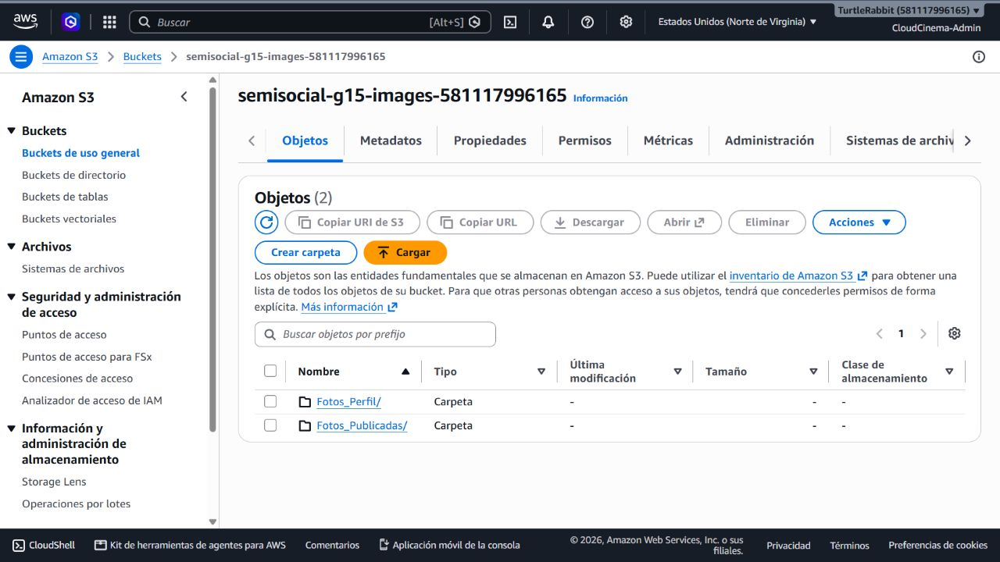

Validaciones HTTP, actualización del stack y decisiones de IAM del bucket de imágenes:

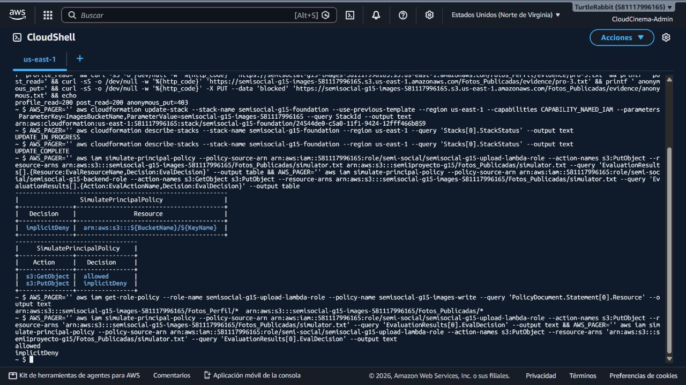

Regla de ciclo de vida de los objetos temporales (siete días):

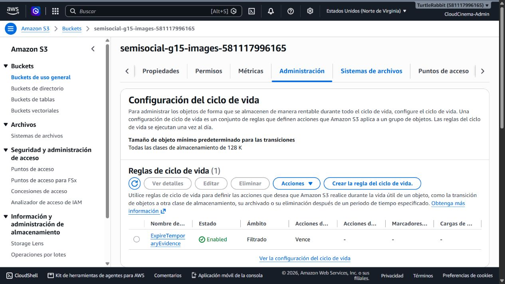

Bucket del sitio web: objetos del build en la raíz, hosting estático, política de solo lectura y sitio funcionando:

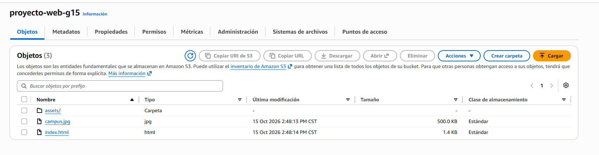

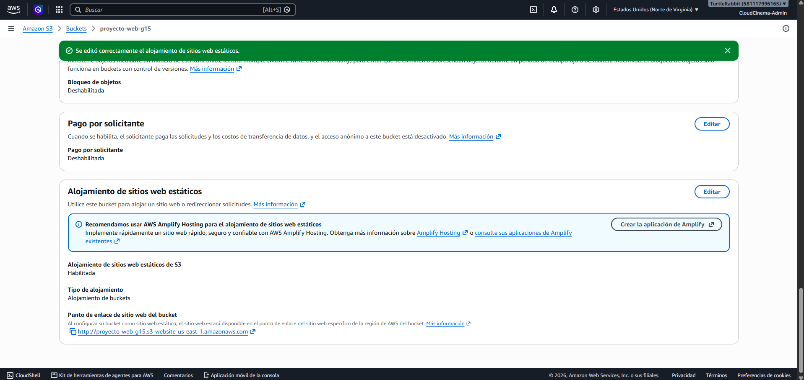

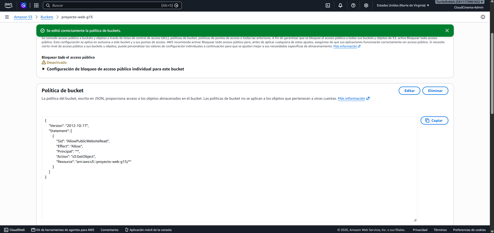

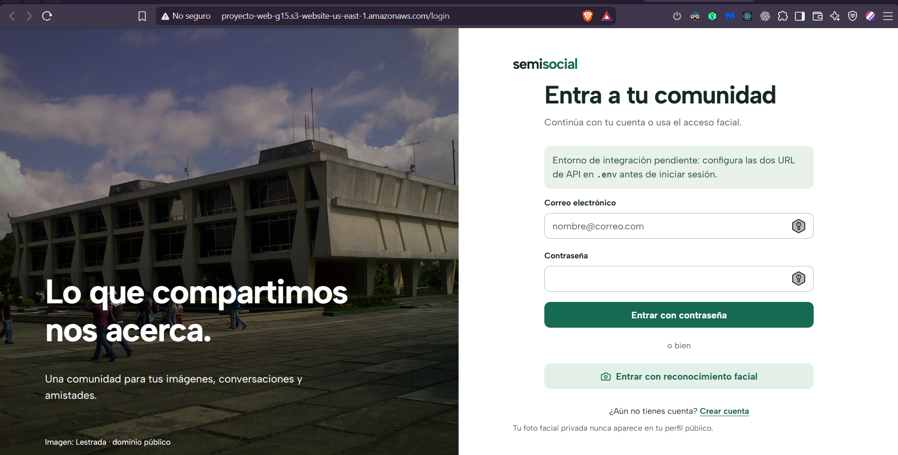

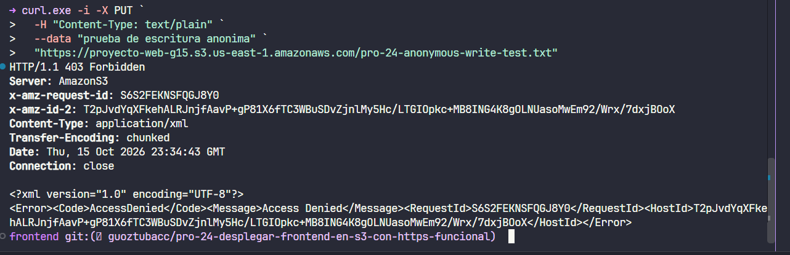

[CAPTURA PENDIENTE: lista de buckets de S3 con `semisocial-g15-images-581117996165` y `proyecto-web-g15`, región us-east-1] 

[CAPTURA PENDIENTE: pestaña Permisos del bucket de imágenes con la política vigente (lectura pública de `Fotos_Perfil/public/*` y `Fotos_Publicadas/*`, denegación sin TLS)] 

[CAPTURA PENDIENTE: objetos dentro de `Fotos_Publicadas/` con imágenes de publicaciones reales de la app] 

### 11.2 EC2

Asistente de lanzamiento de la EC2 Node (nombre, sistema operativo, red, grupo de seguridad y perfil de instancia). Muestra el lanzamiento en la VPC `10.15.0.0/16`, anterior al despliegue actual (ver sección 4.1):

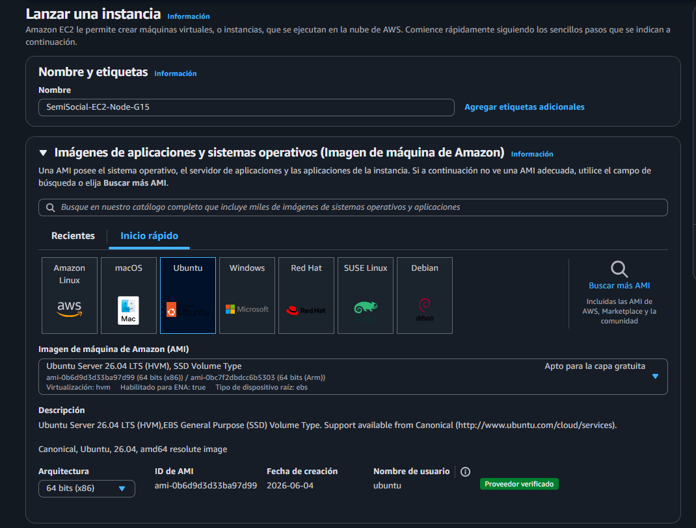

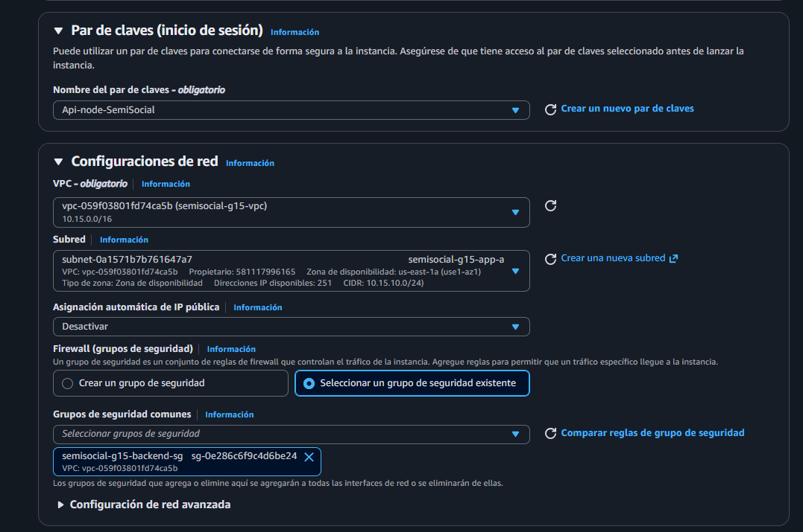

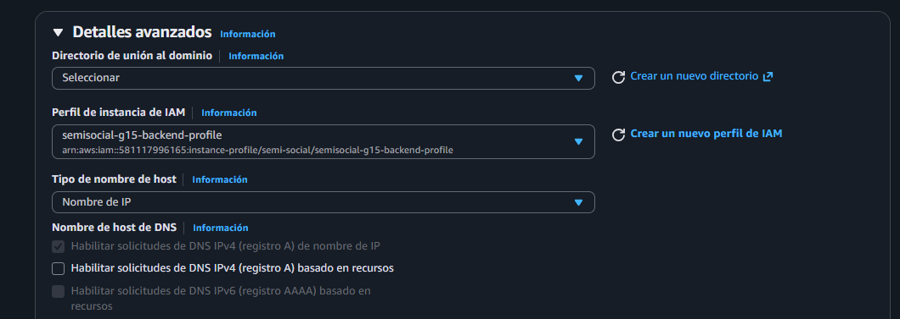

Las dos instancias registradas en el target group (Node `i-05479ce4e0fa5b060` y Python `i-0a3c4a8b108539d35`, ejecutándose, mismo grupo de seguridad y subred):


[CAPTURA PENDIENTE: consola de EC2 con las dos instancias de Semi-Social en estado "En ejecución" y 2/2 comprobaciones] 

[CAPTURA PENDIENTE: detalle de `semisocial-g15-python-1` (tipo, AMI Amazon Linux 2023, subred, IP pública, perfil de instancia, IMDSv2 obligatorio, sin par de claves)] 

[CAPTURA PENDIENTE: detalle de `semiSocial-EC2-node-g15` (`i-05479ce4e0fa5b060`: tipo, AMI, subred, perfil de instancia, grupos de seguridad)] 

[CAPTURA PENDIENTE: reglas de entrada de `semisocial-g15-backend-sg-default` (solo TCP 3000 desde el grupo del ALB, sin 22)] 

[CAPTURA PENDIENTE: Fleet Manager con ambas instancias "En línea" y una sesión de Session Manager abierta] 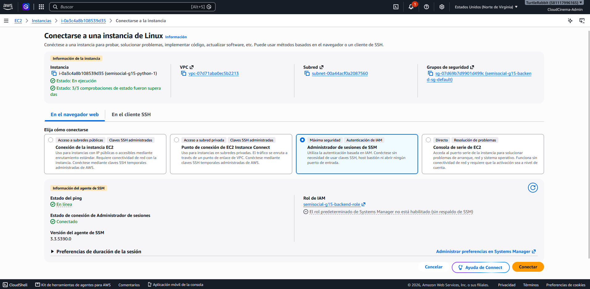

[CAPTURA PENDIENTE: `systemctl status semisocial-python` activo y `curl http://127.0.0.1:3000/health` con `"service":"python"`] 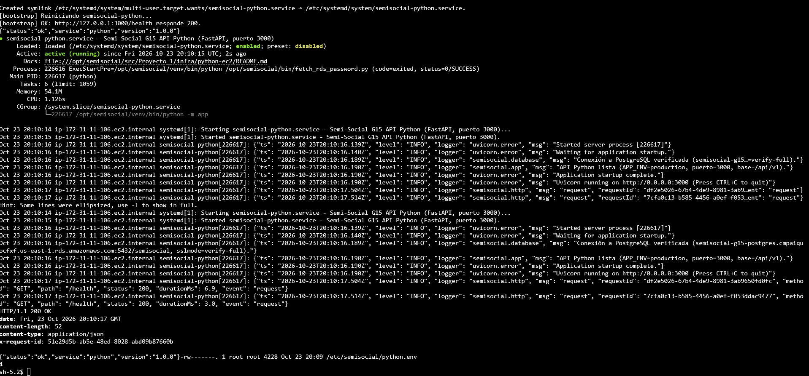

[CAPTURA PENDIENTE: estado del servicio de Node en su EC2 y `curl http://127.0.0.1:3000/health` con `"service":"node"`] 

### 11.3 Base de datos RDS

> No se incluye `docs/evidence/rds/images/vpc-rds-sg-validation.png`: es una captura
> histórica del 18-oct que muestra la regla `170.150.29.119/32` (retirada el 19-oct)
> y la IP de un host. No representa el estado actual del grupo de seguridad.

[CAPTURA PENDIENTE: detalle de `semisocial-g15-postgres` (estado Disponible, `db.t4g.micro`, Single-AZ `us-east-1b`, cifrado, sin acceso público)] 

[CAPTURA PENDIENTE: pestaña Conectividad y seguridad (VPC `vpc-07d71aba0ec5b2213`, grupo de subredes, grupo de seguridad, puerto 5432, acceso público: No)] 

[CAPTURA PENDIENTE: reglas de entrada de `sg-08cf39cce34d6392b` (5432 solo desde el grupo de backends; sin `0.0.0.0/0` ni IP públicas)] 

[CAPTURA PENDIENTE: salida de `verify_schema.sql` (`schema verification passed`) y listado de las tablas del esquema, sin credenciales] 

### 11.4 Aplicación web

Pantalla de acceso servida por CloudFront en HTTPS:

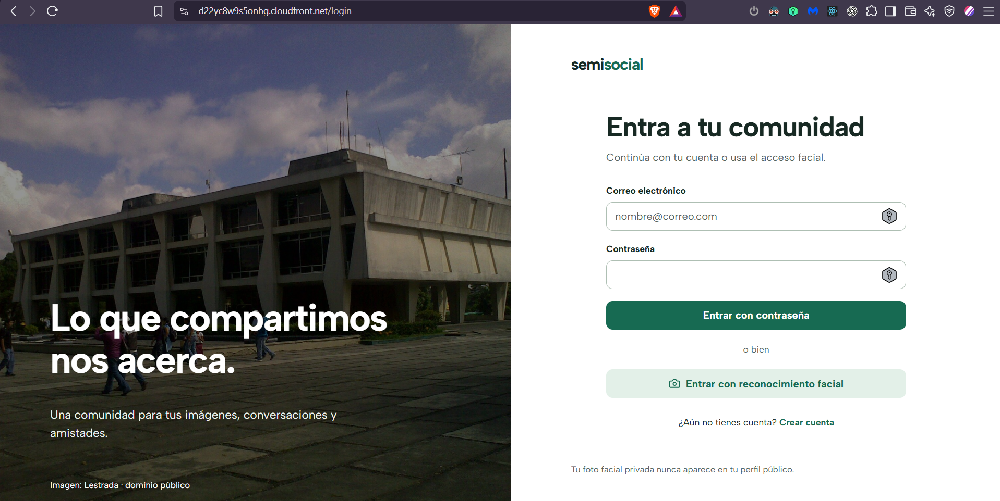

Ruta interna de la SPA abierta directamente por CloudFront, y permiso de cámara en contexto seguro:


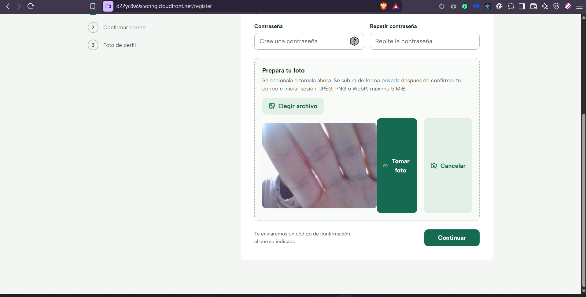

[CAPTURA PENDIENTE: registro de una cuenta con la foto elegida o tomada con la cámara (sin datos reales)] 

[CAPTURA PENDIENTE: confirmación del correo con el campo de código vacío o tapado (sin correo ni código)] 

[CAPTURA PENDIENTE: feed del usuario A con la publicación de prueba] 

[CAPTURA PENDIENTE: feed del usuario B con la misma publicación] 

[CAPTURA PENDIENTE: creación de una publicación con imagen y descripción] 

[CAPTURA PENDIENTE: publicación con etiquetas de Rekognition y filtro por etiqueta aplicado] 

[CAPTURA PENDIENTE: comentarios de una publicación] 

[CAPTURA PENDIENTE: pantalla de personas con solicitudes de amistad recibidas, enviadas y amigos] 

[CAPTURA PENDIENTE: chat en tiempo real entre el usuario A y el usuario B] 

[CAPTURA PENDIENTE: edición de perfil (nombre, DPI, foto) con el campo de contraseña] 

[CAPTURA PENDIENTE: pantalla del bot de la Facultad respondiendo una pregunta aprobada] 

### 11.5 Funciones Lambda y API Gateway

Código desplegado de `semisocial-g15-image-upload` (Node.js 22.x, paquete de 5,7 kB) y sus variables de entorno:


Pruebas en vivo contra API Gateway: cabeceras de la solicitud y rechazo 415 de un archivo que no es imagen:


API HTTP `semisocial-g15-upload-api`: creación, ruta `POST /uploads/images` (la captura muestra que no tiene autorizador asociado), etapa y CORS:


[CAPTURA PENDIENTE: configuración general de `semisocial-g15-image-upload` (memoria 256 MB, tiempo de espera 15 s, rol `semisocial-g15-upload-lambda-role`); la imagen `02-lambda-general-configuration.png` existente muestra las variables de entorno y no esta pestaña] 

[CAPTURA PENDIENTE: lista de funciones Lambda de Semi-Social (carga de imágenes y las tres de Cognito)] 

[CAPTURA PENDIENTE: solicitud 201 de una captura facial con `imageKey` y `imageUrl: null` (sin token ni datos reales)] 

[CAPTURA PENDIENTE: `define-auth`, `create-auth` y `verify-auth` asociadas al pool de Cognito (Propiedades del pool, Extensiones de Lambda)] 

### 11.6 Pool de Cognito

Validación con la CLI del cliente `semisocial-g15-web` con sus flujos de autenticación (incluye `ALLOW_CUSTOM_AUTH`):


Validación inicial del pool con la CLI:


[CAPTURA PENDIENTE: resumen del pool `semisocial-g15-users` (ID `us-east-1_4UrrCPt8Z`, región, inicio de sesión por correo, verificación por correo)] 

[CAPTURA PENDIENTE: cliente de aplicación `semisocial-g15-web` en la consola (sin secreto, flujos habilitados)] 

[CAPTURA PENDIENTE: lista de usuarios del pool con los usuarios A y B en estado Confirmado, con la columna de correo tapada] 

[CAPTURA PENDIENTE: atributos del pool (`name`, `email`, `custom:dpi`) y política de contraseñas de 12 caracteres] 

### 11.7 Configuración de Amazon Lex

> Todavía no existen capturas de Lex en el repositorio
> (`docs/evidence/lex/report.md:257`). Los nombres siguen los que ya declara ese reporte.

[CAPTURA PENDIENTE: bot `semisocial-g15-facultad-bot` (ID `HEE55FCSTB`) en la consola de Lex V2, idioma `es_419`] 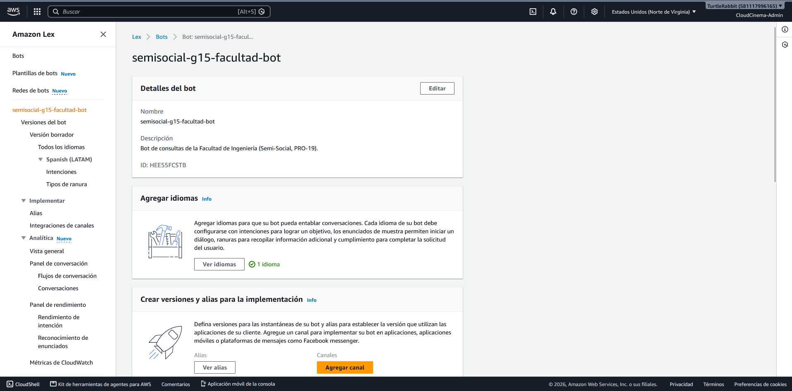

[CAPTURA PENDIENTE: lista de intents y utterances del bot] 

[CAPTURA PENDIENTE: alias `prod` (`Y1CGMUEYYK`) apuntando a una versión numerada] 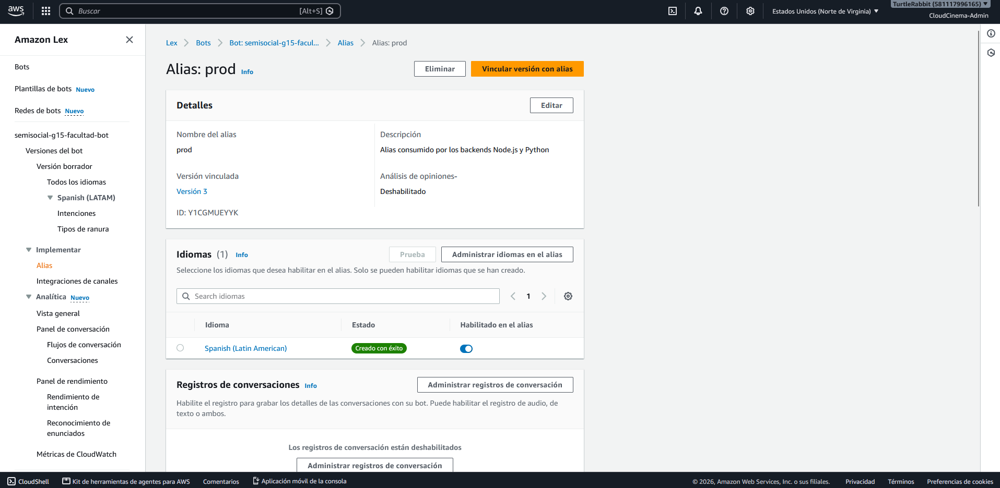

[CAPTURA PENDIENTE: build del idioma `es_419` completado sin errores] 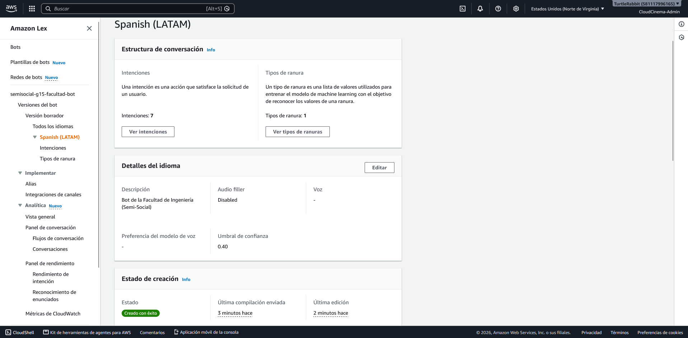

[CAPTURA PENDIENTE: panel de pruebas con una pregunta aprobada respondida (por ejemplo, el horario de Control Académico)] 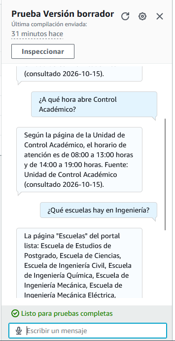

[CAPTURA PENDIENTE: stack `semisocial-g15-lex-bot` con sus salidas `LexBotId` y `LexBotAliasId`] 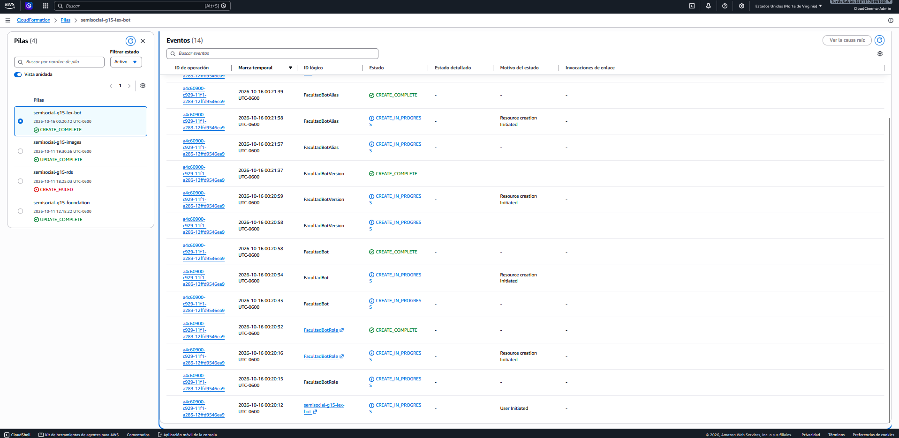

### 11.8 Balanceador de carga

ALB activo con su DNS público, red, security group y listener:


Target group: configuración, comprobación de salud y atributos:


`/health` y error JSON mediante el ALB:


Distribución de CloudFront del API (origen ALB, políticas y estado desplegado):


[CAPTURA PENDIENTE: pestaña Reglas del listener HTTP:80 con la regla de prioridad 10 hacia `semisocial-g15-node-only-tg`] 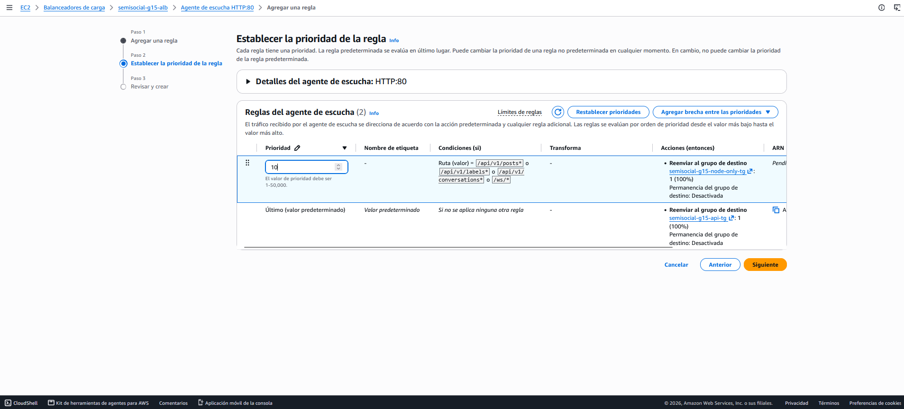

[CAPTURA PENDIENTE: target group `semisocial-g15-node-only-tg` (destino Node y salud)] 

[CAPTURA PENDIENTE: target group `semisocial-g15-api-tg` con los dos destinos en estado `healthy`] 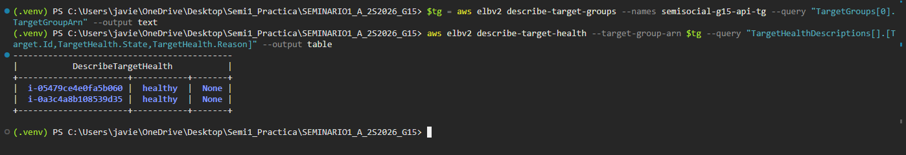

[CAPTURA PENDIENTE: salida de las 12 solicitudes a `/health` por CloudFront (6 Node y 6 Python)] 

[CAPTURA PENDIENTE: failover con Node detenido (target `unhealthy` y respuestas solo de Python)] 

[CAPTURA PENDIENTE: failover con Python detenido (target `unhealthy` y respuestas solo de Node)] 

### 11.9 IAM (políticas y roles)

El enunciado lo pide en la rúbrica (criterio 1.1 y 2.12).

Rol `semisocial-g15-backend-role` (resumen con ARN y perfil de instancia) y simulador de IAM (permitido y denegado):

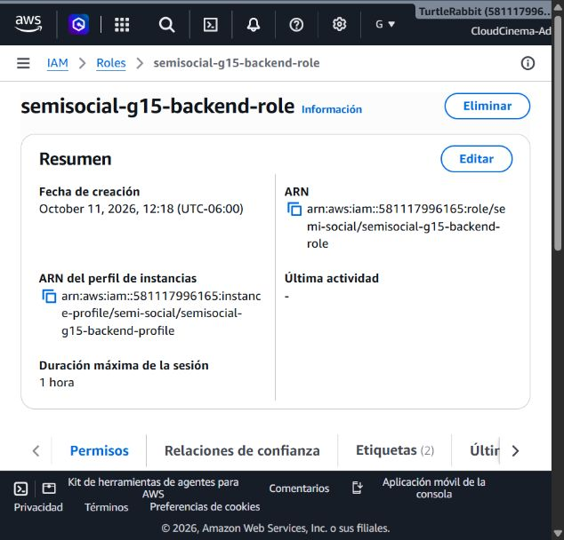

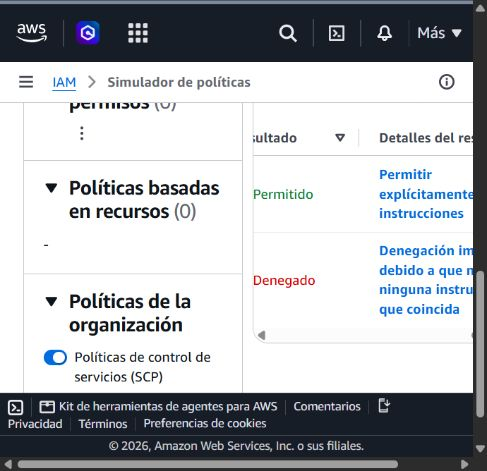

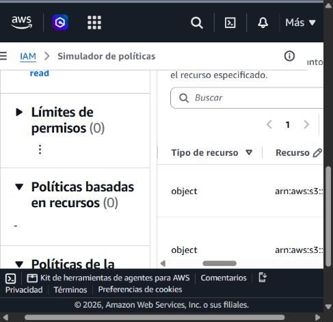

Políticas del rol backend validadas desde CloudShell:


[CAPTURA PENDIENTE: pestaña Permisos de `semisocial-g15-backend-role` con todas las políticas, incluida `AmazonSSMManagedInstanceCore`] 

[CAPTURA PENDIENTE: lista de roles `semisocial-g15-*` (backend, carga de imágenes y Cognito facial)] 

[CAPTURA PENDIENTE: permisos de `semisocial-g15-upload-lambda-role`] 

[CAPTURA PENDIENTE: usuarios IAM del proyecto, si se crean tras aclararlo con los auxiliares (sección 5.2)] 

---

## 12. Documentación de apoyo

- Contrato: [`docs/api/openapi.yaml`](docs/api/openapi.yaml), [`docs/api/contract.md`](docs/api/contract.md)
- Backends: [`docs/api/node.md`](docs/api/node.md), [`docs/api/python.md`](docs/api/python.md)
- Flujos: [`docs/api/auth-flows.md`](docs/api/auth-flows.md), [`docs/api/upload.md`](docs/api/upload.md),
  [`docs/api/labels.md`](docs/api/labels.md), [`docs/api/translation.md`](docs/api/translation.md),
  [`docs/api/bot.md`](docs/api/bot.md), [`docs/api/chat.md`](docs/api/chat.md)
- Modelo de datos: [`docs/data-model/model.md`](docs/data-model/model.md)
- Guía de usuario: [`docs/user-guide.md`](docs/user-guide.md)
- Handoffs: [`docs/handoffs/pro-1.md`](docs/handoffs/pro-1.md), [`docs/handoffs/pro-3.md`](docs/handoffs/pro-3.md),
  [`docs/handoffs/pro-4.md`](docs/handoffs/pro-4.md)

---

## 13. Capturas por insertar

Lista de trabajo: cada archivo se copia con **exactamente** ese nombre en la
carpeta indicada (ruta relativa a `Proyecto_1/`).

| Archivo exacto a copiar | Qué debe mostrar | Sección |
|---|---|---|
| `docs/evidence/s3-images/images/s3-lista-buckets.png` | Lista de buckets con el de imágenes y el del sitio web, región us-east-1 | 11.1 |
| `docs/evidence/s3-images/images/s3-imagenes-politica.png` | Política vigente del bucket de imágenes (lectura pública de dos prefijos, denegación sin TLS) | 11.1 |
| `docs/evidence/s3-images/images/s3-fotos-publicadas.png` | Objetos en `Fotos_Publicadas/` de publicaciones reales | 11.1 |
| `docs/evidence/ec2-python/images/ec2-lista-instancias.png` | Las dos EC2 en ejecución con 2/2 comprobaciones | 11.2 |
| `docs/evidence/ec2-python/images/ec2-python-detalle.png` | Detalle de `semisocial-g15-python-1` (AMI, subred, IP, perfil, IMDSv2, sin par de claves) | 11.2 |
| `docs/evidence/EC2-NODE/images/ec2-node-detalle.png` | Detalle de `semiSocial-EC2-node-g15` (`i-05479ce4e0fa5b060`) | 11.2 |
| `docs/evidence/ec2-python/images/ec2-backend-sg-entrada.png` | Reglas de entrada de `semisocial-g15-backend-sg-default` (3000 desde el ALB, sin 22) | 11.2 |
| `docs/evidence/ec2-python/images/ec2-ssm-online.png` | Fleet Manager con ambas instancias en línea y sesión de Session Manager | 11.2 |
| `docs/evidence/ec2-python/images/ec2-python-systemctl.png` | `systemctl status semisocial-python` y `/health` con `"service":"python"` | 11.2 |
| `docs/evidence/EC2-NODE/images/ec2-node-systemctl.png` | Servicio de Node activo y `/health` con `"service":"node"` | 11.2 |
| `docs/evidence/rds/images/rds-detalle.png` | Detalle de `semisocial-g15-postgres` (disponible, clase, Single-AZ, cifrado, sin acceso público) | 11.3 |
| `docs/evidence/rds/images/rds-conectividad.png` | Conectividad y seguridad (VPC, subredes, grupo de seguridad, puerto 5432, acceso público No) | 11.3 |
| `docs/evidence/rds/images/rds-sg-entrada.png` | Reglas de entrada de `sg-08cf39cce34d6392b` actuales | 11.3 |
| `docs/evidence/rds/images/rds-esquema-verificado.png` | `schema verification passed` y listado de tablas, sin credenciales | 11.3 |
| `docs/evidence/app-web/images/app-registro.png` | Registro con foto de archivo o cámara | 11.4 |
| `docs/evidence/app-web/images/app-confirmacion.png` | Pantalla de confirmación de correo, sin correo ni código | 11.4 |
| `docs/evidence/app-web/images/app-feed-usuario-a.png` | Feed del usuario A con la publicación de prueba | 11.4 |
| `docs/evidence/app-web/images/app-feed-usuario-b.png` | Feed del usuario B con la misma publicación | 11.4 |
| `docs/evidence/app-web/images/app-crear-publicacion.png` | Creación de una publicación con imagen y descripción | 11.4 |
| `docs/evidence/app-web/images/app-filtros-etiquetas.png` | Etiquetas de Rekognition y filtro aplicado | 11.4 |
| `docs/evidence/app-web/images/app-comentarios.png` | Comentarios de una publicación | 11.4 |
| `docs/evidence/app-web/images/app-amigos.png` | Solicitudes de amistad y amigos | 11.4 |
| `docs/evidence/app-web/images/app-chat.png` | Chat en tiempo real entre A y B | 11.4 |
| `docs/evidence/app-web/images/app-perfil.png` | Edición de perfil con contraseña | 11.4 |
| `docs/evidence/app-web/images/app-bot.png` | Pantalla del bot respondiendo | 11.4 |
| `docs/evidence/lambda-upload/images/lambda-upload-configuracion-general.png` | Memoria, tiempo de espera y rol de la Lambda de carga | 11.5 |
| `docs/evidence/lambda-upload/images/lambda-lista-funciones.png` | Las cuatro funciones Lambda del proyecto | 11.5 |
| `docs/evidence/lambda-upload/images/postman-201-subida.png` | Respuesta 201 de la carga, sin token ni datos reales | 11.5 |
| `docs/evidence/cognito-facial/images/lambda-cognito-triggers.png` | Las tres Lambdas asociadas al pool de Cognito | 11.5 |
| `docs/evidence/cognito/images/cognito-pool-resumen.png` | Resumen del pool `semisocial-g15-users` | 11.6 |
| `docs/evidence/cognito/images/cognito-cliente-flujos.png` | Cliente `semisocial-g15-web` con sus flujos | 11.6 |
| `docs/evidence/cognito/images/cognito-usuarios-confirmados.png` | Usuarios A y B confirmados, correo tapado | 11.6 |
| `docs/evidence/cognito/images/cognito-atributos-politica.png` | Atributos del pool y política de contraseñas | 11.6 |
| `docs/evidence/lex/images/lex-bot-resumen.png` | Bot `semisocial-g15-facultad-bot` en la consola de Lex | 11.7 |
| `docs/evidence/lex/images/intents.png` | Intents y utterances | 11.7 |
| `docs/evidence/lex/images/alias-prod.png` | Alias `prod` en una versión numerada | 11.7 |
| `docs/evidence/lex/images/build.png` | Build del idioma `es_419` sin errores | 11.7 |
| `docs/evidence/lex/images/lex-prueba-consola.png` | Conversación de prueba en el panel de la consola | 11.7 |
| `docs/evidence/lex/images/stack-outputs.png` | Stack `semisocial-g15-lex-bot` y sus salidas | 11.7 |
| `docs/evidence/alb/images/alb-listener-reglas.png` | Reglas del listener HTTP:80 con la de prioridad 10 | 11.8 |
| `docs/evidence/alb/images/alb-node-only-tg.png` | Target group `semisocial-g15-node-only-tg` | 11.8 |
| `docs/evidence/alb/images/alb-targets-healthy.png` | `semisocial-g15-api-tg` con 2/2 `healthy` | 11.8 |
| `docs/evidence/alb/images/alb-distribucion-12.png` | 12 solicitudes a `/health`: 6 Node y 6 Python | 11.8 |
| `docs/evidence/alb/images/alb-failover-node-detenido.png` | Failover con Node detenido | 11.8 |
| `docs/evidence/alb/images/alb-failover-python-detenido.png` | Failover con Python detenido | 11.8 |
| `docs/evidence/iam/images/iam-backend-role-permisos.png` | Todas las políticas del rol backend | 11.9 |
| `docs/evidence/iam/images/iam-roles-lista.png` | Roles `semisocial-g15-*` | 11.9 |
| `docs/evidence/iam/images/iam-lambda-role-permisos.png` | Permisos del rol de la Lambda de carga | 11.9 |
| `docs/evidence/iam/images/iam-usuarios.png` | Usuarios IAM, si se crean | 11.9 |
