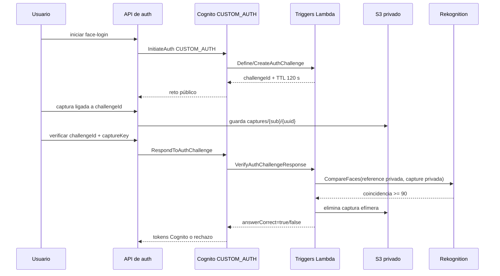

# Flujo de autenticación facial (CUSTOM_AUTH)

La autenticación facial es una extensión del pool Cognito de PRO-5. Cognito
continúa emitiendo los tokens; los backends nunca crean una sesión o JWT
paralelo. Los triggers se encuentran en `lambdas/cognito-facial/` y reciben
clientes AWS por inyección en el empaquetado de despliegue.

## Contrato

- `challengeId`: UUID generado por `CreateAuthChallenge`.
- `purpose`: siempre `faceCapture`.
- `expiresInSeconds`: 120 por defecto.
- `captureKey`: solo `Fotos_Perfil/captures/{cognitoSub}/{uuid}.jpg|png`.
- Referencia: `Fotos_Perfil/references/{cognitoSub}/...`, privada y controlada
  por servidor. El cliente no envía una URL para elegirla.
- `SimilarityThreshold`: `90`; máximo 3 intentos por sesión.
- Una captura se elimina en `finally`, incluso si Rekognition falla.

El trigger comprueba `sub`, `challengeId`, propósito, TTL, prefijo y ausencia
de `..` antes de invocar Rekognition. No registra imágenes, claves completas,
puntajes ni tokens. El login de contraseña de PRO-5 permanece sin cambios.

## Errores

| Caso | Resultado |
|---|---|
| Cuenta no confirmada o sin referencia | Cognito rechaza el reto sin emitir tokens. |
| Reto vencido/consumido | `NotAuthorizedException`; no se reintenta. |
| Captura de otro usuario o URL pública | `answerCorrect=false`; no hay llamada válida. |
| Sin coincidencia | `answerCorrect=false`; después de 3 intentos falla el login. |
| Error temporal de Rekognition | fallo controlado; no se expone detalle biométrico. |

La detección de vida no está implementada y no se promete como protección. El
riesgo residual de suplantación se documenta para la revisión del equipo.
