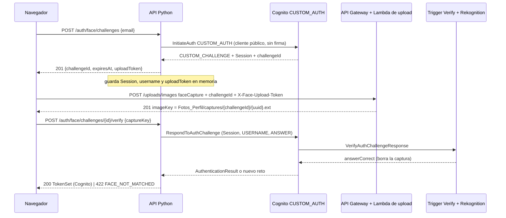

# Login facial en Python (PRO-14)

**Ticket:** PRO-14 — Python: login facial sobre Cognito `CUSTOM_AUTH`
**Responsable:** Javier
**Código:** `backend-python/app/modules/auth/{face.py,face_store.py,router.py}`,
`app/modules/integrations/cognito/gateway.py`, `app/modules/profile/service.py`
**Contrato:** [`openapi.yaml`](openapi.yaml) (`/auth/face/challenges` y `.../{challengeId}/verify`),
[`auth-flows.md`](auth-flows.md), [`contract.md`](contract.md); triggers en `lambdas/cognito-facial/`.

Python **no emite sesión propia**: los tokens que devuelve `verify` son los de Cognito. La comparación facial la
hace el trigger `VerifyAuthChallengeResponse` con Rekognition; Python crea el reto, guarda la `Session` y la
devuelve a Cognito.

## 1. Estado

| Pieza | Estado |
|---|---|
| Rutas `POST /auth/face/challenges` y `POST /auth/face/challenges/{id}/verify` | **Implementadas y verificadas con servicios reales desde la instancia** (§10); **sin verificar desde la página** |
| Gateway: `initiate_custom_auth`, `respond_to_custom_challenge`, `update_face_reference` | Implementado; probado con `Stubber`. `initiate_custom_auth` y `respond_to_custom_challenge` se ejercieron contra Cognito real (§10); `update_face_reference` **no** |
| Escritura de `custom:face_reference_key` en `complete-profile` y `PATCH /me` | Implementada (mejor esfuerzo); **solo con dobles**, sin escritura real hecha por la API |
| `scripts/face_probe.py` (puerta 0) y `scripts/face_smoke.py` | Lógica probada con dobles y **ejecutados en la EC2 el 2026-10-26** (§10): puerta 0 OK; humo OK salvo el usuario inexistente (503) |
| Flujo con Cognito, S3, Lambda, trigger y Rekognition reales | **Verificado desde la instancia** (scripts); **no desde la página** (§9) |
| Enrutamiento de `/api/v1/auth/face*` solo a Python en el ALB | **Hecho a mano el 2026-10-26** (grupo `semisocial-g15-python-only-tg`, regla de prioridad 5); fuera de CloudFormation (§3, §10) |

Verificación en la EC2 y cambios manuales: §10 y
[`../evidence/face-login/python-report.md`](../evidence/face-login/python-report.md).

Pruebas locales: `tests/test_face_login.py` (rutas, almacén, contrato OpenAPI, logs), `tests/test_cognito_face.py`
(gateway con Stubber), `tests/test_face_reference_sync.py`, `tests/test_face_probe.py` y `tests/test_face_scripts.py`
(los scripts de la EC2 contra la app real con dobles). Nada de esto llama a AWS.

## 2. Flujo



`ANSWER` es el JSON `{"challengeId","purpose":"faceCapture","captureKey"}` que espera
`lambdas/cognito-facial/index.js` (`verifyAuthChallengeResponse`). `challengeId` lo genera el trigger
`CreateAuthChallenge`; Python lo lee de `ChallengeParameters` y no lo inventa (solo en el reto falso, §5).

## 3. Almacén de retos en memoria y sus límites

`FaceChallengeStore` (`face_store.py`) guarda por `challengeId`: `username` (el `USERNAME` que devuelve Cognito,
o el correo si falta), la `Session`, el `uploadToken` y la caducidad. Es necesario porque el cliente solo reenvía
`challengeId` y `captureKey` y el ALB no tiene afinidad. Reglas:

- Diccionario protegido con `threading.Lock`; `take` es atómico: **un reto se consume una sola vez**, también
  ante dos `verify` simultáneos (probado con hilos).
- Vigencia = `expiresInSeconds` del trigger (120 s por defecto; se acota a 30–300 s). Vencido o inexistente → 404.
- Tope de 1000 entradas, con limpieza de caducados en cada alta. Con el tope lleno responde **429 sin desalojar**
  a nadie.
- `repr` oculta correo, `Session` y token; nunca se registran.

**Requisitos para que sea correcto (no se cumplen solos):**

1. `/api/v1/auth/face*` debe llegar **siempre a la misma instancia Python**. El ALB repartía esa ruta entre Node y
   Python en round robin sin afinidad. **Hecho a mano el 2026-10-26** (fuera de CloudFormation): grupo
   `semisocial-g15-python-only-tg` con solo la instancia de Python y regla de prioridad 5 (§10). Con un solo
   destino no hay failover: si Python cae, el login facial deja de funcionar.
2. Un solo proceso de uvicorn (`app/__main__.py` lo arranca así; con `--workers N` el almacén se partiría).
3. Se pierde al reiniciar el servicio: los retos en curso devuelven 404 y el usuario reinicia el flujo.

## 4. Contrato

### `POST /auth/face/challenges` (sin token)

Cuerpo `{"email": "..."}` (mismas reglas que el login: correo normalizado, sin caracteres de control).

`201`: `{"challengeId": "<uuid>", "expiresAt": "2026-10-26T18:02:00.000Z", "uploadToken": "<opaco>"}`.
`uploadToken` es aleatorio (`secrets.token_urlsafe(32)`), **opaco y no es un JWT ni un token de Cognito**.

### `POST /auth/face/challenges/{challengeId}/verify` (sin token)

Cuerpo `{"captureKey": "Fotos_Perfil/captures/{challengeId}/{uuid}.jpg"}`. Antes de llamar a Cognito se exige que
`captureKey` empiece por `Fotos_Perfil/captures/{challengeId}/` (prefijo configurable con
`S3_FACE_CAPTURE_PREFIX`), no contenga `..` y que lo que sigue sea un único nombre de archivo
(`[A-Za-z0-9._-]+`, sin subcarpetas ni espacios); si no, **400** con `details.reason = INVALID_CAPTURE_KEY` **sin
consumir el reto**.

`200`: el mismo `TokenSet` que `/auth/login` (`accessToken`, `idToken`, `refreshToken`, `expiresIn`,
`tokenType`, `profileComplete`). Usa `AuthService.token_response`: verifica el token con el JWKS, calcula
`profileComplete` desde RDS y reconcilia la fila si falta, igual que el login por contraseña.

## 5. Mapeo de errores

| Situación | Respuesta |
|---|---|
| Cuerpo inválido, UUID inválido en la ruta | 400 `VALIDATION_ERROR` (antes de tocar Cognito) |
| `captureKey` con `..`, de otro reto o fuera del prefijo | 400 `INVALID_CAPTURE_KEY`; el reto sigue vigente |
| `InitiateAuth`: usuario inexistente o `NotAuthorizedException` | **201 con reto falso** (misma forma, `challengeId` local). Es el diseño: **en la EC2 un usuario inexistente dio 503** (`UserLambdaValidationException`, §10) |
| `InitiateAuth` sin `challengeId`, otro `ChallengeName` o tokens | 201 con reto falso |
| `InitiateAuth`: `UserLambdaValidationException` con `MISSING_FACE_REFERENCE` | 400 `VALIDATION_ERROR`, `details.reason = FACE_REFERENCE_MISSING` |
| `InitiateAuth`: `UserNotConfirmedException` / `PasswordResetRequiredException` | 401 con `USER_NOT_CONFIRMED` / `PASSWORD_RESET_REQUIRED` (igual que el login) |
| Throttling de Cognito (`TooManyRequests`, `LimitExceeded`, ...) o tope del almacén | 429 `RATE_LIMITED` |
| Cualquier otro fallo de Cognito, de un trigger o de red | 503 con mensaje fijo |
| `verify`: reto desconocido, vencido o ya consumido | 404 `NOT_FOUND` |
| `verify` sobre un reto falso | 422 `FACE_NOT_MATCHED` (sin llamar a Cognito) |
| `RespondToAuthChallenge` devuelve otro `CUSTOM_CHALLENGE` (no coincide, quedan intentos) | 422 `FACE_NOT_MATCHED`; **se elimina el reto** y el reto nuevo de Cognito se descarta |
| `RespondToAuthChallenge`: `NotAuthorizedException` (tercer fallo, sesión vencida o consumida) | 422 `FACE_NOT_MATCHED`; se elimina el reto |
| `RespondToAuthChallenge`: throttling | 429; **el reto se conserva** (Cognito limitó antes de invocar al trigger) |
| `RespondToAuthChallenge`: cualquier otro fallo (incluye errores del trigger o de Rekognition) | 503; se elimina el reto |
| `AuthenticationResult` con un token que no verifica | 503; se elimina el reto |

Decisión 2: todo `verify` fallido con 422 elimina el reto; el usuario reinicia el flujo con un reto nuevo.

**Regla de no leer mensajes de AWS** (`gateway.py`): se relaja solo para detectar `MISSING_FACE_REFERENCE` en
`InitiateAuth`; el texto no se devuelve ni se registra. Los mensajes de las respuestas son fijos.

**Anti-enumeración, con sus límites.** El diseño da a un usuario inexistente un 201 idéntico y hace fallar el
`verify` después con 422; **la prueba real no lo confirmó: devolvió 503** (§10). Además `FACE_REFERENCE_MISSING` (400) y `USER_NOT_CONFIRMED` (401) **sí revelan** que la cuenta existe y en
qué estado está, igual que el login por contraseña. Un atacante además puede distinguir un reto real de uno falso
si compara tiempos (el falso no llama a Cognito en `verify`).

**Contrato OpenAPI.** `createFaceChallenge` declara 201/400/429 y `verifyFaceChallenge` 200/400/404/422/429. Python
también devuelve **401** (cuenta sin confirmar) y **503** en la creación y **503** en `verify`, que `openapi.yaml`
no declara; no se editó el contrato (se propone agregarlos en [`python-auth.md`](python-auth.md) §10, #8).

## 6. `custom:face_reference_key` en `complete-profile` y `PATCH /me`

Después de guardar la referencia en RDS (`references/{sub}/{uuid}.{ext}`, derivada en el servidor; el cliente no
la elige) se llama a `AdminUpdateUserAttributes` con `UserPoolId`, `Username = sub` y el atributo
`custom:face_reference_key`. Es la única operación **firmada** de Cognito en Python: usa las credenciales del rol
del backend (`semisocial-g15-backend-role`); requiere `cognito-idp:AdminUpdateUserAttributes` sobre el pool.

- Es **mejor esfuerzo**: si falla, se registra `face.reference_sync_failed` (con el estado HTTP como `reason`,
  sin clave ni correo) y la operación **no falla**. El perfil queda completo en RDS, pero el login facial dará
  `FACE_REFERENCE_MISSING` hasta que se escriba el atributo.
- En `PATCH /me` solo se escribe cuando cambia la foto y **después** de confirmar RDS.
- No hay reintentos ni cola. Repetir la edición de foto o escribir el atributo a mano lo corrige.
- Los usuarios que ya tenían perfil completo **antes** de este cambio no lo reciben hasta que cambien la foto;
  según lo que verificó Javier con la CLI el 2026-10-26 (salida no versionada), 7 de 10 usuarios ya tienen
  el atributo y los 3 sin perfil completo no.

## 7. Cómo probar

### Local (sin AWS)

```powershell
cd Proyecto_1\backend-python
.\.venv\Scripts\Activate.ps1
python -m pytest -q
python -m pytest -q tests\test_face_login.py tests\test_cognito_face.py tests\test_face_reference_sync.py tests\test_face_probe.py tests\test_face_scripts.py
```

### En la EC2 de Python (servicios reales)

Ejecutados así el 2026-10-26 (resultado en §10). Prerrequisitos que **no** se resuelven con código: la rama
desplegada en la instancia (`sudo git -C /opt/semisocial/src pull --ff-only` y
`sudo bash .../infra/python-ec2/bootstrap.sh`, ver `infra/python-ec2/README.md`), el atributo
`custom:face_reference_key` de los usuarios de prueba, el permiso `cognito-idp:AdminUpdateUserAttributes` del rol
y, solo para probar por el ALB, la regla de ruta de §3.

```bash
cd /opt/semisocial/src/Proyecto_1/backend-python
# Puerta 0: solo AWS, sin las rutas nuevas.
/opt/semisocial/venv/bin/python scripts/face_probe.py --email "$EMAIL" \
    --reference-key "$KEY_PROPIA" --other-reference-key "$KEY_AJENA" \
    --upload-url "https://xsjlh2s0d1.execute-api.us-east-1.amazonaws.com/uploads/images"
# Rutas reales contra 127.0.0.1:3000 (--skip-expiry omite la espera de ~2 min; --compare-login pide la contraseña con getpass).
/opt/semisocial/venv/bin/python scripts/face_smoke.py --email "$EMAIL" \
    --reference-key "$KEY_PROPIA" --other-reference-key "$KEY_AJENA"
```

`KEY_PROPIA` es el `custom:face_reference_key` del usuario (`users.face_reference_key`); `KEY_AJENA`, la de **otra
persona**. Con los usuarios A y B no hace falta una captura nueva: la imagen de referencia del propio usuario
sirve de captura positiva (debe coincidir) y la de B como captura ajena (no debe). Salida: una línea `OK` o
`FALLO` por paso con la latencia; nunca correos, tokens, `Session`, `uploadToken` ni claves completas.
Los scripts crean retos reales en Cognito y dejan capturas efímeras de los retos que no se verifican.

Qué cubre `face_probe.py`: (a) `InitiateAuth` `CUSTOM_AUTH`; (b) descarga con el rol y subida como `faceCapture`;
(c) `RespondToAuthChallenge` positivo; (d) captura ajena (no debe emitir tokens); (e) reutilizar la `Session`
consumida. Qué cubre `face_smoke.py`: el mismo flujo por las rutas de Python, `GET /me` con el token, reuso 404,
ajena 422, usuario inexistente 201 → 422, `..` y otro reto 400 y reto vencido 404.

## 8. Riesgos conocidos y deuda (no implementados)

1. **La Lambda de upload no valida `X-Face-Upload-Token`**: acepta cualquier valor no vacío
   (`lambdas/image-upload/index.js:65-74`). El `uploadToken` de Python es opaco y no está ligado a nada que la
   Lambda compruebe. Cualquiera puede subir capturas bajo `captures/{cualquier-uuid}/`. No permite saltar el
   login (el trigger valida el `challengeId` secreto), pero sí llenar el prefijo. Arreglarlo exige cambiar la
   Lambda (firma HMAC con un secreto compartido); no se tocó.
2. **El tope de 3 intentos vale por sesión de Cognito** (`lambdas/cognito-facial/index.js`, `maxAttempts`).
   Reiniciar el flujo crea una sesión nueva y reinicia el contador; solo lo frena el throttling de Cognito y el
   tope del almacén. No hay contador por usuario en Python.
3. **Almacén en memoria**: se pierde al reiniciar y no sirve con más de un proceso o instancia (§3).
4. **Sin detección de vida** (`auth-flows.md`): una foto de la persona sirve como captura.
5. **Una imagen sin rostro** hace fallar a Rekognition dentro del trigger; Cognito lo devuelve como error de
   Lambda y la API responde **503**, no 422. Es una decisión de diseño de esta entrega.
6. **Anti-enumeración parcial** (§5).
7. `face_login_challenges` (migración 001) **no se usa**; su CHECK `challenges/` frente a `captures/` sigue sin
   alinearse, pero no estorba porque Python no escribe en esa tabla.
8. **El Node desplegado respondía con un 201 simulado** a `/auth/face/challenges` el 2026-10-26 (5 de 8
   peticiones antes de la regla 5 las atendió Node). El código de Node en `develop` ya trae una implementación con
   Cognito (commit `15111c4`), pero esa versión no era la que respondía en esa prueba. Mientras Node y Python no
   compartan el almacén de retos, `/auth/face*` debe ir solo a Python (§3); la regla 5 lo cumple.
9. **Paquete de la Lambda `verify-auth` y referencia del usuario A cambiados a mano** (§10): hay que versionarlos
   o revertirlos; una redeploy desde el repositorio puede deshacerlos.

## 9. NO verificado

Lo verificado el 2026-10-26 está en §10. Sigue **sin verificar** (requiere la página, el reloj real o más
infraestructura):

- **El login facial desde la página** (cámara y `/login/face`, `FaceLoginPage.tsx`): solo hay pruebas con mocks y
  los scripts dentro de la instancia.
- **`custom:face_reference_key` escrito por la API** desde `complete-profile` y `PATCH /me`: solo con dobles. El
  simulador de IAM dijo `allowed` para `AdminUpdateUserAttributes`; la API no hizo ninguna escritura real. Tampoco
  se probó que `Username = sub` sea aceptado en un pool con `UsernameAttributes = email`.
- **El vencimiento del reto con el reloj real** (paso 7 omitido; solo probado con reloj falso) y el comportamiento
  tras reiniciar el servicio.
- **Usuario inexistente:** falla con 503 (§10); no hay anti-enumeración en ese caso.
- **Qué devuelve Cognito tras el tercer fallo** de una misma sesión: no se observó (sí la captura ajena y la
  reutilización, §10).
- **Tolerancia a fallos:** almacén en memoria, un proceso, una instancia y un solo destino en la regla 5.
- **`X-Face-Upload-Token`:** la Lambda de upload no lo valida (§8).
- Que las referencias originales de **otros usuarios** contengan un rostro detectable: las de A y B no lo tenían
  (§10).

## 10. Verificación en la EC2 (2026-10-26)

Ejecutada en `i-0a3c4a8b108539d35` con `face_probe.py` (~21:00 UTC) y `face_smoke.py` contra `127.0.0.1:3000`
(21:05 UTC). La salida **no está versionada**; detalle, latencias y cronología en
[`../evidence/face-login/python-report.md`](../evidence/face-login/python-report.md). Las cuentas son «usuario A»
(propia) y «usuario B» (ajena).

| Paso | Resultado |
|---|---|
| Puerta 0 a) `InitiateAuth` `CUSTOM_AUTH` | OK (1305 ms): `CUSTOM_CHALLENGE`, `challengeId` presente, `expiresInSeconds=120` |
| b) captura propia: descarga y subida `faceCapture` | OK: HTTP 201, clave bajo `captures/{challengeId}/` |
| c) `RespondToAuthChallenge` positivo | OK (1030 ms): `AuthenticationResult` |
| d) captura ajena | OK: no coincide; Cognito devolvió un nuevo `CUSTOM_CHALLENGE` (713 ms) |
| e) reutilizar el reto consumido | OK: `NotAuthorizedException` (178 ms) |
| Humo 1) crear reto | OK: 201 con la forma del contrato (361 ms) |
| 2a/2b) `captureKey` con `..` / de otro reto | OK: 400 en ambos |
| 3) `verify` positivo y `GET /me` | OK: 200 `TokenSet` (891 ms); `/me` 200 (13 ms) |
| 4) reutilizar el reto consumido | OK: 404 |
| 5) captura ajena y reuso | OK: 422 `FACE_NOT_MATCHED` (700 ms); reuso 404 |
| 6) usuario inexistente | **FALLO**: 503 en lugar de 201 (`UserLambdaValidationException` en `InitiateAuth.face`) |
| 7) reto vencido | OMITIDO (`--skip-expiry`) |

Con esto quedan **observados** dos puntos que antes eran supuestos: una captura ajena produce un nuevo
`CUSTOM_CHALLENGE` (el mapeo a 422 de §5 lo cubre) y la sesión consumida produce `NotAuthorizedException`. Eventos de
log de Python: `cognito.call`, `face.challenge_created`, `face.verified`, `face.not_matched` (`RETRY_CHALLENGE`) y
`face.challenge_unknown`, sin datos personales.

**Limitación de la anti-enumeración.** Para un usuario inexistente Cognito invoca el trigger y este falla; el
gateway lo traduce a 503, no al 201 con reto falso de §5. Junto con `FACE_REFERENCE_MISSING` (400) y
`USER_NOT_CONFIRMED` (401), una cuenta existente se distingue de una inexistente. La fila de §5 sobre «usuario
inexistente» describe el diseño, **no** lo observado.

**Enrutamiento.** Antes de la regla 5, 8 peticiones por CloudFront a `POST /api/v1/auth/face/challenges` dieron 201
pero solo 3 aparecieron como `face.challenge_created` en Python (las otras 5 las atendió el Node desplegado, que
simula el 201). Después: 8 de 8 en Python (`journalctl`).

### Cambios manuales en AWS (fuera de CloudFormation, reversibles)

1. **Lambda `semisocial-g15-cognito-verify-auth`:** el paquete anterior validaba la captura bajo
   `Fotos_Perfil/captures/{sub}/` mientras la Lambda de upload escribe bajo `captures/{challengeId}/`. Se
   reemplazaron `index.js`, `face-verifier.js`, `config.js` y `runtime.js` por los de `origin/develop` (se
   mantuvo `node_modules`); `create-auth` y `define-auth` no se tocaron. Hay copia del paquete anterior fuera del
   repositorio.
2. **Referencia del usuario A:** se copió a su carpeta de referencias una imagen con rostro de una cuenta de
   prueba de otro integrante y se apuntó su `custom:face_reference_key` a esa copia, porque las referencias
   originales de A y B no tenían rostro detectable (`detect-faces` devolvió 0). Es material de prueba, no el
   registro de una persona real.
3. **Grupo `semisocial-g15-python-only-tg`** (HTTP 3000, health `/health`, solo la instancia de Python) y **regla de
   prioridad 5** de `/api/v1/auth/face*` en el listener HTTP:80 (CloudTrail: 15:13 y 15:15 hora de Guatemala).
