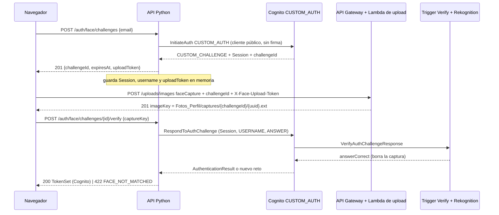

# Login facial en Python (PRO-14)

**Ticket:** PRO-14 — Python: login facial sobre Cognito `CUSTOM_AUTH`
**Responsable:** Javier
**Código:** `backend-python/app/modules/auth/{face.py,face_store.py,router.py}`,
`app/modules/integrations/cognito/gateway.py`, `app/modules/profile/service.py`
**Contrato:** [`openapi.yaml`](openapi.yaml) (`/auth/face/challenges` y `.../{challengeId}/verify`),
[`auth-flows.md`](auth-flows.md), [`contract.md`](contract.md); triggers en `lambdas/cognito-facial/`.

Python **no emite sesión propia**: los tokens que devuelve `verify` son los de Cognito. La comparación facial la
hace el trigger `VerifyAuthChallengeResponse` con Rekognition; Python crea el reto, guarda la `Session` y la
devuelve a Cognito.

## 1. Estado

| Pieza | Estado |
|---|---|
| Rutas `POST /auth/face/challenges` y `POST /auth/face/challenges/{id}/verify` | **Implementadas y probadas con dobles** (reemplazan al 501) |
| Gateway: `initiate_custom_auth`, `respond_to_custom_challenge`, `update_face_reference` | Implementado; probado con `Stubber` (sin AWS) |
| Escritura de `custom:face_reference_key` en `complete-profile` y `PATCH /me` | Implementada (mejor esfuerzo); probada con dobles |
| `scripts/face_probe.py` (puerta 0) y `scripts/face_smoke.py` | Escritos; su lógica está probada con dobles. **No se han ejecutado contra AWS** |
| Flujo extremo a extremo con Cognito, S3, Lambda, trigger y Rekognition reales | **NO VERIFICADO** (§9) |
| Enrutamiento de `/api/v1/auth/face*` solo a Python en el ALB | **Pendiente** (infraestructura, no es código; §3) |

Pruebas locales: `tests/test_face_login.py` (rutas, almacén, contrato OpenAPI, logs), `tests/test_cognito_face.py`
(gateway con Stubber), `tests/test_face_reference_sync.py`, `tests/test_face_probe.py` y `tests/test_face_scripts.py`
(los scripts de la EC2 contra la app real con dobles). Nada de esto llama a AWS.

## 2. Flujo



`ANSWER` es el JSON `{"challengeId","purpose":"faceCapture","captureKey"}` que espera
`lambdas/cognito-facial/index.js` (`verifyAuthChallengeResponse`). `challengeId` lo genera el trigger
`CreateAuthChallenge`; Python lo lee de `ChallengeParameters` y no lo inventa (solo en el reto falso, §5).

## 3. Almacén de retos en memoria y sus límites

`FaceChallengeStore` (`face_store.py`) guarda por `challengeId`: `username` (el `USERNAME` que devuelve Cognito,
o el correo si falta), la `Session`, el `uploadToken` y la caducidad. Es necesario porque el cliente solo reenvía
`challengeId` y `captureKey` y el ALB no tiene afinidad. Reglas:

- Diccionario protegido con `threading.Lock`; `take` es atómico: **un reto se consume una sola vez**, también
  ante dos `verify` simultáneos (probado con hilos).
- Vigencia = `expiresInSeconds` del trigger (120 s por defecto; se acota a 30–300 s). Vencido o inexistente → 404.
- Tope de 1000 entradas, con limpieza de caducados en cada alta. Con el tope lleno responde **429 sin desalojar**
  a nadie.
- `repr` oculta correo, `Session` y token; nunca se registran.

**Requisitos para que sea correcto (no se cumplen solos):**

1. `/api/v1/auth/face*` debe llegar **siempre a la misma instancia Python**. Hoy el ALB lo reparte entre Node y
   Python en round robin sin afinidad (`infra/alb/README.md:40,64-66`): hay que crear un target group solo de
   Python y una regla de ruta de mayor prioridad. **No está hecho**; es un cambio de infraestructura.
2. Un solo proceso de uvicorn (`app/__main__.py` lo arranca así; con `--workers N` el almacén se partiría).
3. Se pierde al reiniciar el servicio: los retos en curso devuelven 404 y el usuario reinicia el flujo.

## 4. Contrato

### `POST /auth/face/challenges` (sin token)

Cuerpo `{"email": "..."}` (mismas reglas que el login: correo normalizado, sin caracteres de control).

`201`: `{"challengeId": "<uuid>", "expiresAt": "2026-10-26T18:02:00.000Z", "uploadToken": "<opaco>"}`.
`uploadToken` es aleatorio (`secrets.token_urlsafe(32)`), **opaco y no es un JWT ni un token de Cognito**.

### `POST /auth/face/challenges/{challengeId}/verify` (sin token)

Cuerpo `{"captureKey": "Fotos_Perfil/captures/{challengeId}/{uuid}.jpg"}`. Antes de llamar a Cognito se exige que
`captureKey` empiece por `Fotos_Perfil/captures/{challengeId}/` (prefijo configurable con
`S3_FACE_CAPTURE_PREFIX`), no contenga `..` y que lo que sigue sea un único nombre de archivo
(`[A-Za-z0-9._-]+`, sin subcarpetas ni espacios); si no, **400** con `details.reason = INVALID_CAPTURE_KEY` **sin
consumir el reto**.

`200`: el mismo `TokenSet` que `/auth/login` (`accessToken`, `idToken`, `refreshToken`, `expiresIn`,
`tokenType`, `profileComplete`). Usa `AuthService.token_response`: verifica el token con el JWKS, calcula
`profileComplete` desde RDS y reconcilia la fila si falta, igual que el login por contraseña.

## 5. Mapeo de errores

| Situación | Respuesta |
|---|---|
| Cuerpo inválido, UUID inválido en la ruta | 400 `VALIDATION_ERROR` (antes de tocar Cognito) |
| `captureKey` con `..`, de otro reto o fuera del prefijo | 400 `INVALID_CAPTURE_KEY`; el reto sigue vigente |
| `InitiateAuth`: usuario inexistente o `NotAuthorizedException` | **201 con reto falso** (misma forma, `challengeId` local) |
| `InitiateAuth` sin `challengeId`, otro `ChallengeName` o tokens | 201 con reto falso |
| `InitiateAuth`: `UserLambdaValidationException` con `MISSING_FACE_REFERENCE` | 400 `VALIDATION_ERROR`, `details.reason = FACE_REFERENCE_MISSING` |
| `InitiateAuth`: `UserNotConfirmedException` / `PasswordResetRequiredException` | 401 con `USER_NOT_CONFIRMED` / `PASSWORD_RESET_REQUIRED` (igual que el login) |
| Throttling de Cognito (`TooManyRequests`, `LimitExceeded`, ...) o tope del almacén | 429 `RATE_LIMITED` |
| Cualquier otro fallo de Cognito, de un trigger o de red | 503 con mensaje fijo |
| `verify`: reto desconocido, vencido o ya consumido | 404 `NOT_FOUND` |
| `verify` sobre un reto falso | 422 `FACE_NOT_MATCHED` (sin llamar a Cognito) |
| `RespondToAuthChallenge` devuelve otro `CUSTOM_CHALLENGE` (no coincide, quedan intentos) | 422 `FACE_NOT_MATCHED`; **se elimina el reto** y el reto nuevo de Cognito se descarta |
| `RespondToAuthChallenge`: `NotAuthorizedException` (tercer fallo, sesión vencida o consumida) | 422 `FACE_NOT_MATCHED`; se elimina el reto |
| `RespondToAuthChallenge`: throttling | 429; **el reto se conserva** (Cognito limitó antes de invocar al trigger) |
| `RespondToAuthChallenge`: cualquier otro fallo (incluye errores del trigger o de Rekognition) | 503; se elimina el reto |
| `AuthenticationResult` con un token que no verifica | 503; se elimina el reto |

Decisión 2: todo `verify` fallido con 422 elimina el reto; el usuario reinicia el flujo con un reto nuevo.

**Regla de no leer mensajes de AWS** (`gateway.py`): se relaja solo para detectar `MISSING_FACE_REFERENCE` en
`InitiateAuth`; el texto no se devuelve ni se registra. Los mensajes de las respuestas son fijos.

**Anti-enumeración, con sus límites.** Un usuario inexistente recibe un 201 idéntico y el `verify` falla después
con 422. Pero `FACE_REFERENCE_MISSING` (400) y `USER_NOT_CONFIRMED` (401) **sí revelan** que la cuenta existe y en
qué estado está, igual que el login por contraseña. Un atacante además puede distinguir un reto real de uno falso
si compara tiempos (el falso no llama a Cognito en `verify`).

**Contrato OpenAPI.** `createFaceChallenge` declara 201/400/429 y `verifyFaceChallenge` 200/400/404/422/429. Python
también devuelve **401** (cuenta sin confirmar) y **503** en la creación y **503** en `verify`, que `openapi.yaml`
no declara; no se editó el contrato (se propone agregarlos en [`python-auth.md`](python-auth.md) §10, #8).

## 6. `custom:face_reference_key` en `complete-profile` y `PATCH /me`

Después de guardar la referencia en RDS (`references/{sub}/{uuid}.{ext}`, derivada en el servidor; el cliente no
la elige) se llama a `AdminUpdateUserAttributes` con `UserPoolId`, `Username = sub` y el atributo
`custom:face_reference_key`. Es la única operación **firmada** de Cognito en Python: usa las credenciales del rol
del backend (`semisocial-g15-backend-role`); requiere `cognito-idp:AdminUpdateUserAttributes` sobre el pool.

- Es **mejor esfuerzo**: si falla, se registra `face.reference_sync_failed` (con el estado HTTP como `reason`,
  sin clave ni correo) y la operación **no falla**. El perfil queda completo en RDS, pero el login facial dará
  `FACE_REFERENCE_MISSING` hasta que se escriba el atributo.
- En `PATCH /me` solo se escribe cuando cambia la foto y **después** de confirmar RDS.
- No hay reintentos ni cola. Repetir la edición de foto o escribir el atributo a mano lo corrige.
- Los usuarios que ya tenían perfil completo **antes** de este cambio no lo reciben hasta que cambien la foto;
  según lo que verificó Javier con la CLI el 2026-10-26 (salida no versionada), 7 de 10 usuarios ya tienen
  el atributo y los 3 sin perfil completo no.

## 7. Cómo probar

### Local (sin AWS)

```powershell
cd Proyecto_1\backend-python
.\.venv\Scripts\Activate.ps1
python -m pytest -q
python -m pytest -q tests\test_face_login.py tests\test_cognito_face.py tests\test_face_reference_sync.py tests\test_face_probe.py tests\test_face_scripts.py
```

### En la EC2 de Python (servicios reales)

Prerrequisitos que **no** se resuelven con código: la rama desplegada en la instancia
(`sudo git -C /opt/semisocial/src pull --ff-only` y `sudo bash .../infra/python-ec2/bootstrap.sh`, ver
`infra/python-ec2/README.md`), el atributo `custom:face_reference_key` de los usuarios de prueba, el permiso
`cognito-idp:AdminUpdateUserAttributes` del rol y, solo para probar por el ALB, la regla de ruta de §3.

```bash
cd /opt/semisocial/src/Proyecto_1/backend-python
# Puerta 0: solo AWS, sin las rutas nuevas.
/opt/semisocial/venv/bin/python scripts/face_probe.py --email "$EMAIL" \
    --reference-key "$KEY_PROPIA" --other-reference-key "$KEY_AJENA" \
    --upload-url "https://xsjlh2s0d1.execute-api.us-east-1.amazonaws.com/uploads/images"
# Rutas reales contra 127.0.0.1:3000 (--skip-expiry omite la espera de ~2 min; --compare-login pide la contraseña con getpass).
/opt/semisocial/venv/bin/python scripts/face_smoke.py --email "$EMAIL" \
    --reference-key "$KEY_PROPIA" --other-reference-key "$KEY_AJENA"
```

`KEY_PROPIA` es el `custom:face_reference_key` del usuario (`users.face_reference_key`); `KEY_AJENA`, la de **otra
persona**. Con los usuarios A y B no hace falta una captura nueva: la imagen de referencia del propio usuario
sirve de captura positiva (debe coincidir) y la de B como captura ajena (no debe). Salida: una línea `OK` o
`FALLO` por paso con la latencia; nunca correos, tokens, `Session`, `uploadToken` ni claves completas.
Los scripts crean retos reales en Cognito y dejan capturas efímeras de los retos que no se verifican.

Qué cubre `face_probe.py`: (a) `InitiateAuth` `CUSTOM_AUTH`; (b) descarga con el rol y subida como `faceCapture`;
(c) `RespondToAuthChallenge` positivo; (d) captura ajena (no debe emitir tokens); (e) reutilizar la `Session`
consumida. Qué cubre `face_smoke.py`: el mismo flujo por las rutas de Python, `GET /me` con el token, reuso 404,
ajena 422, usuario inexistente 201 → 422, `..` y otro reto 400 y reto vencido 404.

## 8. Riesgos conocidos y deuda (no implementados)

1. **La Lambda de upload no valida `X-Face-Upload-Token`**: acepta cualquier valor no vacío
   (`lambdas/image-upload/index.js:65-74`). El `uploadToken` de Python es opaco y no está ligado a nada que la
   Lambda compruebe. Cualquiera puede subir capturas bajo `captures/{cualquier-uuid}/`. No permite saltar el
   login (el trigger valida el `challengeId` secreto), pero sí llenar el prefijo. Arreglarlo exige cambiar la
   Lambda (firma HMAC con un secreto compartido); no se tocó.
2. **El tope de 3 intentos vale por sesión de Cognito** (`lambdas/cognito-facial/index.js`, `maxAttempts`).
   Reiniciar el flujo crea una sesión nueva y reinicia el contador; solo lo frena el throttling de Cognito y el
   tope del almacén. No hay contador por usuario en Python.
3. **Almacén en memoria**: se pierde al reiniciar y no sirve con más de un proceso o instancia (§3).
4. **Sin detección de vida** (`auth-flows.md`): una foto de la persona sirve como captura.
5. **Una imagen sin rostro** hace fallar a Rekognition dentro del trigger; Cognito lo devuelve como error de
   Lambda y la API responde **503**, no 422. Es una decisión de diseño de esta entrega.
6. **Anti-enumeración parcial** (§5).
7. `face_login_challenges` (migración 001) **no se usa**; su CHECK `challenges/` frente a `captures/` sigue sin
   alinearse, pero no estorba porque Python no escribe en esa tabla.
8. **Node sigue simulando** `/auth/face/*` (200 con tokens `mock-…`, `backend-node/src/modules/auth/auth.service.ts`)
   y comparte el rol del backend; mientras el ALB reparta `/auth/face*` entre ambos backends, parte de los
   intentos recibirán esa simulación. Por eso el enrutamiento solo a Python (§3) es un requisito, no una mejora.

## 9. NO verificado

Nada de lo siguiente se ha ejecutado; requiere AWS real o infraestructura:

- Que `InitiateAuth` `CUSTOM_AUTH` devuelva `CUSTOM_CHALLENGE` con `challengeId` y `USERNAME` para un usuario con
  referencia, y el valor real de `ChallengeParameters.USERNAME` (el código usa ese valor o, si falta, el correo).
- Que `RespondToAuthChallenge` acepte `USERNAME` y `ANSWER` como se envían y emita tokens con una captura propia.
- Qué devuelve Cognito exactamente con una captura ajena (nuevo `CUSTOM_CHALLENGE` o `NotAuthorizedException`) y
  tras el tercer fallo: el mapeo cubre ambos como 422, pero no se observó.
- Cómo responde Cognito ante un usuario inexistente con `PreventUserExistenceErrors` en `CUSTOM_AUTH` (si invoca al
  trigger o devuelve un reto simulado): ambos caminos terminan en un reto que falla con 422, pero no se probó.
- Que el rol del backend ejecute `AdminUpdateUserAttributes` en la práctica (el simulador de IAM dijo que sí;
  `AdminGetUser` está denegado).
- Que `Username = sub` sea aceptado por `AdminUpdateUserAttributes` en un pool con `UsernameAttributes = email`.
- Que la Lambda de upload acepte el `uploadToken` y devuelva la clave `captures/{challengeId}/…` (hay 9/9 pruebas
  con dobles, pero ningún `faceCapture` real ligado a un reto real).
- Que las referencias `references/{sub}/…` de los usuarios existan en S3 y sean legibles por el trigger.
- El vencimiento del reto con el reloj real (solo probado con reloj falso) y el comportamiento tras reiniciar el
  servicio.
- La regla del ALB hacia Python y la afinidad de `/api/v1/auth/face*` (no existe todavía).
- La integración con el frontend real (`FaceLoginPage.tsx`) más allá de sus pruebas con mocks.
