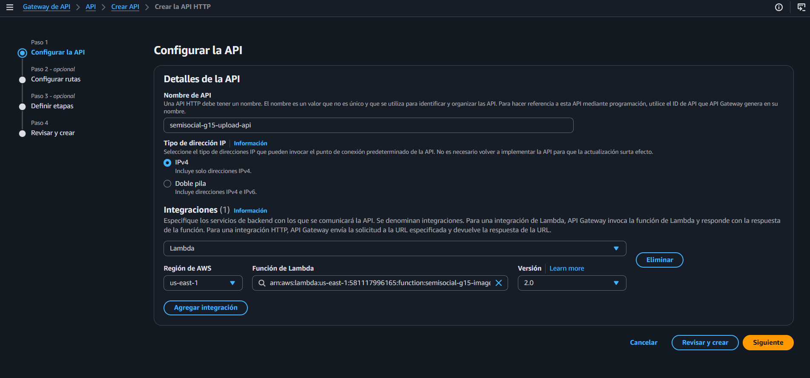
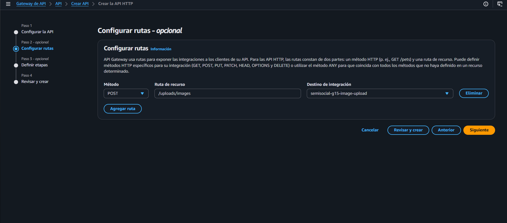
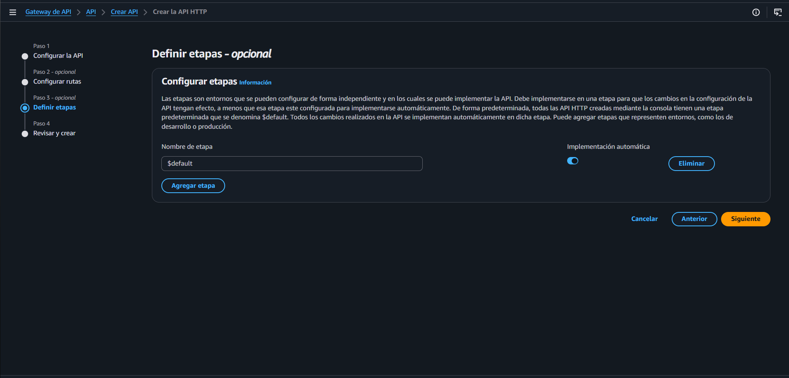
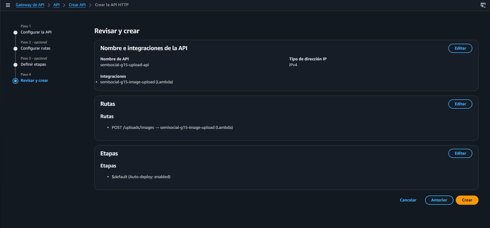
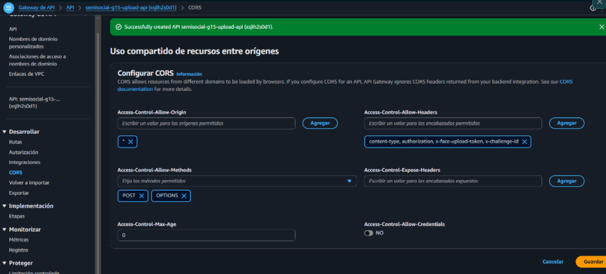
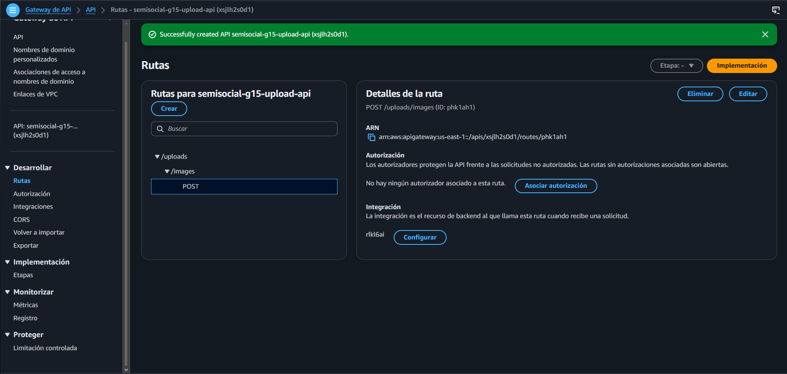

# Evidencia — Despliegue de API Gateway para Carga de Imágenes (PRO-11)

**Ticket:** PRO-11 — Implementar carga de imágenes con API Gateway y Lambda  
**Fase:** 2 — Multimedia  
**Fecha:** 15 de octubre de 2026  
**Región AWS:** `us-east-1`  

---

## 1. Resumen de la Configuración en AWS API Gateway

Se aprovisionó exitosamente un **HTTP API (API Gateway v2)** configurado para actuar como proxy seguro entre las aplicaciones cliente (Frontend React / Postman) y la función AWS Lambda encargada del procesamiento y almacenamiento en Amazon S3.

### Ficha Técnica de la API
* **Nombre de la API:** `semisocial-g15-upload-api`
* **API ID:** `xsjlh2s0d1`
* **Tipo de API:** HTTP API (API Gateway v2)
* **Protocolo:** HTTP/HTTPS (IPv4)
* **Región:** `us-east-1`
* **URL de Invocación Base (Invoke URL):**  
  `https://xsjlh2s0d1.execute-api.us-east-1.amazonaws.com`
* **Endpoint de Carga de Imágenes:**  
  `https://xsjlh2s0d1.execute-api.us-east-1.amazonaws.com/uploads/images`

---

## 2. Enrutamiento e Integración con Lambda

| Parámetro | Configuración |
|---|---|
| **Método HTTP** | `POST` |
| **Ruta de Recurso** | `/uploads/images` |
| **Destino de Integración** | Función Lambda `semisocial-g15-image-upload` |
| **Versión del Formato de Payload** | `2.0` (Lambda Proxy v2) |
| **Etapa de Despliegue (Stage)** | `$default` |
| **Implementación Automática (Auto-Deploy)** | Activada (`enabled`) |

---

## 3. Configuración de CORS (Cross-Origin Resource Sharing)

Para permitir que el frontend web (React) y herramientas de desarrollo invoquen el endpoint sin bloqueos de navegador:

* **Access-Control-Allow-Origin:** `*`
* **Access-Control-Allow-Methods:** `POST`, `OPTIONS`
* **Access-Control-Allow-Headers:**  
  `content-type, authorization, x-face-upload-token, x-challenge-id`
* **Access-Control-Max-Age:** `0`
* **Access-Control-Allow-Credentials:** `false`

---

## 4. Registro Fotográfico de Evidencias

### Paso 1: Configurar la API e Integración con Lambda
Configuración de la API HTTP `semisocial-g15-upload-api` e integración con la Lambda `semisocial-g15-image-upload` (Payload format 2.0).

---

### Paso 2: Configuración de Rutas
Definición de la ruta `POST /uploads/images` conectada al destino `semisocial-g15-image-upload`.

---

### Paso 3: Configuración de Etapas
Configuración de la etapa `$default` con auto-despliegue habilitado para reflejar cambios automáticamente.

---

### Paso 4: Revisión y Creación
Resumen previo a la creación del recurso en la consola de AWS API Gateway.

---

### Paso 5: Configuración de CORS
Definición de orígenes (`*`), métodos (`POST, OPTIONS`) y cabeceras permitidas (`content-type, authorization, x-face-upload-token, x-challenge-id`).

---

### Paso 6: Verificación y Guardado
Confirmación del guardado de CORS y obtención del ID de API Gateway activo (`xsjlh2s0d1`).

---

## 5. Estado y Handoff
*  API Gateway creado y enrutado a Lambda.
*  CORS habilitado para navegador.
*  Endpoint activo y listo para ser consumido por el frontend y backend.

## 6. E2E real autorizado — 25 de octubre de 2026

Se ejecutó el endpoint público con una solicitud `multipart/form-data` estándar
desde la cuenta autorizada, usando la imagen entregada para la prueba. La
contraseña, el JWT, el correo y la clave completa de S3 no se guardaron en la
documentación.

| Caso | Resultado |
| --- | --- |
| `POST /uploads/images` con `purpose=profile` y JPEG | **201 Created** |
| Escritura en el bucket/prefijo de perfil | **PASS**; objeto creado y verificado con `ListObjectsV2` |
| `POST /api/v1/me/complete-profile` con la referencia del objeto | **200**; `profileComplete=true` |
| Lectura posterior de `/me` | **200**; perfil completo persistido |

La primera variante de cliente no produjo un multipart compatible con el
parser de la Lambda y devolvió `400 VALIDATION_ERROR`; se repitió con el
formato multipart estándar y la prueba final fue exitosa. El objeto de prueba
se conserva para permitir la repetición del E2E, sin incrustar la fotografía en
este repositorio.
