# Balanceo de carga y entrada pública del API

**Proyecto:** SemiSocial · Proyecto final · Grupo 15  
**Ticket:** PRO-25 — Validar failover de EC2 mediante el ALB  
**Fecha de implementación:** 22 de octubre de 2026

**Última validación:** 25 de octubre de 2026

**Estado:** infraestructura, distribución y failover verificados

## 1. Objetivo

Publicar los backends de SemiSocial mediante un Application Load Balancer
(ALB), centralizar sus comprobaciones de salud, retirar el acceso público
directo al puerto de aplicación y exponer el API con HTTPS mediante una
distribución CloudFront independiente de la SPA.

La separación entre la distribución web y la distribución del API evita que
las respuestas de React Router conviertan errores HTTP del backend en
`index.html`. Así, el frontend conserva los códigos y cuerpos JSON reales.

## 2. Arquitectura implementada

```text
Navegador
   │ HTTPS / WSS
   ▼
CloudFront API · dxfjcvf5o1pes.cloudfront.net
   │ HTTP :80
   ▼
Application Load Balancer · semisocial-g15-alb
   │ HTTP :3000
   ▼
Target group · semisocial-g15-api-tg
   ├── EC2 Node.js · i-05479ce4e0fa5b060
   └── EC2 Python  · i-0a3c4a8b108539d35
          │
          ▼
     Amazon RDS PostgreSQL
```

CloudFront termina HTTPS y reenvía solicitudes sin caché hacia el ALB. El ALB
solo envía tráfico a targets que superan `GET /health`. Ambos backends utilizan
la misma base de datos para que la persistencia no dependa de la instancia.

## 3. Inventario definitivo

| Recurso | Identificador o valor | Estado verificado |
|---|---|---|
| Cuenta AWS | `581117996165` | Activa |
| Región | `us-east-1` | Activa |
| VPC | `vpc-07d71aba0ec5b2213` | Asociada |
| SG del ALB | `sg-02bfdb21497a1a4f2` | Configurado |
| SG de backends | `sg-07d69b7d9901d499c` | Configurado |
| EC2 Node.js | `i-05479ce4e0fa5b060` | `healthy` |
| EC2 Python | `i-0a3c4a8b108539d35` | `healthy` |
| Target group | `semisocial-g15-api-tg` | Activo |
| ALB | `semisocial-g15-alb` | Activo |
| DNS del ALB | `semisocial-g15-alb-327553020.us-east-1.elb.amazonaws.com` | Responde HTTP |
| CloudFront API | `E3BPWGBX2XJ1C` | `Deployed` y habilitada |
| Dominio HTTPS del API | `dxfjcvf5o1pes.cloudfront.net` | Responde HTTPS |

## 4. Target group y comprobaciones de salud

El target group se creó para instancias sobre HTTP/1.1 y puerto 3000. La ruta
`/health` determina qué backend puede recibir tráfico.

| Parámetro | Configuración |
|---|---|
| Tipo de target | Instances |
| Protocolo y puerto | HTTP :3000 |
| Ruta de salud | `/health` |
| Puerto de salud | Traffic port |
| Código esperado | `200` |
| Umbrales healthy / unhealthy | 2 / 2 |
| Timeout / intervalo | 5 s / 10 s |
| Deregistration delay | 30 s |
| Algoritmo | Round robin |
| Stickiness | Desactivada |

Las dos instancias están registradas y la validación del 25/10/2026 confirmó
ambas como `healthy` sobre el puerto 3000. La consulta reproducible y su salida
se conservan en
[`runtime-validation-2026-10-25.md`](runtime-validation-2026-10-25.md).

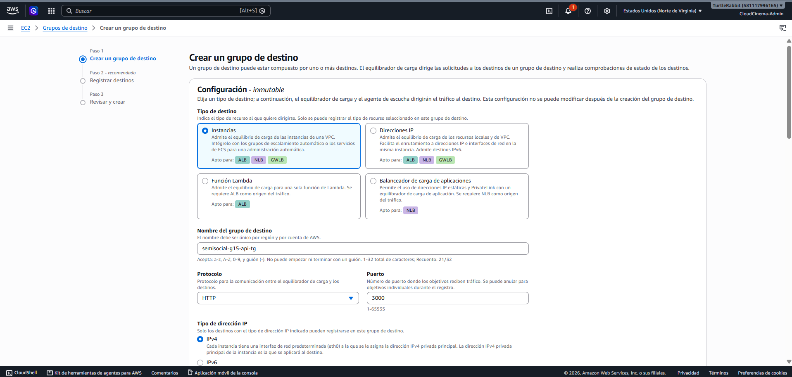

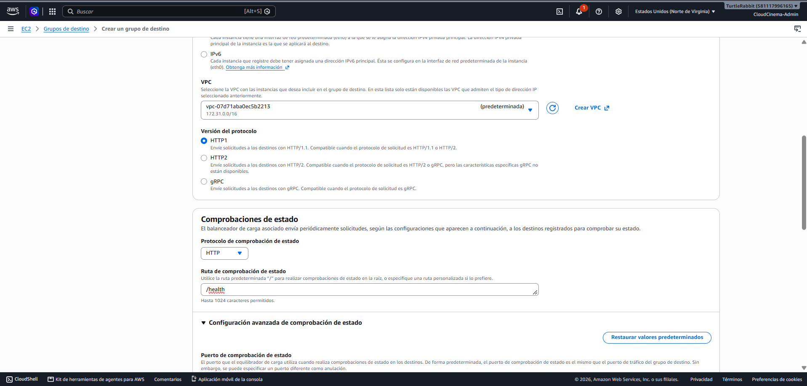

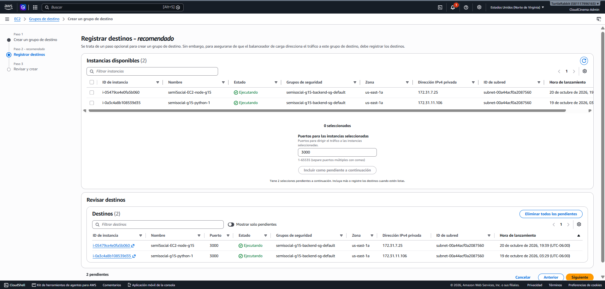

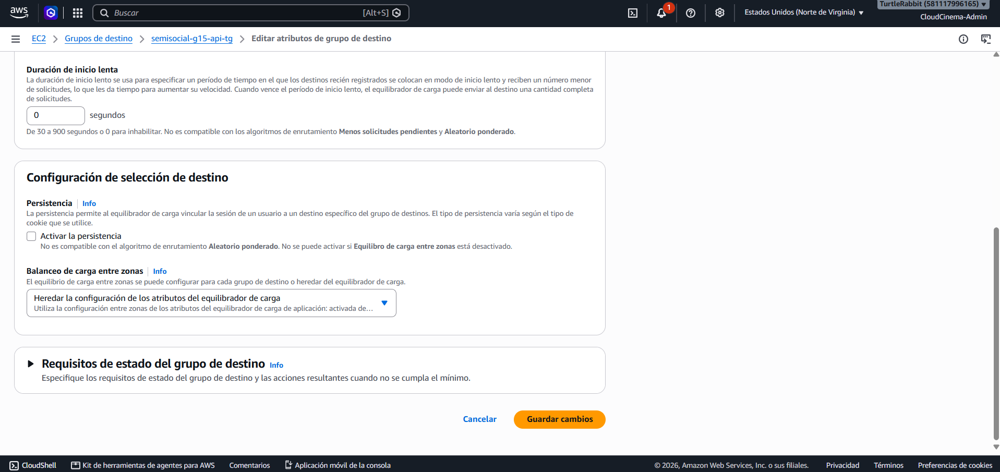

## 5. Application Load Balancer

El ALB se desplegó como `internet-facing`, IPv4, en dos subredes públicas de la
VPC del proyecto.

| Campo | Valor |
|---|---|
| Nombre | `semisocial-g15-alb` |
| VPC | `vpc-07d71aba0ec5b2213` |
| Subred us-east-1a | `subnet-00a44acf0a2087560` |
| Subred us-east-1b | `subnet-061594793c9d5e5d7` |
| Listener | HTTP :80 |
| Acción | Forward a `semisocial-g15-api-tg` |
| Security group | `sg-02bfdb21497a1a4f2` |
| Idle timeout | 300 segundos |
| Deletion protection | Desactivada |
| Desync mitigation | Defensive |

El tiempo de espera de 300 segundos evita cerrar prematuramente conexiones
WebSocket. No se configuró afinidad porque el estado persistente se comparte en
RDS y el contexto de servicios administrados permanece fuera de la EC2.

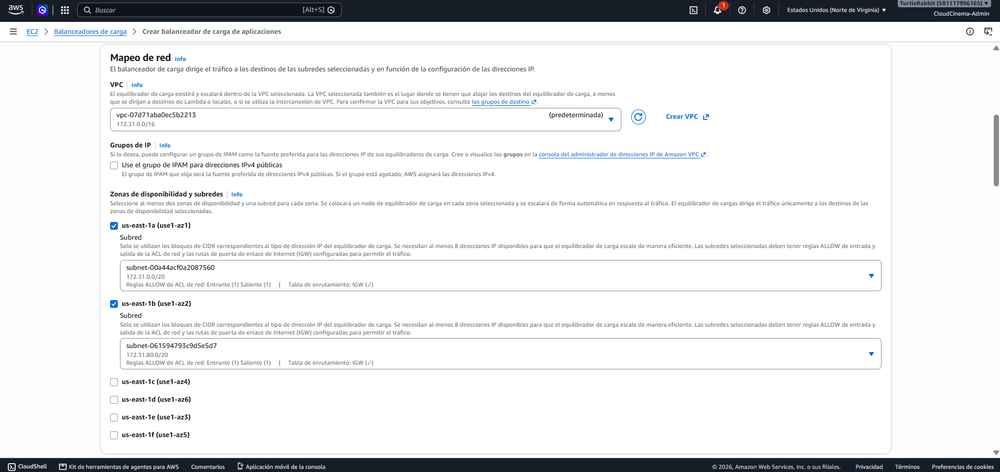

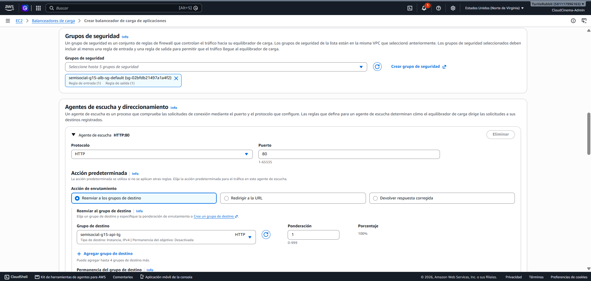

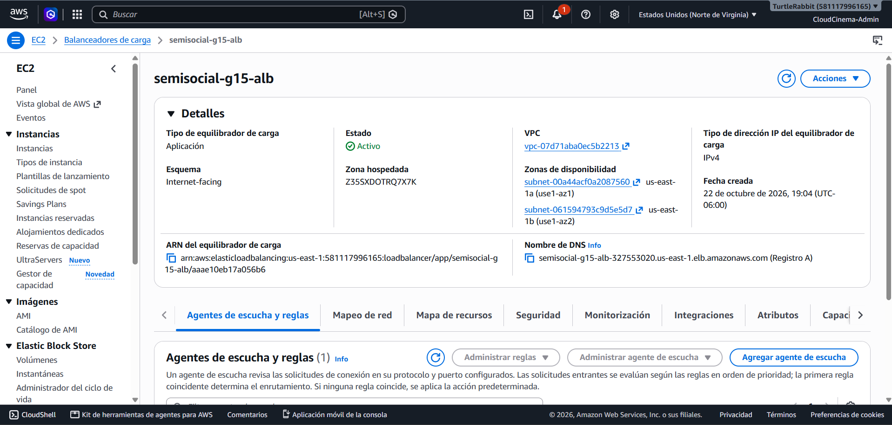

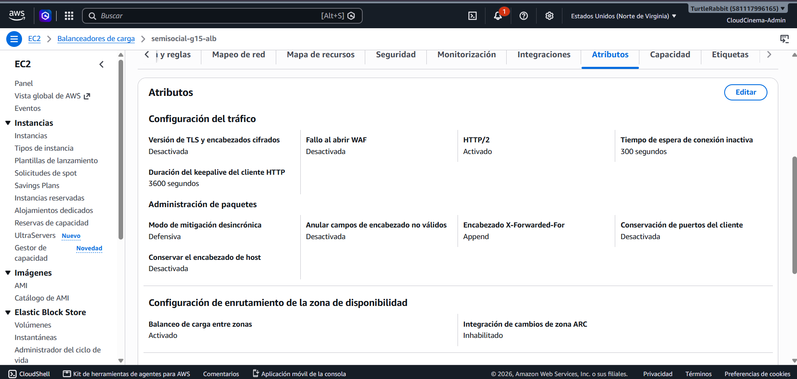

## 6. CloudFront exclusivo para el API

Se creó la distribución `semisocial-api-g15` con el ALB como origen. No se
reutilizó la distribución de la SPA y no se habilitó WAF para evitar costos
adicionales no requeridos por el proyecto.

| Campo | Valor |
|---|---|
| Distribution ID | `E3BPWGBX2XJ1C` |
| Dominio | `dxfjcvf5o1pes.cloudfront.net` |
| Origen | DNS de `semisocial-g15-alb` |
| Protocolo al origen | HTTP only, puerto 80 |
| Viewer protocol policy | Redirect HTTP to HTTPS |
| Métodos | GET, HEAD, OPTIONS, PUT, POST, PATCH, DELETE |
| Cache policy | `CachingDisabled` |
| Origin request policy | `AllViewerExceptHostHeader` |
| Origin Shield | Desactivado |
| WAF | No configurado |
| Logging | Desactivado |

`AllViewerExceptHostHeader` reenvía autorización, cookies y query strings sin
enviar al ALB el `Host` de CloudFront. La política sin caché evita respuestas
obsoletas o el intercambio accidental de respuestas autenticadas.

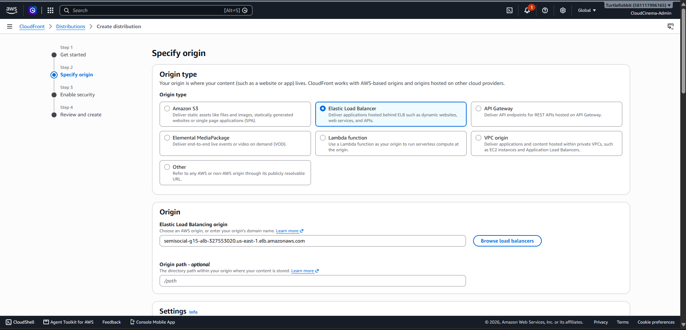

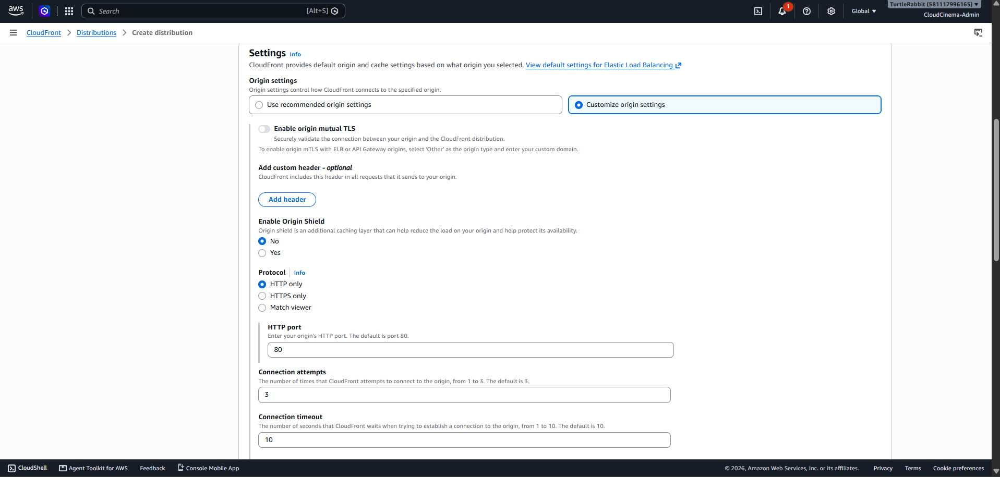

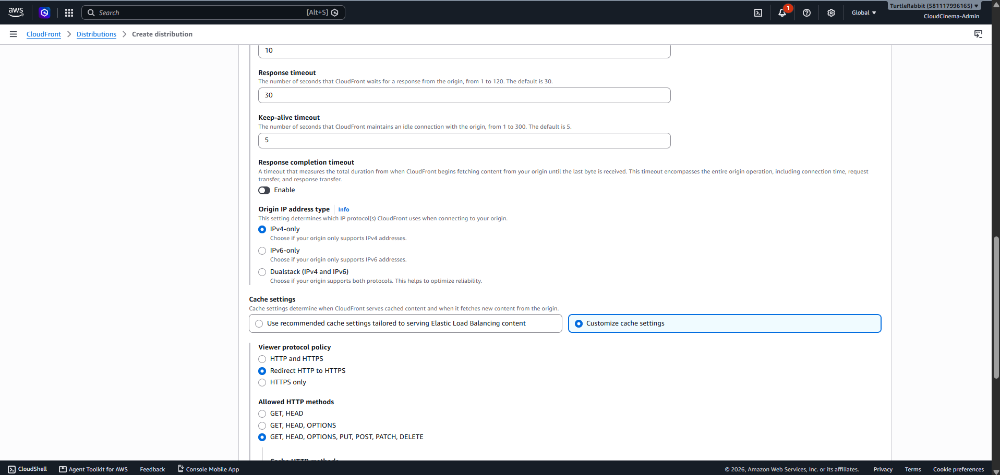

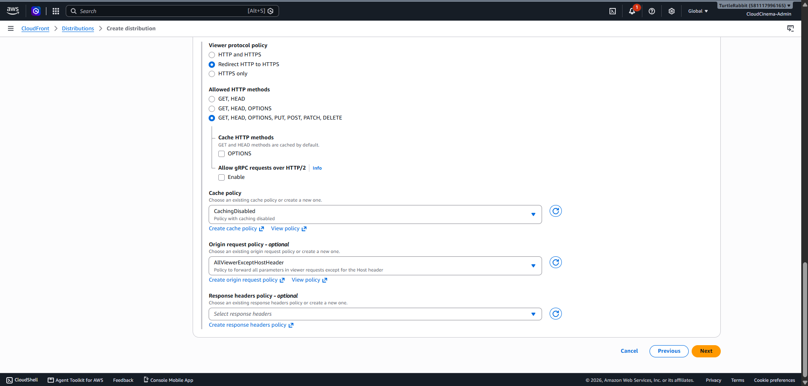

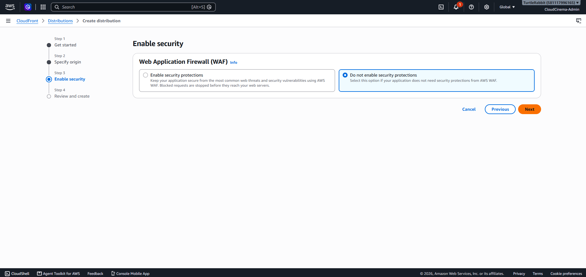

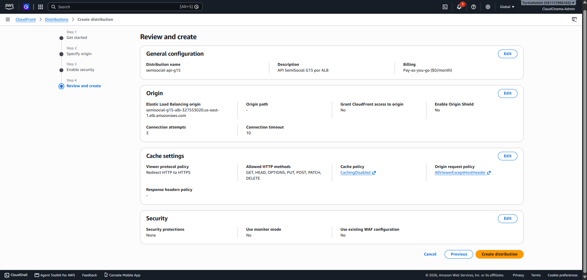

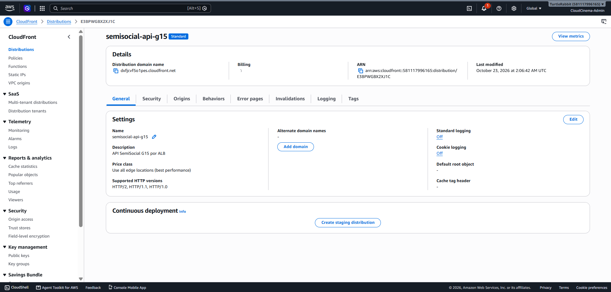

## 7. Seguridad de red

La exposición directa de las EC2 se retiró después de comprobar la ruta por el
ALB y CloudFront:

- el SG de backends permite TCP 3000 únicamente desde
  `sg-02bfdb21497a1a4f2`;
- ya no existe una regla `3000` desde `0.0.0.0/0`;
- el SG del ALB permite HTTP 80 únicamente desde la prefix list administrada
  `pl-3b927c52`, correspondiente a los orígenes de CloudFront;
- RDS, secretos, tokens y puertos administrativos no se exponen públicamente.

Así, el tráfico web debe seguir CloudFront → ALB → EC2 y no puede alcanzar el
servicio mediante la IP pública de una instancia.

## 8. Validaciones ejecutadas

### 8.1 Respuesta directa del ALB

`GET /health` mediante el DNS del ALB devolvió HTTP 200:

```json
{
  "status": "ok",
  "service": "node",
  "version": "1.0.0"
}
```

Una ruta inexistente devolvió HTTP 404 con el contrato JSON del backend, no
HTML de la SPA.

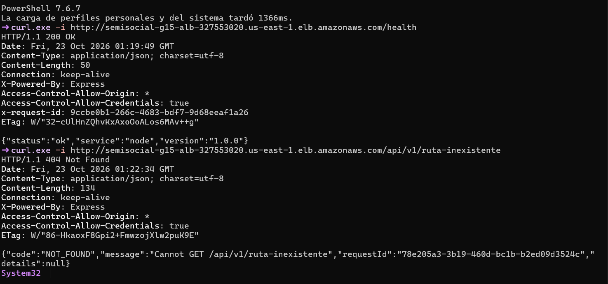

### 8.2 Respuesta HTTPS mediante CloudFront

Se repitieron ambas solicitudes contra la distribución pública:

```text
GET https://dxfjcvf5o1pes.cloudfront.net/health
→ HTTP 200
→ {"status":"ok","service":"node","version":"1.0.0"}

GET https://dxfjcvf5o1pes.cloudfront.net/api/v1/ruta-inexistente
→ HTTP 404
→ Content-Type: application/json
→ code: NOT_FOUND
```

Esto confirma que HTTPS llega al backend, el API no se almacena en caché y los
errores conservan su estado y representación JSON.

### 8.3 Matriz de resultados

| Caso | Resultado |
|---|---|
| Node mediante health check | Aprobado · `healthy` |
| Python mediante health check | Aprobado · `healthy` |
| Distribución entre runtimes | Aprobado · 12/12 HTTP 200, 6 Node y 6 Python |
| Health mediante ALB | Aprobado · HTTP 200 |
| Error del API mediante ALB | Aprobado · HTTP 404 JSON |
| Health mediante CloudFront | Aprobado · HTTPS 200 |
| Error del API mediante CloudFront | Aprobado · HTTPS 404 JSON |
| Caché desactivada para el API | Aprobado |
| Puerto 3000 cerrado al público | Aprobado |
| ALB restringido a CloudFront | Aprobado |
| Compatibilidad del transporte WSS | Configurada |
| Ruta protegida `/api/v1/me` sin token | Aprobado · 6/6 HTTP 401 con esquema común |
| Failover Node → Python | Aprobado · 12/12 HTTP 200 después de convergencia |
| Failover Python → Node | Aprobado · un 504 transitorio y luego 12/12 HTTP 200 |
| Recuperación final | Aprobado · 2/2 targets `healthy` |

## 9. Distribución y failover

La validación vigente ejecutó 12 solicitudes independientes contra
`https://dxfjcvf5o1pes.cloudfront.net/health`: seis respondieron como Node y
seis como Python, todas con HTTP 200.

Durante la prueba coordinada de failover se retiró cada runtime por separado:

- con Node detenido, Python sostuvo 12/12 respuestas HTTP 200 después de la
  convergencia;
- al restaurar Node se corrigió el servicio systemd para ejecutar el artefacto
  real `dist/src/main.js` y el target recuperó el estado healthy;
- con Python detenido se observó un 504 transitorio durante la convergencia y,
  a continuación, Node sostuvo 12/12 respuestas HTTP 200;
- Python fue restaurado y una consulta posterior confirmó 2/2 targets healthy.

El 504 no se ocultó: corresponde al intervalo en que el balanceador retiraba el
target y debe considerarse en la experiencia cliente mediante reintentos
seguros. La evidencia textual reproducible está en
[`runtime-validation-2026-10-25.md`](runtime-validation-2026-10-25.md).

También se enviaron seis solicitudes sin token a `GET /api/v1/me`. Todas
respondieron HTTP 401 con `code`, `message`, `requestId` y `details`. El texto
humano del mensaje varía entre Node y Python, aunque el estado y el esquema son
equivalentes; la paridad funcional completa de los módulos se cubre en PRO-26.

## 10. Resultado

El ALB, target group, CloudFront y los security groups quedaron desplegados y
verificados. El frontend dispone de un único origen HTTPS para el API y las EC2
no exponen directamente el puerto 3000. Los dos runtimes están healthy, reciben
tráfico y recuperaron el servicio después de retirar cada instancia por
separado. PRO-25 demuestra el balanceo y failover de infraestructura; la matriz
E2E completa y las diferencias contractuales de negocio corresponden a PRO-26
y a los tickets de cada backend.
