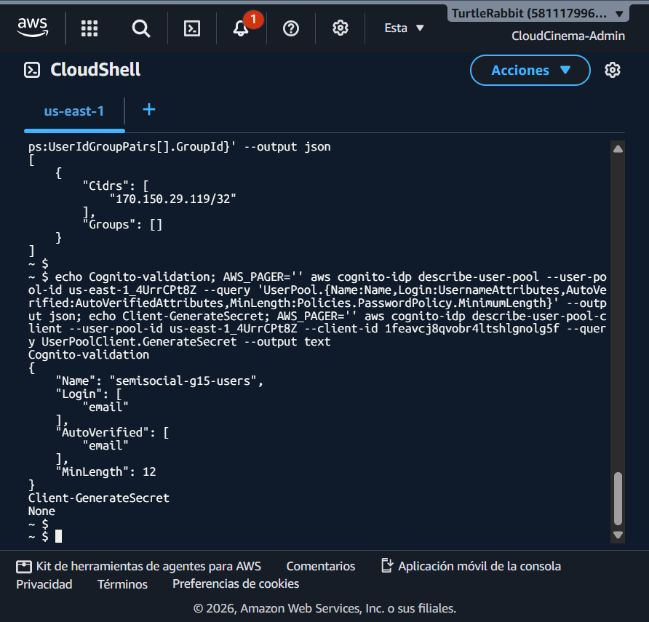
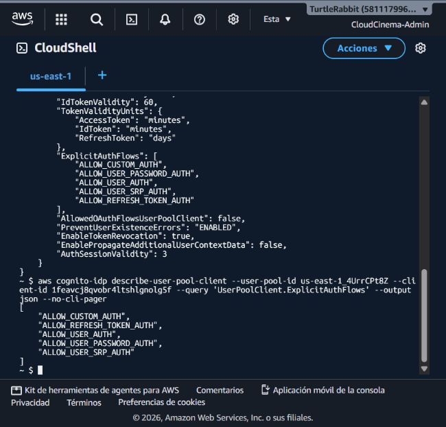

# Evidencia de Cognito (PRO-5)

El recurso se creó en `us-east-1` con la configuración equivalente a
`infra/cognito/user-pool.yaml`. No se guardan contraseñas, códigos, tokens ni
secretos en este reporte.

## Estado

**Estado actual:** validación E2E real aprobada para recuperación, login y
emisión/validación de credenciales contra el API público. No se registran en
este reporte contraseñas, códigos, tokens, correos completos ni datos
biométricos.

- Método: consola de Cognito (pool y cliente públicos)
- User Pool: `semisocial-g15-users`
- User Pool ID: `us-east-1_4UrrCPt8Z`
- App Client: `semisocial-g15-web`
- App Client ID: `1feavcj8qvobr4ltshlgnolg5f`
- Región: `us-east-1`
- Emisor: `https://cognito-idp.us-east-1.amazonaws.com/us-east-1_4UrrCPt8Z`
- JWKS: `https://cognito-idp.us-east-1.amazonaws.com/us-east-1_4UrrCPt8Z/.well-known/jwks.json`

## Validaciones observadas en la consola

- Cliente público sin secreto embebido (`GenerateSecret: false`).
- Inicio de sesión por correo y verificación asistida por Cognito.
- Política personalizada: mínimo de 12 caracteres, número, mayúscula,
  minúscula y símbolo; contraseña temporal válida por 7 días.
- Atributo personalizado `custom:dpi`, tipo String, longitud fija de 13 y
  mutable. `name` se conserva como atributo estándar de Cognito.
- Plan de características Básico.
- No se configuraron SES, proveedores sociales, MFA, WAF, replicación regional,
  ni identidades federadas.

La configuración del pool, cliente, atributos y región fue revisada nuevamente
en la consola y mediante AWS CLI en CloudShell el 15 y el 19 de octubre de 2026. La
consulta `describe-user-pool` confirmó la política de 12 caracteres, los cuatro
requisitos de complejidad, login por `email` y verificación automática por
correo; `describe-user-pool-client` devolvió `GenerateSecret: None`, equivalente
a `false` para un cliente público. No se creó un usuario de prueba ni se envió
correo adicional; la prueba de bandeja queda pendiente de un correo autorizado.

### Comparación del cliente activo con la plantilla

La consulta del 19 de octubre confirmó que el cliente activo
`semisocial-g15-web` mantiene `GenerateSecret: None`, `PreventUserExistenceErrors:
ENABLED` y los flujos de contraseña, SRP y refresh. Con autorización del equipo,
se actualizó el cliente para incluir también `ALLOW_CUSTOM_AUTH`, conservando
los cinco flujos existentes. La verificación posterior devolvió:
`ALLOW_CUSTOM_AUTH`, `ALLOW_REFRESH_TOKEN_AUTH`, `ALLOW_USER_AUTH`,
`ALLOW_USER_PASSWORD_AUTH` y `ALLOW_USER_SRP_AUTH`. No se crearon usuarios ni
se enviaron correos; falta probar los triggers contra una bandeja autorizada.

También se observó que `custom:dpi` está creado como atributo mutable de 13
caracteres y no obligatorio en el pool existente; la plantilla lo declara
obligatorio. Esta diferencia queda registrada para que el equipo decida si se
conserva compatibilidad con usuarios existentes o se aplica en una migración
controlada. No se puede cambiar retroactivamente la obligatoriedad de un
atributo Cognito ya creado.

Comandos reproducibles (sin secretos ni tokens):

```bash
AWS_PAGER='' aws cognito-idp describe-user-pool \
  --user-pool-id us-east-1_4UrrCPt8Z \
  --query 'UserPool.{Policies:Policies,UsernameAttributes:UsernameAttributes,AutoVerifiedAttributes:AutoVerifiedAttributes}' \
  --output json

AWS_PAGER='' aws cognito-idp describe-user-pool-client \
  --user-pool-id us-east-1_4UrrCPt8Z \
  --client-id 1feavcj8qvobr4ltshlgnolg5f \
  --query UserPoolClient.GenerateSecret --output text

AWS_PAGER='' aws cognito-idp update-user-pool-client \
  --user-pool-id us-east-1_4UrrCPt8Z \
  --client-id 1feavcj8qvobr4ltshlgnolg5f \
  --explicit-auth-flows ALLOW_REFRESH_TOKEN_AUTH ALLOW_USER_AUTH \
    ALLOW_USER_PASSWORD_AUTH ALLOW_USER_SRP_AUTH ALLOW_CUSTOM_AUTH
```

## Casos de evidencia pendientes de integración

El 18 de octubre de 2026 se ejecutó localmente
`infra/cognito/validate-template.ps1`. La validación pasó para login por
correo, verificación, `custom:dpi`, cliente público sin secreto, flujos de
contraseña/SRP/custom/refresh y outputs de issuer/JWKS. El preflight no ejecuta
CloudFormation ni crea recursos; la revisión de consola y la integración con
las APIs siguen siendo la evidencia del despliegue real.

1. Registro con correo de prueba, confirmación con código y login exitoso.
2. Login con cuenta no confirmada rechazado.
3. Recuperación de contraseña y rechazo de contraseña que no cumple la
   política.
4. JWT validado por issuer/JWKS, ocultando el valor completo del token.

La lista anterior conserva los casos históricos que no forman parte de esta
ejecución; los casos E2E autorizados de recuperación, login y rutas protegidas
se documentan abajo.

La vista de la validación CLI inicial quedó guardada localmente y se incluye en
este manual. Después de habilitar CUSTOM_AUTH se guardó una captura nueva con
la respuesta real del cliente activo:





## Usuario de prueba y correo de confirmación — 19/10/2026

Se registró `ipatzantzic@gmail.com` con el cliente público activo. Cognito
respondió `UserConfirmed=false` y `CodeDeliveryDetails.DeliveryMedium=EMAIL`;
el código se recibió en la bandeja autorizada y la cuenta quedó `CONFIRMED`.
Finalmente, `InitiateAuth` con `USER_PASSWORD_AUTH` devolvió un resultado
Bearer con expiración de 3600 segundos. No se imprimieron ni guardaron tokens,
el código ni la contraseña en el repositorio.

La evidencia textual anterior es reproducible con los dos comandos descritos.

## E2E real autorizado: recuperación, API protegida y perfil — 25/10/2026

Se reutilizó la cuenta autorizada del propietario del repositorio y la bandeja
de entrada ya autenticada únicamente para recibir el código de recuperación de
Cognito. El código, la contraseña temporal y el JWT se usaron en memoria y no
se copiaron al repositorio, a Linear ni a este reporte.

Resultados observados contra `https://dxfjcvf5o1pes.cloudfront.net/api/v1`:

| Caso | Resultado |
| --- | --- |
| Recuperación de contraseña y confirmación | **PASS**; usuario quedó `CONFIRMED` |
| `POST /auth/login` | **200** |
| `GET /me` sin credencial | **401 UNAUTHENTICATED** |
| `GET /me` con Bearer inválido | **401 UNAUTHENTICATED** |
| `GET /me` con Bearer válido | **200** |
| `GET /posts` sin credencial | **401 UNAUTHENTICATED** |
| `GET /posts` con Bearer válido | **200**, feed vacío válido |

Durante la primera llamada autenticada se detectó que el usuario ya existía en
Cognito pero no tenía fila equivalente en RDS. Se aplicó una reconciliación
puntual usando el `sub` de Cognito, sin registrar la contraseña ni el token.
Después de esa corrección, `/me`, `complete-profile`, `PATCH /me` y la lectura
posterior confirmaron la persistencia autenticada.

## Handoff

Las APIs reciben `COGNITO_USER_POOL_ID`, `COGNITO_APP_CLIENT_ID`,
`COGNITO_ISSUER` y `COGNITO_JWKS_URI` como variables de entorno. Usan `sub`
para enlazar `users.cognito_sub`; no generan JWT propios ni consultan una
contraseña en RDS. La foto obligatoria y `profileComplete` se coordinan con
PRO-11, y el login facial futuro reutiliza este mismo pool en PRO-31.
