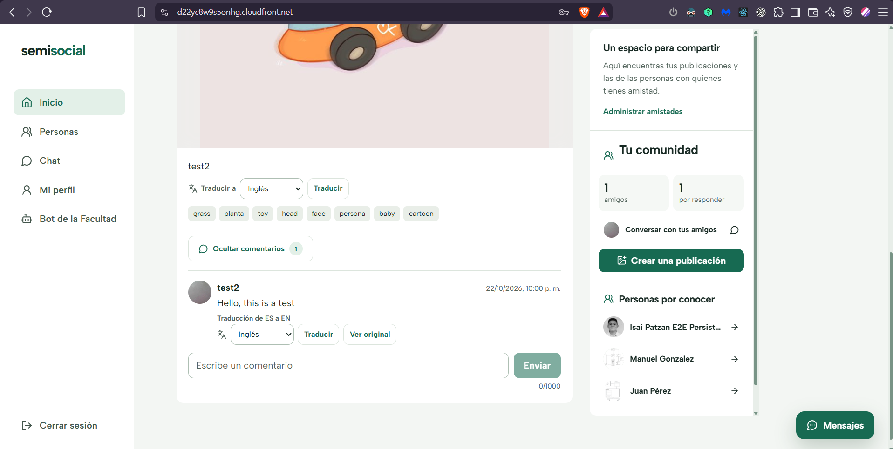
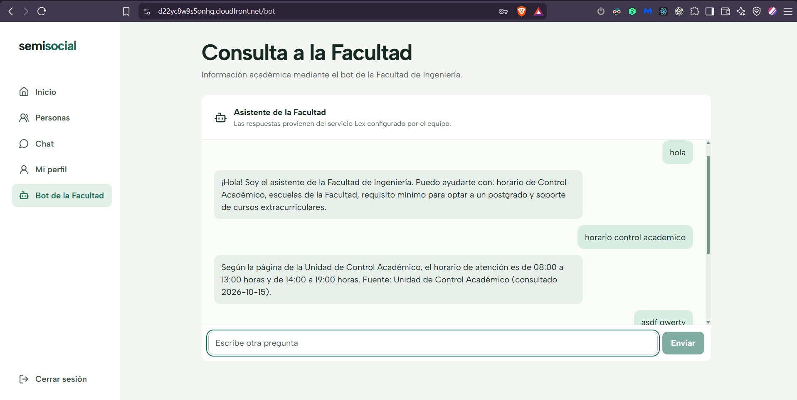

# Evidencias - Traducción y asistente de la Facultad

Este documento describe la integración del frontend de SemiSocial con Amazon
Translate y Amazon Lex V2. Ambas funciones se consumen mediante la API
publicada detrás de CloudFront y el Application Load Balancer; el navegador no
recibe credenciales de AWS ni invoca directamente sus SDK.

## 1. Alcance de la integración

La interfaz incorpora dos funciones de lectura asistida:

1. Traducir descripciones y comentarios a español, inglés, francés o alemán.
2. Conversar con el asistente de la Facultad de Ingeniería mediante una sesión
   continua de Amazon Lex.

| Componente | Ruta consumida | Servicio administrado |
|---|---|---|
| Traducción | `POST /api/v1/translations` | Amazon Translate |
| Asistente | `POST /api/v1/bot/messages` | Amazon Lex V2 |

Las solicitudes utilizan el token de la sesión de Cognito y el cliente HTTP
compartido del frontend. El flujo externo es navegador → CloudFront → ALB →
backend saludable → servicio administrado de AWS.

## 2. Traducción de publicaciones y comentarios

Cada publicación y comentario presenta un selector con los destinos `es`,
`en`, `fr` y `de`. Al seleccionar **Traducir**, la interfaz mantiene visible el
contenido hasta recibir la respuesta y muestra el idioma detectado y el
destino. **Ver original** restaura inmediatamente el texto publicado.

La traducción es solo de lectura: no actualiza la descripción, el comentario
ni ningún registro en RDS. Al cambiar de idioma se descarta únicamente el
resultado anterior y se conserva el original para permitir una nueva
solicitud.

Los errores de autorización, validación, límite de solicitudes o
indisponibilidad se presentan dentro del mismo control. Un fallo nunca
reemplaza ni elimina el contenido original.

La siguiente captura muestra el comentario original antes de solicitar la
traducción:

Después de traducir a inglés, la interfaz identifica el cambio de `ES` a `EN`
y mantiene disponible la acción **Ver original**:

## 3. Asistente de la Facultad

La pantalla **Asistente** permite elegir una consulta sugerida o escribir un
mensaje de hasta 500 caracteres. El frontend envía un `sessionId` opaco y
reutiliza el valor devuelto por la API, de modo que Lex conserva el contexto
entre mensajes.

El historial se almacena en `sessionStorage`: permanece al navegar por la
aplicación o recargar la misma pestaña, pero no se guarda permanentemente ni se
comparte con otras pestañas. La acción **Nueva conversación** elimina el
historial y genera otro identificador de sesión.

Mientras existe una solicitud en curso se muestra un indicador de espera y se
impide el envío duplicado. Las respuestas de fallback se muestran como mensajes
normales del asistente para orientar a la persona sin simular una respuesta que
Lex no conoce.

La conversación desplegada muestra el saludo y la consulta de horario resueltos
por Lex, además de la entrada utilizada para verificar el fallback:

## 4. Configuración real verificada

| Dato | Valor |
|---|---|
| Región | `us-east-1` |
| Bot ID | `HEE55FCSTB` |
| Alias | `prod` (`Y1CGMUEYYK`) |
| Versión del alias | `3` |
| Estado del alias | `Available` |
| Locale | `es_419` |
| API pública | `https://dxfjcvf5o1pes.cloudfront.net` |
| Frontend | `https://d22yc8w9s5onhg.cloudfront.net` |

Amazon Translate fue habilitado en la cuenta y se comprobó primero mediante
`TranslateText`. La entrada `Hola, esta es una prueba de SemiSocial.` produjo
`Hello, this is a SemiSocial test.` con origen `es` y destino `en`.

## 5. Pruebas reales por el ALB

Las siguientes verificaciones se realizaron el 26 de octubre de 2026 desde el
frontend desplegado. Los registros de las EC2 confirman que el ALB distribuyó
las solicitudes entre las implementaciones Node.js y Python.

### 5.1 Amazon Translate

| Backend | Solicitud observada | Estado | Duración |
|---|---|---:|---:|
| Node.js | Traducción a inglés | `200` | 250 ms |
| Node.js | Traducción a alemán | `200` | 281 ms |
| Python | Traducción desde el frontend | `200` | 227 ms |
| Python | Traducción desde el frontend | `200` | 261 ms |
| Python | Traducción desde el frontend | `200` | 285 ms |

Esto verifica la ruta pública, la autenticación, la salida desde ambas EC2 y
la compatibilidad del contrato usado por el frontend.

### 5.2 Amazon Lex V2

Se enviaron desde la interfaz `hola`, `horario control academico` y una entrada
no reconocida. Las solicitudes conservaron el mismo `sessionId` y obtuvieron
respuesta satisfactoria:

| Backend | Evidencia del registro | Estado | Duración |
|---|---|---:|---:|
| Node.js | Request ID `3a0e7144-d85e-4c45-b279-2dbbcea7eeae` | `200` | 204 ms |
| Python | Request ID `c6e1fad3-b7fc-4f65-a8bf-4cf3ad4f41a3` | `200` | 289 ms |
| Python | Request ID `df575ba2-fcf4-43bf-aef6-4aa31c4ca388` | `200` | 2538 ms |

Una validación adicional contra el alias `prod` confirmó los intents:

| Entrada | Intent | Estado |
|---|---|---|
| `hola` | `Saludo` | `Fulfilled` |
| `horario control academico` | `HorarioControlAcademico` | `Fulfilled` |
| `asdf qwerty` | `FallbackIntent` | `Fulfilled` |

## 6. Seguridad y manejo de datos

- El frontend no contiene access keys, secret keys ni credenciales de AWS.
- Los servicios se invocan desde roles asociados a las EC2.
- Las rutas requieren autenticación antes de acceder a Translate o Lex.
- El texto original permanece en la publicación o comentario.
- El identificador interno enviado a Lex se deriva en el backend y no expone
  directamente el `sub` de Cognito.
- Los registros usados para esta validación no incluyen tokens.

## 7. Resultado

La traducción funciona para publicaciones y comentarios sin sobrescribir el
contenido original. El asistente mantiene una conversación en la misma sesión,
responde consultas conocidas y utiliza `FallbackIntent` para entradas fuera de
su alcance. Las pruebas reales alcanzaron tanto Node.js como Python detrás del
ALB sin cambiar la experiencia del frontend.
