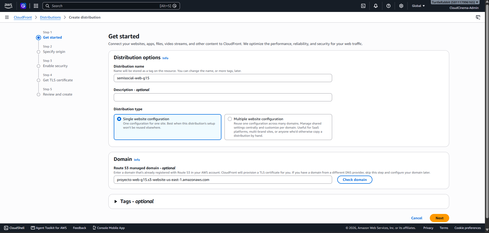
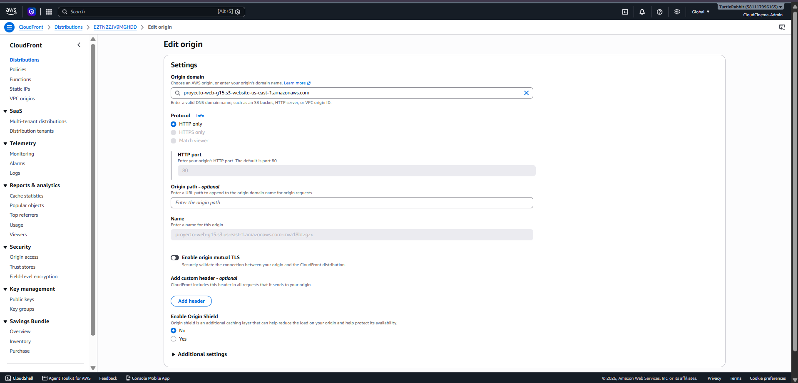
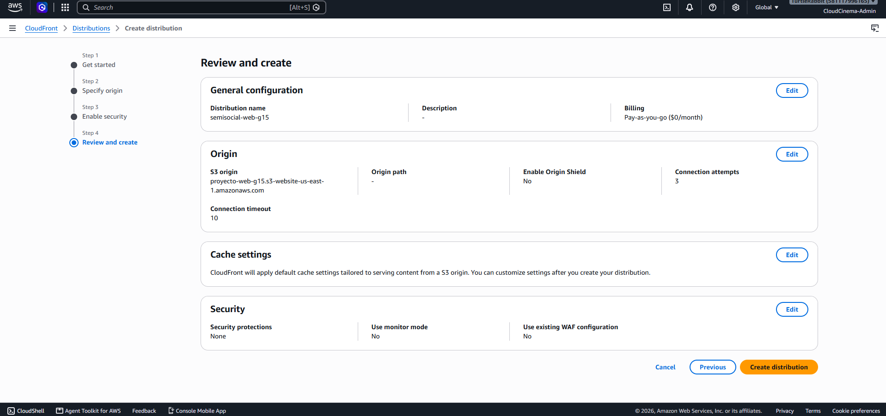
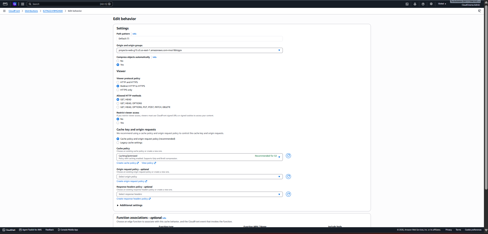
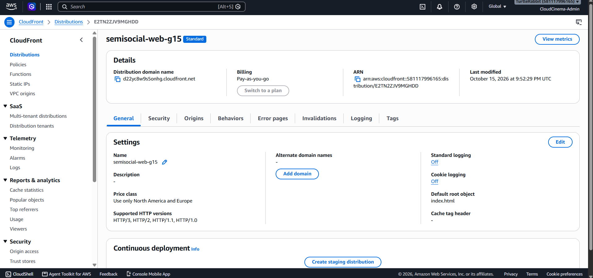
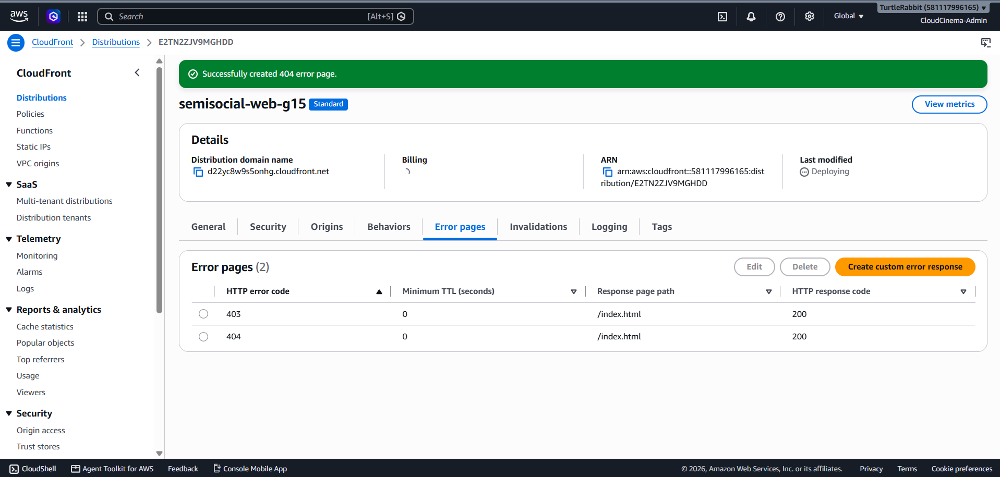

# Distribución HTTPS del frontend con Amazon CloudFront

**Proyecto:** SemiSocial · Proyecto final · Grupo 15
**Ticket:** PRO-24 — Desplegar frontend en S3 con HTTPS funcional
**Fecha de implementación:** 15 de octubre de 2026
**Estado:** implementación y validaciones completadas

## 1. Propósito y alcance

Amazon CloudFront se configuró como punto público de entrada para el frontend
de SemiSocial. La distribución recibe las solicitudes del navegador por HTTPS,
obtiene los archivos desde el website endpoint de S3 y mantiene el contexto
seguro requerido por funcionalidades web como el acceso a cámara.

Esta configuración cubre:

- publicación HTTPS con el certificado predeterminado de CloudFront;
- redirección automática de HTTP a HTTPS;
- caché y compresión de archivos estáticos;
- soporte de accesos directos y refresh en rutas de React Router;
- actualización del frontend mediante invalidaciones;
- configuración sin WAF, Origin Shield ni servicios Edge adicionales.

La distribución documentada entrega únicamente el frontend estático. Los
endpoints de ALB, API Gateway y WebSocket se incorporarán cuando los tickets de
backend e integración publiquen sus valores definitivos.

## 2. Flujo implementado

```text
Navegador
   │
   │ HTTPS
   ▼
CloudFront: d22yc8w9s5onhg.cloudfront.net
   │
   │ HTTP :80
   ▼
S3 website endpoint
proyecto-web-g15.s3-website-us-east-1.amazonaws.com
   │
   └── index.html + assets/
```

CloudFront termina HTTPS frente al usuario. La comunicación con el origen usa
HTTP porque los website endpoints de S3 no admiten HTTPS. Esto no expone al
navegador a contenido inseguro: el usuario consume exclusivamente el dominio
HTTPS de CloudFront.

## 3. Inventario de la distribución

| Dato | Valor | Uso |
|---|---|---|
| Nombre | `semisocial-web-g15` | Identificación de la distribución |
| Distribution ID | `E2TN2ZJV9MGHDD` | Operaciones e invalidaciones mediante CLI |
| Dominio público | `d22yc8w9s5onhg.cloudfront.net` | URL HTTPS del frontend |
| Origen | `proyecto-web-g15.s3-website-us-east-1.amazonaws.com` | Website endpoint de S3 |
| Default root object | `index.html` | Documento solicitado en `/` |
| Price class | `PriceClass_100` | Norteamérica y Europa |
| Certificado | Predeterminado de CloudFront | TLS para `*.cloudfront.net` |

Durante la creación se registró el nombre `semisocial-web-g15` y se mantuvo el
modelo **Pay-as-you-go**, sin contratar un plan adicional.



## 4. Configuración del origen

Se seleccionó el endpoint de alojamiento web y no el endpoint REST del bucket.
El website endpoint permite que S3 entregue la aplicación estática y su
documento de error como sitio web.

| Campo | Valor | Motivo |
|---|---|---|
| Origin domain | `proyecto-web-g15.s3-website-us-east-1.amazonaws.com` | Origen del frontend estático |
| Origin protocol policy | `HTTP only` | El website endpoint no admite HTTPS |
| HTTP port | `80` | Puerto del endpoint web S3 |
| Origin path | Vacío | El build se encuentra en la raíz |
| Mutual TLS | Desactivado | No corresponde a un website endpoint S3 |
| Custom headers | Ninguno | No se necesita información adicional |
| Origin Shield | Desactivado | Evita costo no requerido para el proyecto |

La captura siguiente reúne el dominio final, el protocolo HTTP y el puerto 80.



La consola inicialmente sugirió cambiar del endpoint REST al website endpoint.
Después de aplicar la recomendación, el resumen previo a la creación registró
el dominio correcto y Origin Shield desactivado.



No se configuró OAC ni OAI porque ambos mecanismos corresponden al endpoint
REST privado de S3. En esta arquitectura, el enunciado requiere alojamiento web
estático público con una política limitada a lectura.

## 5. Behavior predeterminado del frontend

El behavior `Default (*)` procesa todas las rutas que no tengan un patrón más
específico. No se creó un behavior nuevo para cada página de React.

| Campo | Valor | Motivo |
|---|---|---|
| Origin | Website endpoint de `proyecto-web-g15` | Entregar el build estático |
| Compress objects automatically | Yes | Reducir transferencia de CSS y JavaScript |
| Viewer protocol policy | Redirect HTTP to HTTPS | Forzar navegación segura |
| Allowed methods | GET, HEAD | El sitio solamente necesita lectura |
| Restrict viewer access | No | El frontend es público y no usa signed URLs |
| Cache policy | `CachingOptimized` | Optimizar assets estáticos versionados |
| Origin request policy | Ninguna | No se requieren datos adicionales del viewer |
| Response headers policy | Ninguna | No forma parte del alcance de PRO-24 |



La caché se aplica al contenido estático. Las futuras respuestas privadas de la
API no deben incorporarse a este behavior; se consumirán mediante los endpoints
de integración que correspondan.

## 6. Configuración general y seguridad

| Campo | Valor | Motivo |
|---|---|---|
| Default root object | `index.html` | Resolver la ruta raíz |
| Alternate domain names | Ninguno | Se utiliza el dominio de CloudFront |
| SSL certificate | Certificado predeterminado | TLS sin dominio personalizado |
| Supported HTTP versions | HTTP/3, HTTP/2, HTTP/1.1 y HTTP/1.0 | Compatibilidad y rendimiento |
| Price class | Norteamérica y Europa | Limitar cobertura y costo |
| Standard logging | Off | No existe requisito de auditoría en PRO-24 |
| Cookie logging | Off | El sitio estático no lo necesita |
| AWS WAF | Desactivado | Evitar el cargo adicional no requerido |

La distribución se creó con el identificador `E2TN2ZJV9MGHDD` y dominio
`d22yc8w9s5onhg.cloudfront.net`. La vista general registra también el objeto
raíz, la clase de precio y los protocolos habilitados.



## 7. Fallback para React Router

SemiSocial es una Single Page Application. Rutas como `/login`, `/register` o
`/profile` no corresponden a objetos físicos dentro del bucket. Cuando el
usuario abre o refresca una de estas rutas, CloudFront debe devolver
`index.html` para que React Router determine la vista correcta.

Se configuraron las siguientes respuestas personalizadas:

| Error del origen | Response page path | Código devuelto | Minimum TTL |
|---|---|---:|---:|
| `403 Forbidden` | `/index.html` | `200 OK` | `0` segundos |
| `404 Not Found` | `/index.html` | `200 OK` | `0` segundos |

El TTL en cero evita conservar temporalmente la respuesta de error original.
CloudFront devuelve el documento de la SPA con estado 200 y el router procesa
la URL solicitada.



## 8. Publicación de cambios e invalidación

Después de modificar el frontend se generó un build nuevo, se sincronizó con el
mismo bucket y se invalidó la caché de la distribución existente:

```bash
pnpm build
aws s3 sync dist/ s3://proyecto-web-g15 --delete
aws cloudfront create-invalidation \
  --distribution-id E2TN2ZJV9MGHDD \
  --paths "/*"
```

No es necesario crear una nueva distribución ni otro behavior. Cuando la
invalidación llega a `Completed`, CloudFront obtiene los archivos vigentes del
origen.

La página de acceso servida por el dominio HTTPS muestra el build actualizado y
confirma que el aviso temporal de configuración fue retirado.


## 9. Validación de rutas de la SPA

Se abrió directamente una ruta interna mediante el dominio CloudFront. La vista
de registro cargó sin devolver XML de S3 ni una página 403/404, validando el
fallback configurado.


Las comprobaciones HTTP registraron:

| Solicitud | Resultado |
|---|---|
| `https://d22yc8w9s5onhg.cloudfront.net/` | `HTTP 200` |
| `https://d22yc8w9s5onhg.cloudfront.net/register` | `HTTP 200` |
| Website endpoint S3 | `HTTP 200` |

## 10. Validación del contexto seguro

El acceso mediante HTTPS permite utilizar `navigator.mediaDevices` y solicitar
el permiso de cámara. Esta capacidad es necesaria para el registro de la foto
de perfil y los flujos de reconocimiento facial.

La captura utiliza una imagen de prueba y no incorpora información biométrica
real al repositorio.


## 11. Criterios de aceptación

| Criterio | Estado |
|---|---|
| Distribución CloudFront creada y habilitada | Cumplido |
| Frontend disponible mediante HTTPS | Cumplido |
| HTTP redirige a HTTPS | Cumplido |
| Origen S3 configurado por HTTP al puerto 80 | Cumplido |
| Métodos limitados a GET y HEAD | Cumplido |
| Caché optimizada y compresión habilitada | Cumplido |
| Rutas internas y refresh de la SPA | Cumplido |
| Cámara disponible en contexto seguro | Cumplido |
| WAF, Origin Shield y logging de pago desactivados | Cumplido |
| Procedimiento de actualización documentado | Cumplido |

## 12. Trazabilidad y handoff

| Responsable o componente | Información entregada |
|---|---|
| Frontend | URL pública `https://d22yc8w9s5onhg.cloudfront.net` |
| Publicación | Bucket `proyecto-web-g15` y Distribution ID `E2TN2ZJV9MGHDD` |
| Integración ALB | Variable pública `VITE_API_BASE_URL` cuando exista el endpoint |
| Integración de uploads | `VITE_UPLOAD_BASE_URL` cuando API Gateway esté disponible |
| Pruebas E2E | Dominio HTTPS para autenticación, cámara y navegación |

Las variables de entorno se integrarán durante el build correspondiente. No se
deben colocar claves AWS, contraseñas, tokens ni secretos en variables `VITE_*`.

## 13. Resultado final

CloudFront quedó operativo como entrada HTTPS del frontend SemiSocial. La
distribución utiliza el website endpoint de S3, fuerza HTTPS para los usuarios,
comprime y almacena en caché los recursos estáticos, resuelve las rutas de la
SPA y proporciona el contexto seguro requerido por la cámara. El procedimiento
de sincronización e invalidación permite actualizar el sitio sin crear recursos
adicionales.
