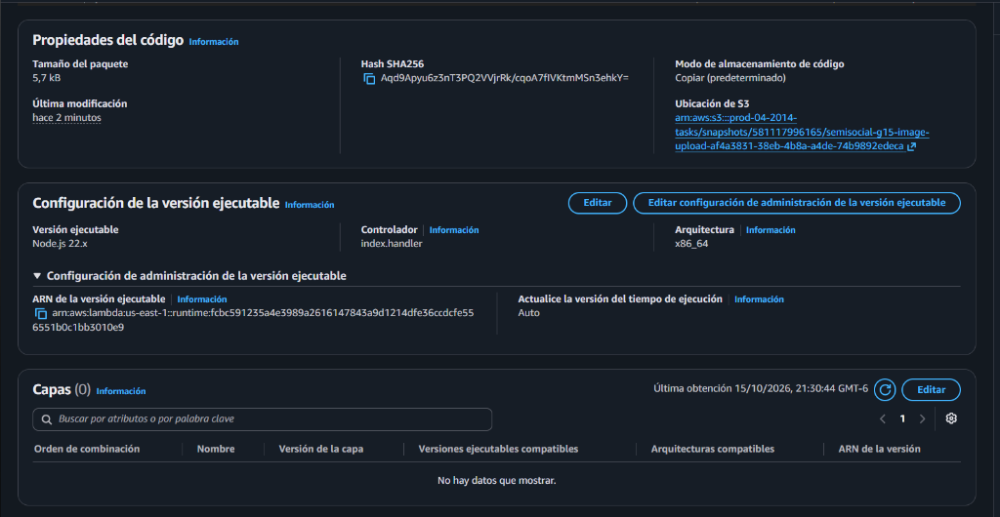
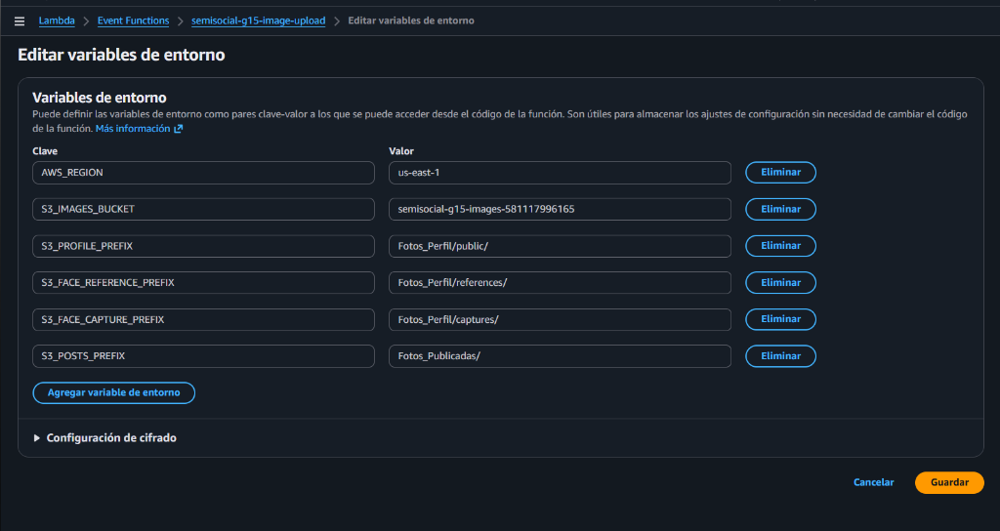
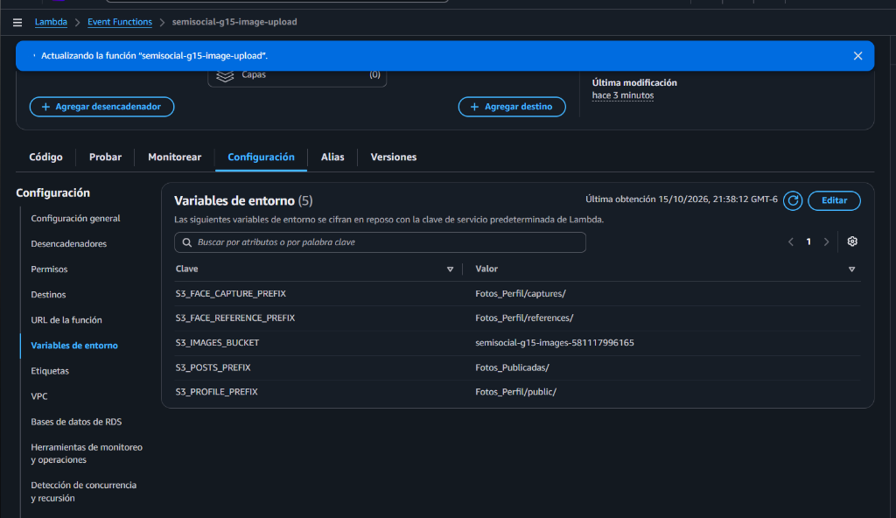
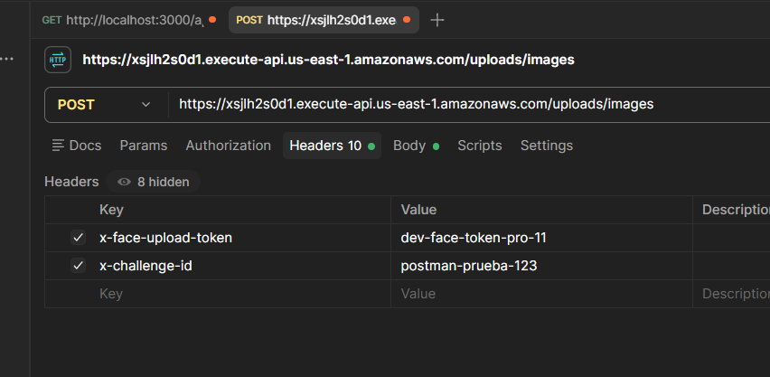
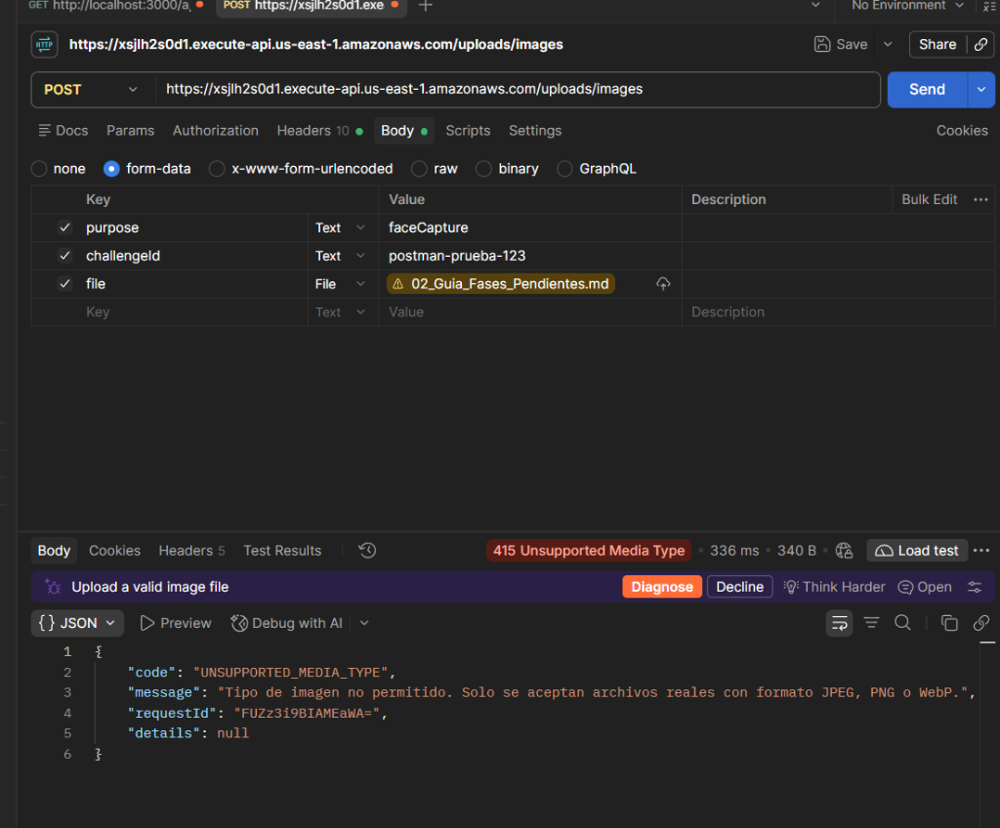

# Evidencia PRO-11 — Carga de Imágenes con API Gateway y Lambda

**Ticket:** PRO-11 — Implementar carga de imágenes con API Gateway y Lambda  
**Fase:** 2 — Multimedia  
**Directorio de Código:** `Proyecto_1/lambdas/image-upload/`  
**Infraestructura:** `Proyecto_1/infra/api-gateway/`  
**Fecha de Validación:** 15 de octubre de 2026  

---

## 1. Entrega Versionada

- `lambdas/image-upload/index.js`: Handler principal para integración AWS Lambda Proxy con API Gateway HTTP/REST.
- `lambdas/image-upload/multipart.js`: Parser nativo de `multipart/form-data` con detección estricta de *magic bytes* (JPEG, PNG y WebP) y límites de tamaño.
- `lambdas/image-upload/config.js`: Centralización de prefijos S3, límites (5 MiB) y bucket objetivo.
- `lambdas/image-upload/index.test.js`: Suite de 9 pruebas unitarias automatizadas con `node --test`.
- `infra/api-gateway/openapi-api-gateway.yaml`: Plantilla OpenAPI 3.0 para aprovisionar el API Gateway con CORS y enlace a la Lambda.
- `docs/api/upload.md`: Documentación del contrato, payload, seguridad y handoff a frontend.

---

## 2. Validación de Pruebas Unitarias Automatizadas

Las pruebas locales utilizan funciones inyectadas y aislamiento en memoria, permitiendo verificar todas las reglas de negocio sin requerir conexión a internet ni generar cargos en AWS:

```bash
cd Proyecto_1/lambdas/image-upload
node --test index.test.js
```

### Resultado de la Ejecución

```text
✔ 1. Preflight CORS OPTIONS responde 204 con cabeceras permitidas (3.1682ms)
✔ 2. Subida de Foto de Perfil (purpose=profile) crea foto pública y copia privada de referencia (2.5081ms)
✔ 3. Subida de Publicación (purpose=post) crea objeto en Fotos_Publicadas/ (0.7588ms)
✔ 4. Subida de Captura Facial (purpose=faceCapture) crea objeto privado en captures y retorna imageUrl=null (0.5595ms)
✔ 5. Rechazo por Archivo Mayor a 5 MiB (413 FILE_TOO_LARGE) (10.7363ms)
✔ 6. Rechazo por Tipo no Permitido (415 UNSUPPORTED_MEDIA_TYPE) cuando el archivo es texto plano (0.91ms)
✔ 7. Rechazo por Falta de Token de Autenticación (401 UNAUTHENTICATED) (0.6806ms)
✔ 8. Rechazo por Falta de Parámetros Obligatorios (400 VALIDATION_ERROR) (0.6718ms)
✔ 9. Validación de Integridad SHA-256 cuando se envía checksum (2.386ms)

ℹ tests 9
ℹ suites 0
ℹ pass 9
ℹ fail 0
ℹ cancelled 0
ℹ skipped 0
ℹ todo 0
ℹ duration_ms 227.7818
```

---

## 3. Criterios de Aceptación Verificados

1. **Flujo de Registro y Foto Obligatoria:**
   * La subida con `purpose=profile` escribe la foto visible en `Fotos_Perfil/public/` y genera simultáneamente la copia privada de referencia en `Fotos_Perfil/references/` para el mismo `cognito_sub`.
   * El token Cognito emitido tras el registro (con `profileComplete=false`) es aceptado para esta operación.
2. **Publicaciones:**
   * La subida con `purpose=post` escribe en `Fotos_Publicadas/` y retorna la URL pública utilizable en el feed.
3. **Privacidad Biometríca:**
   * La captura facial efímera (`purpose=faceCapture`) escribe en `Fotos_Perfil/captures/` y retorna obligatoriamente `imageUrl: null`.
4. **Rechazo Estricto de Archivos Inválidos:**
   * Archivos mayores a 5 MiB (5,242,880 bytes) son rechazados con `413 FILE_TOO_LARGE` sin escribir ningún objeto residual en S3.
   * Archivos no imagen (como texto plano o ejecutables renombrados a `.jpg`) son rechazados con `415 UNSUPPORTED_MEDIA_TYPE` mediante validación de cabeceras binarias (Magic Bytes).
   * Peticiones sin token son rechazadas con `401 UNAUTHENTICATED`.
5. **CORS y Desacoplamiento:**
   * Manejo transparente de `OPTIONS` con código 204 y cabeceras CORS para permitir la integración con el frontend alojado en S3 / CloudFront.

---

## 4. Capturas de Evidencia en Consola AWS

### Despliegue de Código
Paquete de código cargado y desplegado con éxito en AWS Lambda con sus cuatro archivos (`config.js`, `index.js`, `multipart.js`, `package.json`).



---

### Configuración General de Ejecución
Configuración de memoria (256 MB), timeout extendido (15 segundos) y rol de ejecución `semisocial-g15-upload-lambda-role`.



---

### Variables de Entorno del Servicio
Variables de entorno activas apuntando a `semisocial-g15-images-581117996165` y los prefijos acordados.



---

## 5. Pruebas Funcionales en Vivo (Postman & API Gateway)

Las pruebas fueron ejecutadas directamente contra el endpoint en vivo desplegado en AWS:  
`POST https://xsjlh2s0d1.execute-api.us-east-1.amazonaws.com/uploads/images`

### Prueba 1: Configuración de Cabeceras en Postman
Envío de cabeceras de desafío facial efímero (`x-face-upload-token` y `x-challenge-id`) para autorizar la carga sin requerir sesión activa:



---

### Prueba 2: Validación de Magic Bytes y Rechazo de Archivos Inválidos (Opción C)
Al intentar enviar un archivo que no corresponde a una imagen real (en este caso, un documento `.md`), el analizador binario de la Lambda interceptó los *magic bytes* y rechazó la petición de inmediato con código **415 Unsupported Media Type** sin escribir objetos en S3:



**Respuesta JSON Obtenida en Vivo:**
```json
{
  "code": "UNSUPPORTED_MEDIA_TYPE",
  "message": "Tipo de imagen no permitido. Solo se aceptan archivos reales con formato JPEG, PNG o WebP.",
  "requestId": "FUZz3i9BIAMEaWA=",
  "details": null
}
```

---

### Prueba 3: Carga Exitosa de Captura Facial (Opción A)
Al enviar una imagen PNG válida junto a los parámetros requeridos (`purpose=faceCapture`, `challengeId` y `file`), la API procesó y persistió el archivo en Amazon S3 devolviendo exitosamente un código **201 Created** y protegiendo la privacidad biométrica (`imageUrl: null`):

```http
HTTP/1.1 201 Created
Content-Type: application/json
Connection: keep-alive

{
  "imageKey": "Fotos_Perfil/captures/test-challenge-001/fe3fc4c1-4ecb-4e9f-8c36-3bccdf6bde18.png",
  "imageUrl": null
}
```

---

## 6. Dictamen Final de Conformidad
* **Infraestructura:** API Gateway HTTP API (`semisocial-g15-upload-api`) + AWS Lambda (`semisocial-g15-image-upload`) operando en `us-east-1`.
* **Pruebas Automatizadas:** 9/9 pruebas unitarias aprobadas localmente.
* **Pruebas en Vivo:** Validación de rechazo (415) y carga exitosa (201) confirmadas en AWS.
* **Estado:**  **Aprobado para Integración de Frontend y Flujos Biométricos**.

