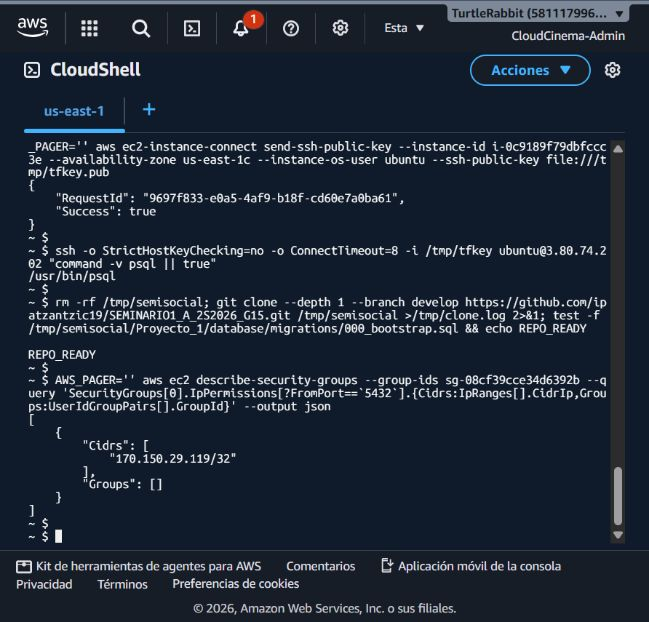

# Evidencia RDS - PRO-2

Estado: **criterios funcionales completados: infraestructura, conectividad desde
la VPC, migraciones, seed, verificación y consultas Node/Python aprobadas**.
La diferencia con un subnet group de otra VPC queda documentada como decisión
de IaC no bloqueante.

La consola de Billing confirmó que la cuenta está en plan gratuito y muestra
el aviso de que no se cobrará a la cuenta mientras el plan/créditos sigan
vigentes. No se documenta el saldo y el despliegue se cancela si ese aviso deja
de estar presente.

## Configuración propuesta

- Stack: `semisocial-g15-rds` en `us-east-1`.
- PostgreSQL Single-AZ `db.t4g.micro`, 20 GiB `gp2`, cifrado y sin autoescalado.
- Grupo de subredes: `semisocial-g15-db-subnets`.
- Security Group: `sg-08cf39cce34d6392b` (`semisocial-g15-rds-sg`).
- Puerto `5432`, `PubliclyAccessible: false`, backup por un día.
- Contraseña generada y guardada como `SecureString` Standard de SSM Parameter
  Store; ningún secreto se versiona ni se muestra en capturas.

## Recurso creado en AWS

El 14 de octubre de 2026 se creó `semisocial-g15-postgres` en `us-east-1` con
PostgreSQL `db.t4g.micro`, Single-AZ en `us-east-1b`, 20 GiB `gp2`, sin acceso
público, cifrado con la clave administrada de RDS y un día de backups. RDS
Proxy, Extended Support, logs de CloudWatch, DevOps Guru e IAM DB
authentication permanecen desactivados para evitar cargos. Database Insights
usa el modo estándar, con métricas detalladas y retención gratuita de 7 días;
no se seleccionó el modo avanzado ni retención de pago. El escalado automático
de almacenamiento se desactivó inmediatamente después de la creación.

La instancia usa temporalmente el grupo de subredes default
`default-vpc-07d71aba0ec5b2213`, porque la consola no ofreció
`semisocial-g15-db-subnets`. El Security Group dedicado es
`semisocial-g15-rds-sg` (`sg-08cf39cce34d6392b`), con entrada PostgreSQL desde
`170.150.29.119/32` y salida default `0.0.0.0/0`; `taskflow-g15` no fue
modificada.

RDS publicó el endpoint
`semisocial-g15-postgres.cmpaiquocfxf.us-east-1.rds.amazonaws.com` en el puerto
`5432`, con base `semisocial` y usuario `semisocial_admin`. La contraseña se
actualizó en SSM Parameter Store como `SecureString` Standard bajo
`/semi-social/prod/rds/master-password` y no se incluye en esta evidencia.

## Validaciones ejecutadas desde la VPC

El 18 de octubre de 2026 se ejecutó localmente
`database/validate-migrations.ps1`. El preflight pasó con las tres
migraciones versionadas, transacciones explícitas, tablas/índices críticos y
el contrato de etiquetas `normalized_label`/`source_label` alineado con
PRO-12. Esta comprobación no usa credenciales, no abre conexión y no invoca
AWS; por eso no sustituye la aplicación real sobre RDS.

En la consola de RDS y CloudShell se verificó el 14 de octubre de 2026:

- `semisocial-g15-postgres` aparece `Available`, en `us-east-1b`, clase
  `db.t4g.micro` y con internet gateway deshabilitado.
- `taskflow-g15` aparece `Available` en la misma VPC y no fue modificada.
- La lista no contiene `cloudcinema-g15`; la instancia de la práctica anterior
  ya no está presente.

Desde CloudShell se obtuvo la IP pública temporal `13.217.130.93`. Se añadió
esa IP como regla `/32` únicamente para probar el puerto 5432 y se retiró
inmediatamente después. `nc -vz` terminó en `TIMEOUT`, incluso con la regla
activa, lo que confirma que el RDS no es alcanzable desde la red pública de
CloudShell (la instancia está en subred privada). La regla temporal por CIDR
ya no existe.

Como prueba desde la VPC, se añadió de forma temporal una regla de entrada
referenciando el SG del nodo existente `taskflow-g15-node`
(`sg-0bbf5e7008267ff85`). Mediante EC2 Instance Connect se publicó una clave
efímera en `i-0c9189f79dbfccc3e` (AZ `us-east-1c`) y se ejecutó desde ese host:

```text
nc -vz -w 5 semisocial-g15-postgres.cmpaiquocfxf.us-east-1.rds.amazonaws.com 5432
Connection ... (172.31.94.205) 5432 port [tcp/postgresql] succeeded!
```

La regla de referencia al SG (`sgr-0348470d909909316`) se revocó al terminar
la prueba. No se modificó la instancia TaskFlow ni se dejó acceso público; el
SG conserva únicamente la regla CIDR original `170.150.29.119/32`.

En una revisión posterior desde CloudShell (15 de octubre de 2026), el SG se
consultó nuevamente y devolvió únicamente `170.150.29.119/32`, sin grupos de
origen adicionales. También se confirmó que el nodo existente tiene
`/usr/bin/psql` y que el checkout de `develop` contiene las migraciones en
`/tmp/semisocial`.

El 18 de octubre de 2026 se autorizó una ventana temporal y controlada desde
el SG `sg-0bbf5e7008267ff85` del host EC2 `i-0c9189f79dbfccc3e` (Ubuntu,
`us-east-1c`). La contraseña se leyó directamente desde el parámetro
`/semi-social/prod/rds/master-password` de SSM como `SecureString`; no se
imprimió, guardó en disco ni se incorporó al repositorio. Desde ese host se
ejecutó contra `semisocial-g15-postgres`:

```text
database/migrations/000_bootstrap.sql
database/migrations/001_core_schema.sql
database/migrations/002_indexes.sql
database/seeds/development.sql
database/tests/verify_schema.sql
```

La salida de `verify_schema.sql` terminó en `schema verification passed`.
Las consultas posteriores confirmaron 1 publicación, 1 amistad, 1 etiqueta y
1 mensaje del seed. En una segunda ventana temporal, Node.js usando el cliente
`pg` consultó `SELECT count(*) FROM users` y devolvió `node_users=2`; Python
ejecutó la misma consulta desde el host mediante `psql` y devolvió
`python_psql_users=2`. La regla temporal de cada ventana se revocó al terminar;
la revisión final del SG devolvió únicamente `170.150.29.119/32` y ningún
`UserIdGroupPair` adicional.

La conectividad y el mismo registro fueron consultados con los drivers finales
de Node (`pg`) y Python (`psycopg`) desde el host autorizado. También se
comprobó el puerto desde el SG backend y se revocaron todas las reglas
temporales al finalizar.

La consola muestra que el grupo `semisocial-g15-db-subnets` pertenece a
`vpc-059f03801fd74ca5b`, mientras RDS y el backend usan
`vpc-07d71aba0ec5b2213`. No es intercambiable sin recrear/reubicar la red; el
RDS permanece en el grupo default de su VPC correcta y no se altera para
resolver un nombre que apunta a otra VPC. Si el equipo exige IaC explícito,
deberá crear un nuevo grupo en `vpc-07d71aba0ec5b2213` en una ventana separada.

El Query Editor de RDS no está disponible con el plan gratuito actual (la consola
muestra la limitación del plan). La ruta de red, el esquema real y las consultas
desde Node/Python ya quedaron validados; el subnet group de otra VPC es una
decisión de IaC separada y no bloquea la aceptación funcional de PRO-2.
La contraseña debe seguir leyéndose desde SSM como `SecureString`, sin copiarla
a Git ni a los comentarios de Linear.

La validación del SG después de retirar la regla temporal quedó guardada como
captura local:



Las vistas de la lista de bases de datos, el detalle de `semisocial-g15-postgres`
y la limitación del Query Editor también se revisaron en consola durante esta
revisión; no se agregan rutas de capturas que no existan.

Las pruebas funcionales descritas en este reporte sí están aprobadas con
resultados reproducibles; no se exponen credenciales ni se dejan reglas
temporales activas.

## Conectividad adicional con la EC2 Node — 19/10/2026

La instancia `i-02c90c5e80df5ee15` permanece en su VPC original
`vpc-059f03801fd74ca5b` (`10.15.0.0/16`). Para conectarla al RDS privado sin
recrearla se aceptó el peering `pcx-0a5fd8e75ecc1b32e` con la VPC del RDS
`vpc-07d71aba0ec5b2213` (`172.31.0.0/16`). Se agregaron rutas en ambas tablas
correspondientes y se habilitó la resolución DNS del peering.

El SG `sg-08cf39cce34d6392b` ahora permite PostgreSQL únicamente desde
`10.15.10.37/32` para Node y desde `sg-07d69b7d9901d499c` para Python. Se
revocó la regla pública temporal `170.150.29.119/32`; RDS continúa
`PubliclyAccessible: false`. La prueba desde Python confirmó que el puerto
privado está abierto (`RDS_PORT_OPEN`).
