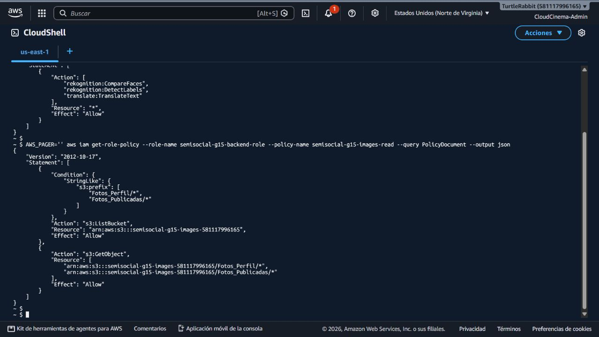

# Evidencia PRO-12 — contrato de etiquetas

## Resultado de esta entrega

Se versionaron el contrato común, la política mínima y el script reproducible
para Node.js/Python:

- `docs/api/labels.md`: entrada S3, umbral, normalización, esquema SQL,
  errores, reintentos y handoff.
- `infra/iam/rekognition-labels-policy.json`: `ListBucket` restringido al
  prefijo `Fotos_Publicadas/*`, `GetObject` solo en ese prefijo y únicamente
  `rekognition:DetectLabels`.
- `scripts/rekognition/detect-labels.ps1`: dos claves de ejemplo y modo
  `DRY-RUN` por defecto; `-Execute` es un opt-in explícito.

La política se entrega como artefacto versionado para incorporarse al rol de
ejecución de Node/Python. La plantilla existente de la fundación conserva las
acciones compartidas de los demás tickets; no se modificó ni se desplegó una
política en AWS durante esta entrega.

## Validación del rol existente

El 15 de octubre de 2026 se consultó el rol `semisocial-g15-backend-role` desde
CloudShell, sin invocar Rekognition ni crear recursos. El rol tiene las
políticas inline `semisocial-g15-ai-invoke` y `semisocial-g15-images-read`.
La primera permite `CompareFaces`, `DetectLabels` y `TranslateText` con
`Resource: "*"`; la segunda permite `ListBucket` condicionado a
`Fotos_Perfil/*`/`Fotos_Publicadas/*` y `GetObject` en ambos prefijos.

Esto confirma que el rol actual es funcional para las superficies existentes,
pero todavía es más amplio que el contrato mínimo de PRO-12 (que debe limitarse
a `Fotos_Publicadas/*` y `DetectLabels`). No se reemplazó la política activa
para no romper PRO-31 ni Translate; queda como acción coordinada con los
responsables antes de marcar el criterio de mínimo privilegio como aprobado.



## Configuración acordada

| Campo | Valor |
|---|---|
| Región | `us-east-1` |
| Bucket | `semisocial-g15-images-581117996165` |
| Fuente | `Fotos_Publicadas/<sub>/<post>.jpg` o `.png` |
| `MaxLabels` | `20` |
| `MinConfidence` | `80.0` |
| Persistencia | `post_labels(post_id, normalized_label, confidence, source_label)` |

## Validación segura

El script se puede revisar sin invocar AWS:

```powershell
pwsh Proyecto_1/scripts/rekognition/detect-labels.ps1
```

El 18 de octubre de 2026 se ejecutó el modo seguro y se observaron dos
solicitudes JSON, una por clave de ejemplo, con `MaxLabels=20` y
`MinConfidence=80`. Además, se cargaron dos objetos de prueba derivados de la
imagen pública `campus.jpg` del frontend del proyecto (sin datos personales):

| Clave S3 | Tamaño | Tipo | Uso |
|---|---:|---|---|
| `Fotos_Publicadas/examples/labels-example-1.jpg` | 511966 bytes | `image/jpeg` | fixture para Node/Python |
| `Fotos_Publicadas/examples/labels-example-2.jpg` | 511966 bytes | `image/jpeg` | fixture para Node/Python |

Los dos objetos están en `semisocial-g15-images-581117996165` y se verificaron
con `head-object`. El 18 de octubre de 2026 se ejecutó `DetectLabels` sobre
ambas claves desde CloudShell, con `MaxLabels=20` y `MinConfidence=80`. Las dos
respuestas fueron exitosas y devolvieron etiquetas consistentes, entre ellas
`Person`, `Clothing`, `Footwear`, `Shoe`, `Hat`, `Accessories` y `Bag`.

La consulta previa a `aws freetier get-free-tier-usage` no reportó consumo de
Rekognition en la cuenta. Aun así, esta prueba se hizo con la sesión autorizada
de CloudShell; Daniel y Javier deben repetirla desde los roles efectivos de
Node/Python para cerrar el criterio IAM de runtime. La persistencia en RDS y la
comparación con el feed quedan pendientes de PRO-32/PRO-34 y PRO-26. La captura
del bucket y sus prefijos ya se encuentra en
`../s3-images/images/02-bucket-prefixes.jpg`.

## Criterios trazables

- **Misma imagen → misma respuesta:** contrato y normalización deterministas;
  ejecución real pendiente por la política de costo.
- **IAM autorizado/denegado:** política separa lectura de publicaciones de
  cualquier otro prefijo y no otorga escritura; validación efectiva pendiente
  de adjuntar el rol de runtime a los backends.
- **Sin secretos:** el script usa la cadena de credenciales estándar de AWS y
  no recibe claves por argumentos ni las guarda en archivos.
- **Handoff:** `docs/api/labels.md` contiene los campos que Daniel, Javier y
  Guo deben consumir; PRO-26 retomará la prueba E2E.
