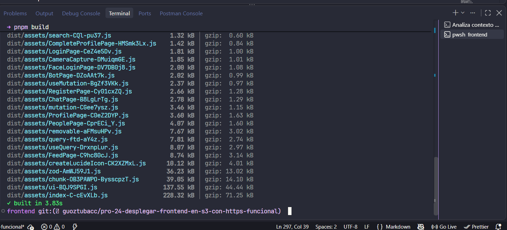
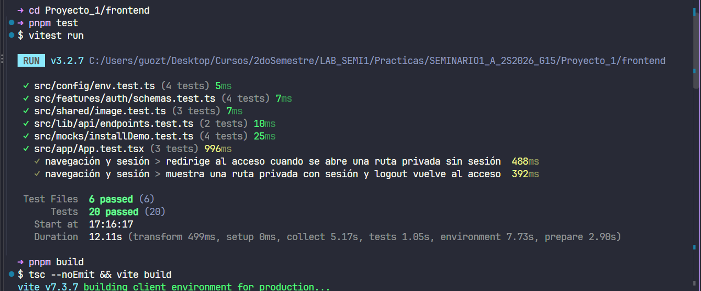
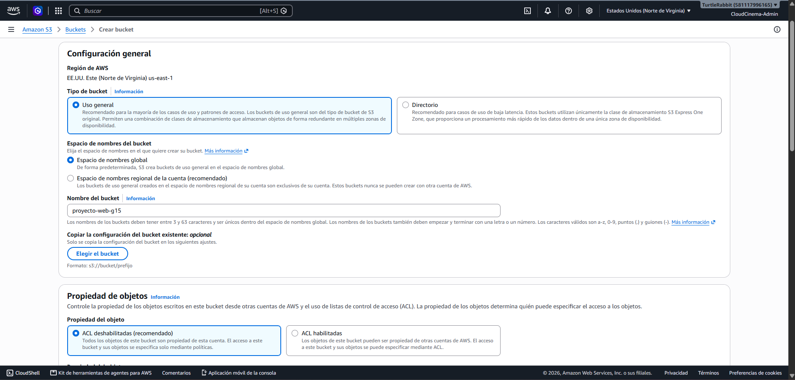
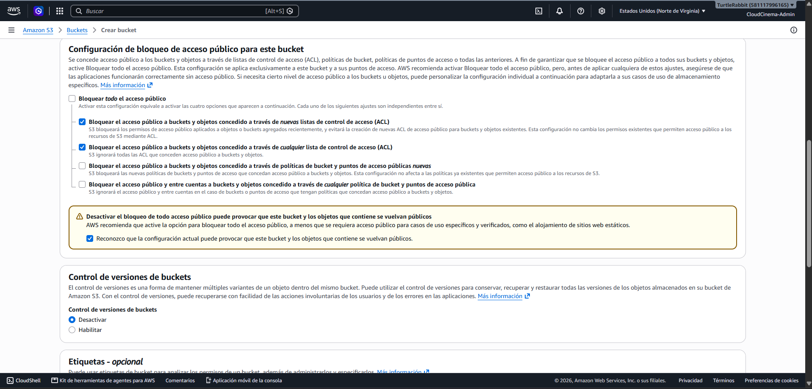
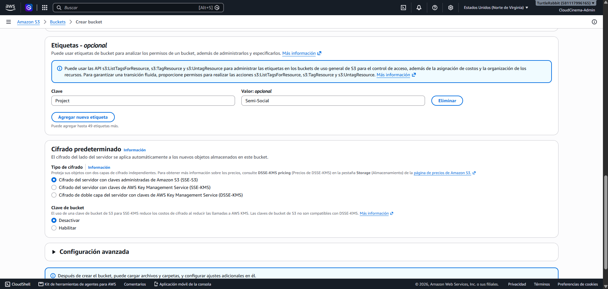
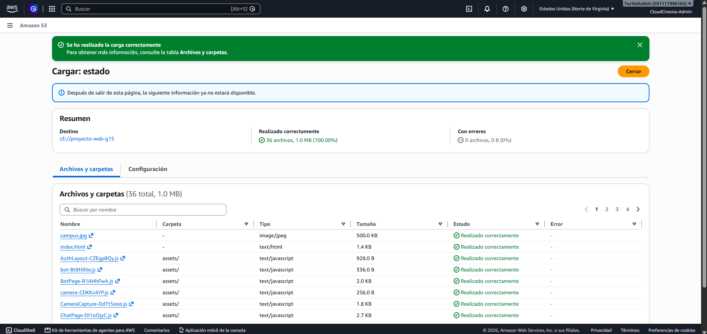

# Publicación del frontend en Amazon S3

**Proyecto:** SemiSocial · Proyecto final · Grupo 15
**Ticket:** PRO-24 — Desplegar frontend en S3 con HTTPS funcional
**Fecha de implementación:** 15 de octubre de 2026
**Estado:** implementación y validaciones completadas

## 1. Objetivo y alcance

Se publicó el frontend React/Vite de SemiSocial en un bucket Amazon S3
independiente del almacenamiento de fotografías. El bucket funciona como sitio
web estático, permite únicamente la lectura pública de los archivos compilados
y actúa como origen de la distribución CloudFront documentada en
[`../https-ingress/report.md`](../https-ingress/report.md).

La solución cubre:

- compilación y verificación del frontend;
- bucket exclusivo para el sitio web;
- alojamiento web estático;
- publicación de `index.html` y los assets versionados;
- lectura pública controlada mediante política;
- rechazo de escritura anónima;
- actualización repetible mediante AWS CLI.

El bucket web no recibe fotografías de perfil ni publicaciones. Dichos objetos
pertenecen al bucket de imágenes y a los flujos de API Gateway/Lambda definidos
por otros tickets.

## 2. Arquitectura implementada

```text
Código React/TypeScript
        │
        │ pnpm test + pnpm build
        ▼
Proyecto_1/frontend/dist/
        │
        │ aws s3 sync
        ▼
Amazon S3: proyecto-web-g15
        │  website endpoint HTTP
        ▼
Amazon CloudFront
        │  HTTPS público
        ▼
Navegador del usuario
```

S3 entrega los archivos estáticos y CloudFront proporciona el punto de acceso
HTTPS. Esta separación permite mantener el bucket dedicado al frontend y usar
la caché de CloudFront sin incorporar credenciales AWS en el navegador.

## 3. Inventario del recurso

| Dato | Valor | Propósito |
|---|---|---|
| Bucket | `proyecto-web-g15` | Alojar exclusivamente el build del frontend |
| ARN | `arn:aws:s3:::proyecto-web-g15` | Identificador del recurso en políticas AWS |
| Región | `us-east-1` | Región utilizada por la infraestructura del proyecto |
| Endpoint web | `http://proyecto-web-g15.s3-website-us-east-1.amazonaws.com` | Origen web de CloudFront |
| Documento de inicio | `index.html` | Punto de entrada de la SPA |
| Documento de error | `index.html` | Respaldo para navegación de la SPA |
| Cifrado | `SSE-S3` | Cifrado administrado por Amazon S3 |
| Versionado | Desactivado | Evitar almacenamiento y costo de versiones innecesarias |

El enunciado utiliza el nombre lógico `Proyecto-Web-G15`. Amazon S3 exige
nombres DNS en minúsculas, por lo que el recurso real se creó como
`proyecto-web-g15` sin alterar su propósito ni trazabilidad.

## 4. Verificación y compilación del frontend

Antes de publicar se ejecutaron las pruebas automatizadas y el build de
producción desde `Proyecto_1/frontend`.

```bash
pnpm test
pnpm build
```

El script de build ejecuta primero `tsc --noEmit`, por lo que la publicación
requiere que TypeScript compile sin errores antes de generar `dist/`.

| Verificación | Resultado |
|---|---|
| Archivos de pruebas | 6 aprobados |
| Pruebas automatizadas | 20 aprobadas |
| TypeScript | Sin errores |
| Build Vite | Generado correctamente |
| Directorio publicado | `Proyecto_1/frontend/dist/` |

La primera captura presenta los bundles generados y la finalización correcta
del build. La segunda registra el resultado de Vitest y el comienzo del build
posterior.





## 5. Creación del bucket

El bucket se creó en `us-east-1` como recurso de uso general. Se mantuvo la
propiedad de objetos en **Bucket owner enforced**, de modo que las ACL quedan
deshabilitadas y los permisos se administran mediante políticas.



La configuración de acceso público se ajustó para conservar los bloqueos
relacionados con ACL y permitir una política pública limitada a lectura. Esto
evita habilitar ACL públicas y mantiene el control en un único documento de
política.

| Opción de Block Public Access | Estado |
|---|---|
| Bloquear nuevas ACL públicas | Activada |
| Ignorar todas las ACL públicas | Activada |
| Bloquear nuevas políticas públicas | Desactivada |
| Restringir políticas públicas y entre cuentas | Desactivada |



También se dejó el versionado desactivado y se seleccionó el cifrado
predeterminado SSE-S3. Estas opciones son suficientes para los artefactos
reproducibles del frontend y evitan servicios adicionales que no exige el
proyecto.



## 6. Publicación del build

El contenido de `dist/` se sincronizó directamente con la raíz del bucket:

```bash
aws s3 sync dist/ s3://proyecto-web-g15 --delete
```

La opción `--delete` retira bundles antiguos cuyos nombres hash ya no forman
parte del build. De esta forma, `index.html` siempre referencia únicamente los
assets vigentes.



La vista de objetos confirma que `index.html` y el prefijo `assets/` se
encuentran en la raíz. No se creó un nivel adicional `dist/`, ya que eso
impediría que el website endpoint resolviera correctamente el documento de
inicio.


## 7. Alojamiento web estático

En las propiedades del bucket se habilitó **Static website hosting** con los
siguientes valores:

| Campo | Valor | Motivo |
|---|---|---|
| Hosting | Enabled | Permitir que S3 sirva el frontend como sitio web |
| Index document | `index.html` | Entrada principal de React |
| Error document | `index.html` | Mantener la navegación de la SPA |


## 8. Política pública de solo lectura

La política del bucket permite únicamente `s3:GetObject` para los objetos del
sitio. No incluye `PutObject`, `DeleteObject`, administración del bucket ni
listado público.

```json
{
  "Version": "2012-10-17",
  "Statement": [
    {
      "Sid": "PublicReadOnlyForWebsite",
      "Effect": "Allow",
      "Principal": "*",
      "Action": "s3:GetObject",
      "Resource": "arn:aws:s3:::proyecto-web-g15/*"
    }
  ]
}
```


El endpoint web respondió correctamente y cargó el frontend compilado. La
captura valida la relación entre el hosting estático y los objetos publicados.


## 9. Validaciones funcionales y de seguridad

| Prueba | Resultado esperado | Resultado obtenido |
|---|---|---|
| Abrir el website endpoint | Página HTML disponible | `HTTP 200` |
| Abrir el dominio CloudFront | Frontend disponible por HTTPS | `HTTP 200` |
| Acceder directamente a `/register` | React Router carga la vista | `HTTP 200` |
| Ejecutar un `PUT` anónimo | Operación rechazada | `HTTP 403 AccessDenied` |
| Buscar credenciales en el frontend | Ninguna credencial AWS | Sin credenciales |

La escritura anónima se comprobó con una solicitud sin firma:

```bash
curl -i -X PUT \
  -H "Content-Type: text/plain" \
  --data "prueba de escritura anonima" \
  "https://proyecto-web-g15.s3.us-east-1.amazonaws.com/pro-24-anonymous-write-test.txt"
```

S3 respondió `403 Forbidden` con `AccessDenied`; por tanto, el objeto de prueba
no fue creado.


## 10. Procedimiento de actualización

Para publicar una nueva versión del frontend:

```bash
cd Proyecto_1/frontend
pnpm test
pnpm build
aws s3 sync dist/ s3://proyecto-web-g15 --delete
aws cloudfront create-invalidation \
  --distribution-id E2TN2ZJV9MGHDD \
  --paths "/*"
```

No se crea otro bucket, distribución ni behavior. La invalidación solicita a
CloudFront descartar la versión anterior y recuperar el build actualizado.

## 11. Trazabilidad y handoff

| Componente consumidor | Dato entregado |
|---|---|
| CloudFront | `proyecto-web-g15.s3-website-us-east-1.amazonaws.com` |
| Equipo frontend | Bucket `proyecto-web-g15` y procedimiento de publicación |
| Integración final | `https://d22yc8w9s5onhg.cloudfront.net` |

La infraestructura estática queda lista para incorporar los endpoints de ALB,
API Gateway y WebSocket cuando sean publicados. Las variables
`VITE_API_BASE_URL` y `VITE_UPLOAD_BASE_URL` deben establecerse antes del build
de integración y nunca deben contener credenciales o secretos.

## 12. Resultado final

El frontend quedó compilado, publicado en un bucket S3 independiente y
disponible mediante el website endpoint. La política habilita la lectura que
requiere el sitio, rechaza escrituras anónimas y mantiene las ACL deshabilitadas.
CloudFront consume este endpoint para proporcionar HTTPS, caché y soporte de
rutas de la SPA.
