# Manual de usuario — SemiSocial

SemiSocial permite compartir publicaciones con imágenes, conectar con amigos,
conversar y consultar información de la Facultad. Este manual explica cómo usar
la aplicación desde el navegador.

**Acceso:** [Abrir SemiSocial](https://d22yc8w9s5onhg.cloudfront.net).

## Contenido

1. [Antes de comenzar](#1-antes-de-comenzar)
2. [Crear y confirmar una cuenta](#2-crear-y-confirmar-una-cuenta)
3. [Iniciar y cerrar sesión](#3-iniciar-y-cerrar-sesión)
4. [Inicio y publicaciones](#4-inicio-y-publicaciones)
5. [Filtrar por etiquetas](#5-filtrar-por-etiquetas)
6. [Comentar publicaciones](#6-comentar-publicaciones)
7. [Traducir contenido](#7-traducir-contenido)
8. [Actualizar el perfil](#8-actualizar-el-perfil)
9. [Encontrar personas y gestionar amistades](#9-encontrar-personas-y-gestionar-amistades)
10. [Usar los mensajes](#10-usar-los-mensajes)
11. [Consultar al Bot de la Facultad](#11-consultar-al-bot-de-la-facultad)
12. [Resolver problemas frecuentes](#12-resolver-problemas-frecuentes)

## 1. Antes de comenzar

Necesitas conexión a Internet, un navegador actualizado y acceso al correo con
el que crearás tu cuenta. Para utilizar la cámara debes autorizar su uso en el
navegador; también puedes seleccionar una fotografía desde tu dispositivo.

Las imágenes admitidas son **JPEG, PNG y WebP**, con un tamaño máximo de
**5 MiB por archivo**. Revisa la previsualización antes de continuar para
comprobar que elegiste la fotografía correcta.

Al abrir la aplicación sin una sesión activa se muestra el inicio de sesión.

*Figura 1. Acceso a SemiSocial mediante contraseña o reconocimiento facial.*

Después de entrar, la navegación lateral permite acceder a **Inicio**,
**Personas**, **Chat**, **Mi perfil** y **Bot de la Facultad**. Desde la misma
barra puedes **Cerrar sesión**.

## 2. Crear y confirmar una cuenta

### 2.1. Completar los datos de la cuenta

1. En la pantalla de acceso, selecciona **Crear cuenta**.
2. Escribe tu **nombre completo**, **DPI** de 13 dígitos y **correo electrónico**.
   Utiliza un correo al que puedas acceder: ahí recibirás el código de confirmación.
3. Crea una contraseña de al menos **12 caracteres** que incluya una mayúscula,
   una minúscula, un número y un símbolo especial. La aplicación indica los
   requisitos que cumples mientras escribes.
4. Repite la contraseña; ambas deben coincidir.
5. En **Prepara tu foto**, utiliza **Elegir archivo** o **Usar cámara**.
   Si utilizas la cámara, autoriza el permiso y pulsa **Tomar foto**.
6. Comprueba la imagen seleccionada y pulsa **Continuar**.

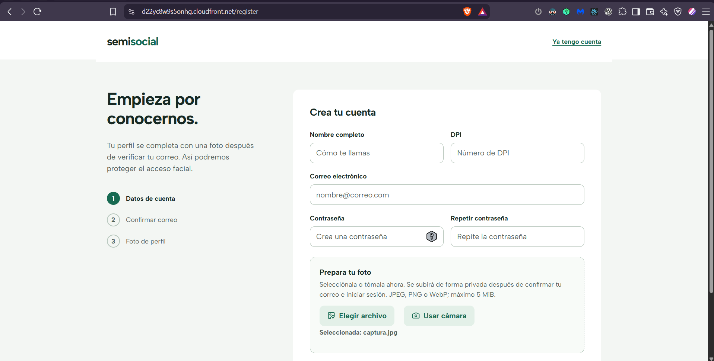

*Figura 2. Primer paso del registro: datos de cuenta y preparación de la fotografía.*

### 2.2. Confirmar el correo

1. Revisa la bandeja de entrada del correo registrado y la carpeta de correo
   no deseado.
2. En **Confirma tu correo**, escribe el **Código de verificación** recibido.
3. Selecciona **Confirmar correo**.
4. Una vez confirmado, la aplicación te dirige al inicio de sesión. Entra con
   el correo y la contraseña que acabas de registrar.

Si el código expira o no llega, utiliza **Reenviar código**. Si aparece una cuenta
regresiva, espera a que termine antes de solicitar otro y utiliza el código del
mensaje más reciente.

**Si el correo ya está registrado:** no necesitas crear otra cuenta. Cuando
aparezca el aviso de que el correo ya inició o completó su registro, utiliza
**Continuar confirmación** si aún no lo verificaste, o **Ir a iniciar sesión** si
ya está confirmado.

### 2.3. Completar la foto de perfil

Después del primer inicio de sesión, la aplicación solicita completar el perfil.

1. Revisa la fotografía preparada durante el registro.
2. Si es correcta, pulsa **Guardar foto y entrar**.
3. Si necesitas reemplazarla, selecciona otro archivo o toma otra fotografía
   antes de guardar.

**No debes seleccionar la misma fotografía dos veces durante el flujo normal.**
La selección se conserva mientras completas el proceso sin recargar la
aplicación. Si recargas o cierras la página antes de guardar la foto, tendrás que
seleccionarla nuevamente: el archivo todavía no se había enviado como foto de
perfil.

## 3. Iniciar y cerrar sesión

### 3.1. Entrar con contraseña

1. Abre la aplicación.
2. Introduce tu **correo electrónico** y **contraseña**.
3. Pulsa **Entrar con contraseña**.
4. Si tu perfil está completo, accederás a Inicio. Si falta la fotografía,
   completa ese paso para continuar.

Una sesión válida puede mantenerse al recargar la misma pestaña. Si la aplicación
indica que venció, vuelve a iniciar sesión.

### 3.2. Entrar con reconocimiento facial

Esta alternativa requiere una cuenta confirmada y una fotografía de perfil
previamente guardada.

1. Desde el inicio de sesión, selecciona **Entrar con reconocimiento facial**.
2. Escribe el correo de tu cuenta.
3. Proporciona una captura de tu rostro mediante una de estas opciones:
   - **Usar cámara:** autoriza el permiso, coloca el rostro frente a la cámara y
     pulsa **Tomar foto**. **Cancelar** cierra la captura sin tomarla.
   - **Seleccionar captura:** elige una imagen desde tu dispositivo.
4. Revisa la previsualización. Procura que el rostro esté visible, bien iluminado
   y sin obstáculos.
5. Pulsa **Verificar e iniciar sesión** y espera la respuesta.

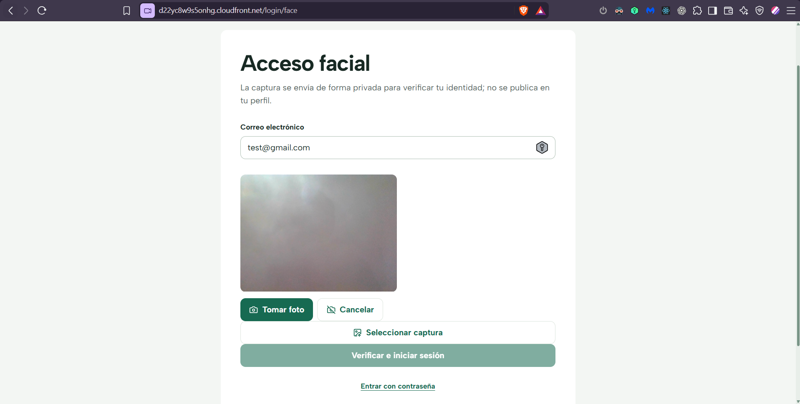

*Figura 3. Captura desde la cámara para el acceso facial.*

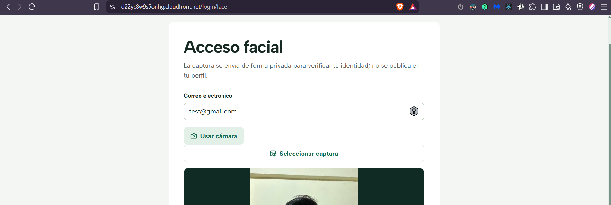

*Figura 4. Alternativa de acceso facial seleccionando una fotografía del dispositivo.*

La captura se carga para realizar la verificación; **no se publica en el feed ni
reemplaza la fotografía del perfil**. Tanto una imagen de archivo como una tomada
con la cámara pasan por este proceso.

Si el rostro no coincide, revisa la imagen y vuelve a intentarlo. Si el proceso
expira, inicia un nuevo intento. También puedes utilizar **Entrar con contraseña**.

### 3.3. Cerrar sesión

Selecciona **Cerrar sesión** en la barra lateral. Hazlo especialmente si utilizas
un equipo compartido. Para volver a acceder tendrás que identificarte nuevamente.

## 4. Inicio y publicaciones

Inicio reúne las publicaciones propias y las de tus amigos. La zona central
muestra el contenido; los paneles complementarios permiten consultar etiquetas
y descubrir personas. La barra **Mensajes**, abajo a la derecha, permite abrir
conversaciones sin abandonar esta pantalla.

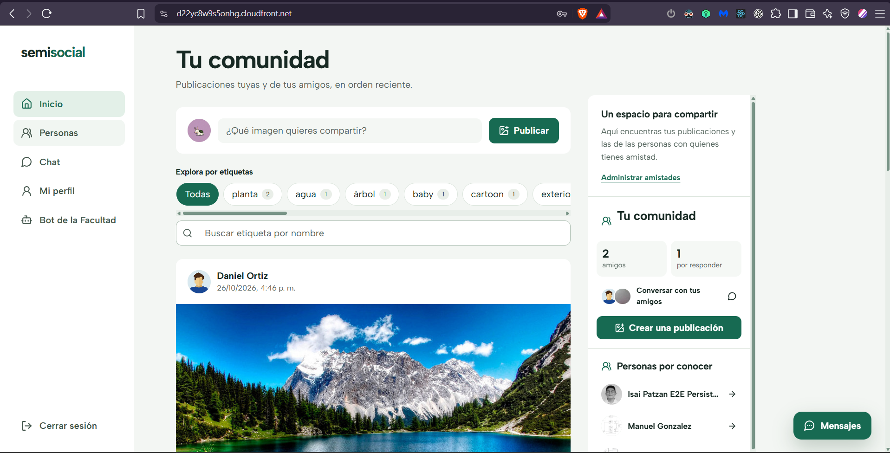

*Figura 5. Inicio: publicaciones, etiquetas, comunidad y acceso rápido a mensajes.*

### 4.1. Crear una publicación

1. Pulsa **Publicar** en el acceso de creación de Inicio.
2. En **Nueva publicación**, selecciona **Elegir imagen (obligatoria)**.
3. Comprueba la previsualización de la imagen.
4. Si lo deseas, escribe una **Descripción (opcional)** de hasta
   **2000 caracteres**.
5. Pulsa **Publicar imagen** y espera a que termine el envío.
6. Comprueba que la nueva publicación aparezca en Inicio.

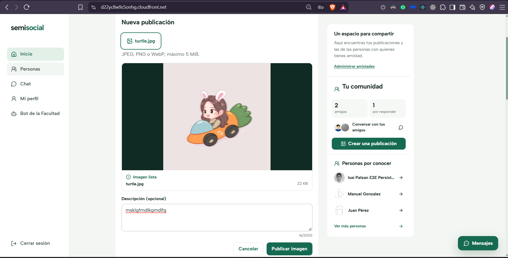

*Figura 6. Creación de una publicación: revisión de la imagen y descripción antes del envío.*

La imagen es obligatoria; se aplican los formatos y el límite de tamaño indicados
al comienzo del manual.

Puedes salir de la vista y regresar mientras la aplicación siga abierta para
retomar el borrador de publicación. **No recargues ni cierres la página si
quieres conservarlo:** la imagen y el texto sin publicar se mantienen solamente
en memoria.

### 4.2. Consultar el contenido

Las publicaciones muestran su autor, imagen y descripción cuando existe. Puedes
abrir sus comentarios y utilizar las opciones de traducción del texto.

Si no ves publicaciones, comprueba el filtro seleccionado y tus amistades.
Crear otra cuenta no la convierte automáticamente en amiga de la primera:
la solicitud debe enviarse y aceptarse.

## 5. Filtrar por etiquetas

Las etiquetas se obtienen del análisis de las imágenes de las publicaciones.

1. En Inicio, localiza el panel de etiquetas.
2. Selecciona una etiqueta para consultar las publicaciones correspondientes.
3. Para localizar una etiqueta en la lista, escribe en
   **Buscar etiqueta por nombre**.
4. Selecciona **Todas** para quitar el filtro de etiqueta.

El buscador de este panel busca **nombres de etiquetas**, no nombres de personas
ni texto de las descripciones. Si una etiqueta no aparece, borra el texto de
búsqueda para volver a ver la lista disponible.

La figura 5 muestra dónde se encuentran estos controles.

## 6. Comentar publicaciones

1. Localiza una publicación y selecciona **Ver comentarios**.
2. Escribe tu respuesta en **Escribe un comentario**.
3. Pulsa **Enviar**.
4. Comprueba que tu comentario aparezca en la conversación.

Cada comentario admite hasta **1000 caracteres**. El contador permite revisar
la longitud antes de enviarlo. Usa **Ocultar comentarios** para plegar la sección.

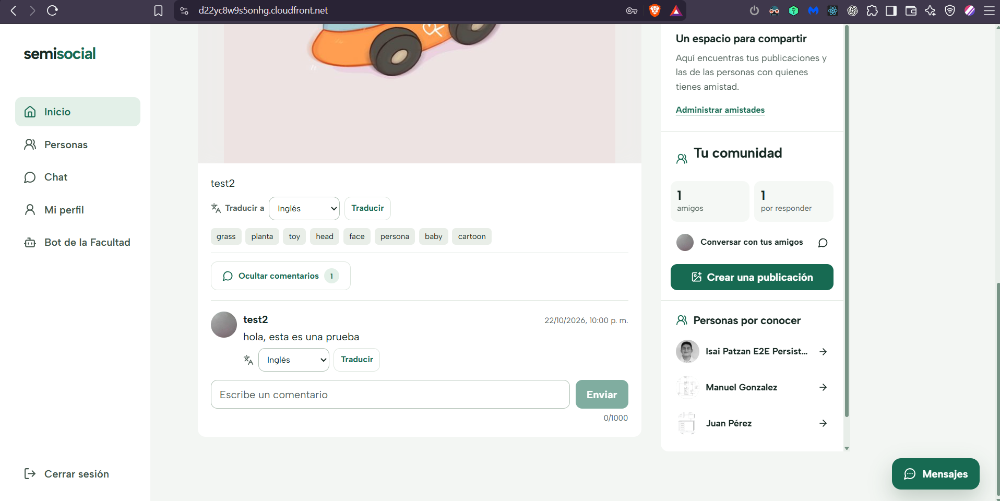

*Figura 7. Lectura y envío de comentarios; también se muestran los controles de traducción.*

## 7. Traducir contenido

Puedes traducir las descripciones de publicaciones y los comentarios. Los idiomas
disponibles son **español, inglés, francés y alemán**.

1. En el texto que quieras traducir, localiza **Traducir a**.
2. Selecciona el idioma de destino.
3. Pulsa **Traducir** y espera el resultado.
4. Usa **Ver original** para regresar al texto inicial.

*Figura 8. Resultado de traducir el comentario de la figura 7 del español al inglés.*

La traducción cambia la visualización del contenido, no modifica el texto que
publicó su autor. Estas opciones no traducen toda la interfaz de la aplicación.

## 8. Actualizar el perfil

1. Abre **Mi perfil** desde la barra lateral.
2. En **Editar datos**, modifica el **Nombre completo** o el **DPI** si corresponde.
3. Para cambiar la fotografía, selecciona una nueva imagen y comprueba su
   previsualización.
4. Introduce tu **Contraseña actual** para autorizar la actualización.
5. Pulsa **Guardar cambios**.
6. Espera el mensaje **Perfil actualizado.** antes de dar por terminado el cambio.

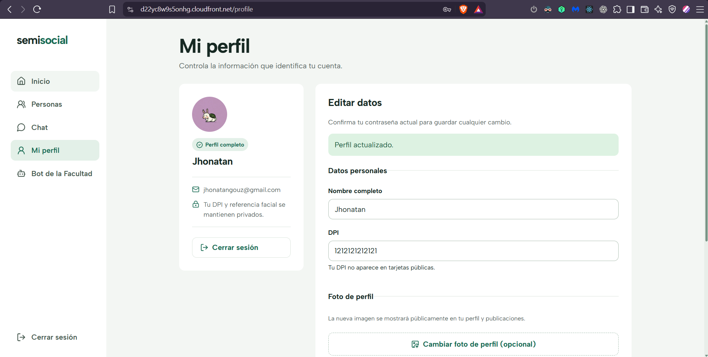

*Figura 9. Consulta y edición del perfil con confirmación de una actualización realizada.*

El DPI debe conservar sus 13 dígitos. El correo no se modifica desde este
formulario. La contraseña actual se solicita para confirmar los cambios:
no es un campo para establecer una contraseña nueva.

## 9. Encontrar personas y gestionar amistades

Abre **Personas**. La vista organiza las opciones en **Descubrir**,
**Solicitudes** y **Amigos**.

### 9.1. Buscar y enviar una solicitud

1. En **Descubrir**, busca por el nombre de la persona.
2. Revisa los resultados para identificar la cuenta correcta.
3. Pulsa **Enviar solicitud**.
4. Espera a que la otra persona la acepte.

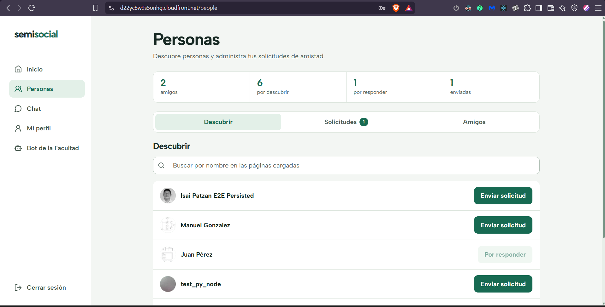

*Figura 10. Búsqueda de personas y envío de solicitudes de amistad.*

La búsqueda filtra las personas de las **páginas ya cargadas**. Si no encuentras
a alguien, utiliza **Cargar más** cuando esté disponible y vuelve a buscar.
No se busca por DPI ni por correo en este campo.

### 9.2. Responder solicitudes

1. Abre **Solicitudes**.
2. Revisa las solicitudes recibidas.
3. Acepta la solicitud para establecer la amistad o recházala si no deseas
   conectar con esa persona.
4. Consulta las solicitudes enviadas para conocer las que siguen esperando
   respuesta.

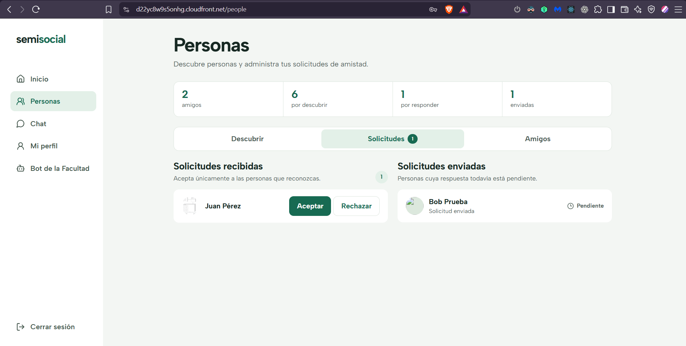

*Figura 11. Gestión de solicitudes recibidas y consulta de las enviadas.*

Una solicitud pendiente no equivale a una amistad aceptada. Mientras no se
acepte, no debes esperar que ambas cuentas tengan acceso a las mismas
publicaciones o puedan conversar como amigos.

### 9.3. Consultar amigos

En **Amigos** encontrarás las conexiones aceptadas. Puedes utilizar
**Abrir chat** para ir a la sección de mensajes y seleccionar allí a la persona
con quien deseas conversar.

## 10. Usar los mensajes

### 10.1. Conversar desde Chat

1. Selecciona **Chat** en la barra lateral.
2. Elige a uno de tus amigos.
3. Espera a que la conexión esté **En línea**.
4. Escribe en **Escribe un mensaje** y pulsa **Enviar**.
5. Desplázate dentro de la conversación para consultar mensajes anteriores.

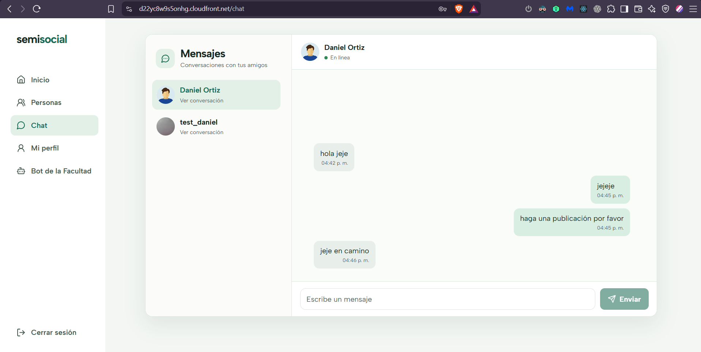

*Figura 12. Conversación con un amigo desde la página Chat.*

Los mensajes admiten hasta **4000 caracteres**. Si aparece
**Cargar mensajes anteriores**, utilízalo para recuperar más historial.

Los estados **Conectando**, **Reconectando** o **Sin conexión** indican que el
canal aún no está listo. Si falla el envío de un mensaje y aparece
**Reintentar**, puedes volver a enviarlo desde ese control.

Al cambiar de sección y regresar a Chat, la aplicación conserva la conversación
seleccionada en la misma pestaña. Esto no significa que un mensaje que todavía
no enviaste esté guardado como borrador.

### 10.2. Conversar sin salir de Inicio

1. Pulsa la barra **Mensajes**, situada abajo a la derecha y visible en la figura 5.
2. Selecciona un amigo para abrir su conversación.
3. Escribe y envía el mensaje.
4. Utiliza el control de minimizar cuando quieras seguir viendo el contenido.

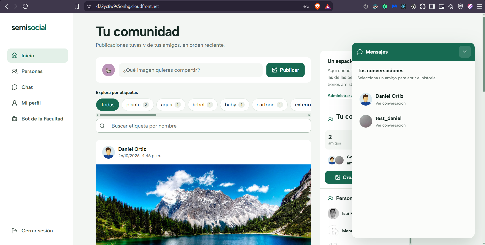

*Figura 13. Selección de conversaciones desde el panel de mensajes de Inicio.*

Este panel permite consultar las conversaciones sin abandonar la sección actual.
La página **Chat** ofrece una vista más amplia para conversar.

## 11. Consultar al Bot de la Facultad

1. Selecciona **Bot de la Facultad** en la barra lateral.
2. En **Consulta a la Facultad**, utiliza una sugerencia inicial o escribe tu
   pregunta.
3. Pulsa **Enviar** y espera la respuesta.
4. Escribe otra pregunta para continuar la conversación.

Las sugerencias son **ejemplos de consultas**, no un menú obligatorio que deba
reaparecer en cada respuesta. Puedes escribir directamente, por ejemplo:
**«¿Cuál es el horario de Control Académico?»**.

*Figura 14. Consulta de información de la Facultad mediante el chatbot.*

Cada pregunta admite hasta **500 caracteres**. El historial se desplaza dentro
del panel de conversación, por lo que puedes consultar las respuestas anteriores
sin que la tarjeta crezca indefinidamente.

La conversación se conserva al navegar por las secciones de la aplicación y al
recargar la misma pestaña. Si el bot no reconoce una pregunta, reformúlala de
manera breve y específica sobre la información de la Facultad.

## 12. Resolver problemas frecuentes

| Situación | Qué hacer |
| --- | --- |
| El formulario no permite continuar | Revisa los mensajes junto a cada campo, los 13 dígitos del DPI, los requisitos de contraseña y la coincidencia de ambas contraseñas. |
| El correo ya inició o completó su registro | Usa **Continuar confirmación** si falta verificarlo; si ya está confirmado, utiliza **Ir a iniciar sesión**. No vuelvas a registrar la misma cuenta. |
| No llega el código | Comprueba el correo escrito, revisa correo no deseado y utiliza **Reenviar código** cuando se habilite. |
| El código expiró o no es válido | Solicita un código nuevo y escribe el del mensaje más reciente. |
| La foto ya no aparece al completar el perfil | Si recargaste o cerraste la página antes de guardarla, selecciona nuevamente el archivo y pulsa **Guardar foto y entrar**. |
| El navegador no permite utilizar la cámara | Autoriza la cámara desde los permisos del sitio. Como alternativa, selecciona una imagen desde el dispositivo. |
| La imagen no se acepta | Utiliza JPEG, PNG o WebP y verifica que no supere 5 MiB. |
| El acceso facial no reconoce el rostro | Comprueba la cuenta, la iluminación y la captura. Vuelve a intentarlo o entra con contraseña. |
| No encuentro a una persona | Busca por su nombre y carga más resultados si hay páginas disponibles. |
| Inicio no muestra publicaciones | Selecciona **Todas**, revisa los filtros y comprueba que existan publicaciones propias o de amistades aceptadas. |
| No puedo conversar con alguien | Comprueba que la amistad esté aceptada y que el chat indique **En línea**. |
| Aparece «Tu sesión venció» | Vuelve a iniciar sesión. Si se repite inmediatamente, no continúes enviando formularios: informa del error al equipo. |
| Se informa que un servicio no está disponible | Espera y vuelve a intentarlo. Si estabas registrándote, comprueba si la cuenta ya fue creada antes de repetir el registro. |
| Una traducción o consulta al bot falla | Conserva el contenido original, espera y vuelve a solicitar la operación. Revisa también tu conexión a Internet. |

**Al terminar:** cierra sesión en equipos compartidos y evita dejar fotografías
o datos de tu cuenta abiertos en un navegador que utilizará otra persona.
